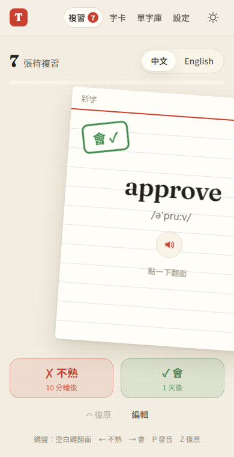
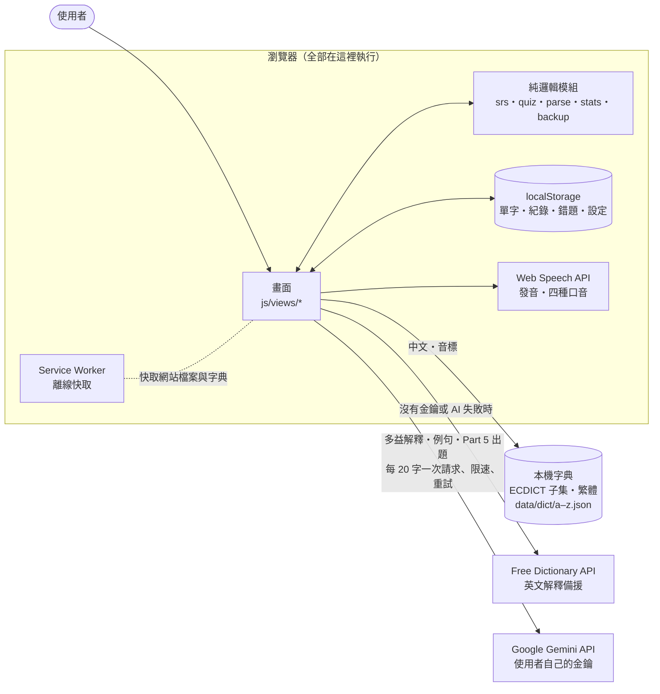

# 多益字卡 TOEIC Cards

**只要輸入英文單字，其餘交給網站。**
中文意思、詞性、音標、淺白英文解釋、多益情境例句、常見搭配詞都會自動產生，再用間隔重複和多益風格測驗幫你記住。

🔗 **線上使用：<https://kevin930326.github.io/toeic-cards/>**（手機可以「加入主畫面」當 App 用，離線也能複習）

<p>
  
  
</p>

---

## 為什麼做這個

準備多益時，最花時間的不是背，而是**整理單字**：查中文、找例句、確認多益考的是哪個意思。市面上的字卡 App 要嘛要自己一個欄位一個欄位填，要嘛內建的單字不是自己需要的。

這個網站的想法很簡單：**你只需要貼上不會的單字**，其他交給字典和 AI；接著用「答錯的很快再出現、答對的越隔越久」的間隔重複複習，再用仿多益的題型檢驗自己。

## 功能

| | |
|---|---|
| **自動產生字卡** | 本機字典（3.2 萬字，繁體中文）立刻顯示中文和音標；填入 Gemini 金鑰後，AI 會產生**多益情境**的中文意思、淺白英文解釋、2 句例句、搭配詞、詞性變化 |
| **批次新增** | 一次貼上一整段（可以夾雜中文、編號、片語），自動拆字、去除重複，加入前先預覽 |
| **間隔重複** | 類似 Anki 的排程（簡化 SM-2）：答錯 10 分鐘後再出現，答對的間隔依 1 → 3 → 8 → 20 天拉長 |
| **滑卡** | 手機往右滑＝會、往左滑＝不熟；電腦上可以用鍵盤 ← → |
| **多益風格測驗** | 看中文選英文、看解釋選單字、**聽力測驗**、**Part 5 句子填空**（AI 出題，錯誤選項取自你自己的字卡）；答錯的字自動進**錯題本** |
| **多益四種口音** | 美、英、加、澳，以及「多益混合」；例句、搭配詞也能點來發音 |
| **每日目標＋連續打卡** | 達標才算打卡，統計頁有每日複習量、熟練度分布、未來 7 天到期量 |
| **離線使用（PWA）** | 可以安裝到手機主畫面或電腦桌面，沒有網路也能複習、測驗、查字典 |
| **備份與還原** | 匯出成 JSON，換裝置時匯入（可以合併或取代）；備份不包含金鑰 |
| **深色模式** | 跟隨系統，也可以手動切換 |

<p>
  
  
  
</p>
<p>
  
  
</p>

## 開始使用

1. 打開網站，到「單字庫」貼上想背的英文單字，中文和音標會立刻出現
2. 到「複習」開始翻卡：點一下翻面，往右滑（或按「會」）、往左滑（或按「不熟」）
3. 想讓 AI 產生多益例句和 Part 5 題目：到右上角 **⚙ 設定 › Gemini AI** 填入金鑰（見下方）
4. 手機上：iPhone 用 Safari 的「分享 › 加入主畫面」；Android 用 Chrome 的「安裝應用程式」

### 取得 Gemini API 金鑰（免費）

1. 到 [Google AI Studio](https://aistudio.google.com/apikey)，用 Google 帳號登入
2. 按「Create API key」，複製產生的金鑰（`AIza` 開頭）
3. 回到網站 **⚙ 設定 › Gemini AI**，貼上後按「儲存並檢查」；網站會自動列出你能用的模型並選好預設
4. 按「**測試 AI**」可以看一次生成要幾秒、內容品質如何

> - 金鑰**只存在你的瀏覽器裡**，只會直接送給 Google，不會上傳到其他地方，也不會被匯出到備份檔
> - 免費方案只能用 Flash／Flash-Lite 系列，有每分鐘與每天的請求上限；網站會自動限速、遇到 429 錯誤時等待後重試
> - 送給 Gemini 的內容只有英文單字；免費方案下 Google 可能會用這些內容改進模型
> - 沒有金鑰也能使用：字典、複習、簡易測驗、聽力測驗都不需要 AI

### 資料存在哪裡？

- **沒登入**：資料只存在**這台裝置的瀏覽器**裡（localStorage）。清除瀏覽器資料就會消失。iPhone 上「主畫面的 App」和「Safari」的資料是分開的。
- **登入後**（⚙ 設定 › 帳號與同步，Google 或 Email＋密碼）：資料會自動同步到雲端（Firebase Firestore）。**清掉瀏覽器資料、換手機，只要重新登入，資料就會回來**。每個帳號只能讀寫自己的資料（[firestore.rules](firestore.rules)）。Gemini 金鑰不會上傳。
- **另外的保險**：在 **⚙ 設定 › 備份與還原** 匯出 JSON 備份檔，自己保存一份。

## 技術與架構

**純 HTML／CSS／JavaScript（ES modules），沒有框架、沒有建置步驟**，放上 GitHub Pages 就能運作（[為什麼這樣選](docs/decisions.md#6-純-htmlcssjavascriptes-modules不使用框架和建置工具)）。



| 部分 | 做法 |
|---|---|
| 單字資料 | **字典＋AI 混合**：[ECDICT](https://github.com/skywind3000/ECDICT) 篩出 32,812 個常用字，用 OpenCC 轉台灣繁體，依首字母拆成 26 個檔案（共 2.75MB）按需載入；Gemini 補上多益情境的解釋與例句 |
| AI | Gemini 免費方案，**一次請求放 20 個字**、用 JSON Schema 規定格式；自動限速、429 依 Google 指示等待、回應被截斷時拆半重送、關閉模型的「思考」以加快速度 |
| 複習 | 簡化 SM-2 演算法（純函式，有單元測試），一天從早上 4 點開始算 |
| 圖表 | 自己用 SVG 畫，依照資料視覺化規範配色，並用工具驗證色盲可讀性 |
| 離線 | Service Worker：網站檔案先連網、斷線用快取；字典與字型有快取就用快取 |
| 測試 | Playwright 端對端測試 344 項（外部服務全部用假回應）、Node 單元測試 53 項 |

重要的技術選擇與取捨（共 49 條）都記錄在 **[docs/decisions.md](docs/decisions.md)**，例如：
- [為什麼讓使用者自己填金鑰](docs/decisions.md#2-讓使用者自己填-api-金鑰網站維持純前端)
- [批次生成：每個請求放 20 個字](docs/decisions.md#14-每個請求放-20-個字用-json-schema-規定輸出格式)
- [一個偶發的競態 bug 是怎麼找到的](docs/decisions.md#31-檢查和寫入之間不能有等待避免非同步的競態)
- [為什麼不用綠／紅表示會／不熟](docs/decisions.md#33-會不熟用藍橘兩個系列色不用綠紅)

## 在自己的電腦上執行

需要 Python（只用來開一個簡單的網頁伺服器）：

```bash
git clone https://github.com/kevin930326/toeic-cards.git
cd toeic-cards
python -m http.server 8000
```

然後用瀏覽器打開 http://localhost:8000 。

> 一定要透過伺服器開啟（不能直接雙擊 `index.html`），因為網站用了 ES modules 和 Service Worker。

## 測試

```bash
pip install playwright
playwright install chromium
node --test "tests/unit/*.test.mjs"        # 單元測試（不需要瀏覽器）
python -m http.server 8123 --bind 127.0.0.1  # 另開一個終端機
python tests/test_step1.py                   # 端對端測試（step1～step9 等）
```

每個測試檔案在測什麼，請看 [tests/README.md](tests/README.md)。

## 專案結構

```
index.html              頁面骨架
manifest.webmanifest    PWA 設定（名稱、圖示、全螢幕）
sw.js                   Service Worker（離線快取）
css/style.css           全部樣式（淺色／深色兩套色彩）
js/
  app.js                路由、主題、PWA 初始化
  store.js              資料儲存（localStorage）
  srs.js  quiz.js  parse.js  stats.js  backup.js   純邏輯（都有單元測試）
  dictionary.js         本機字典＋Free Dictionary
  llm.js  generate.js  part5.js                    Gemini：請求、批次生成、Part 5 出題
  speech.js  swipe.js  charts.js  cardview.js  pwa.js ...
  views/                各頁面：複習、字卡、測驗、單字庫、統計、設定
data/dict/              字典子集（a.json ~ z.json）
icons/                  App 圖示
tools/                  產生字典與圖示的腳本
tests/                  端對端測試、單元測試、截圖腳本
docs/                   開發紀錄、技術決策、截圖
```

## 開發過程

這個專案也是作品集，所以留下了完整的開發過程：

- **[docs/dev-log/](docs/dev-log/)**：每個功能一份紀錄，包括目標、做法、遇到的問題與解法、測試結果和截圖
- **[docs/decisions.md](docs/decisions.md)**：49 條技術決策，每一條都有「考慮過的選項／選擇的理由／取捨」
- **Git commit 歷史**：每完成一個小功能就 commit 一次，bug 修正都另外獨立成 commit

## 資料來源與授權

- 英漢字典：[ECDICT](https://github.com/skywind3000/ECDICT)（MIT License），用 [OpenCC](https://github.com/BYVoid/OpenCC) 轉換成台灣繁體
- 英文解釋備援：[Free Dictionary API](https://dictionaryapi.dev/)
- AI：[Google Gemini API](https://ai.google.dev/)（使用者自己的金鑰）
- 發音：瀏覽器內建的 Web Speech API
- 字型：[Fraunces](https://fonts.google.com/specimen/Fraunces)、[Noto Sans TC](https://fonts.google.com/noto/specimen/Noto+Sans+TC)（SIL Open Font License）
