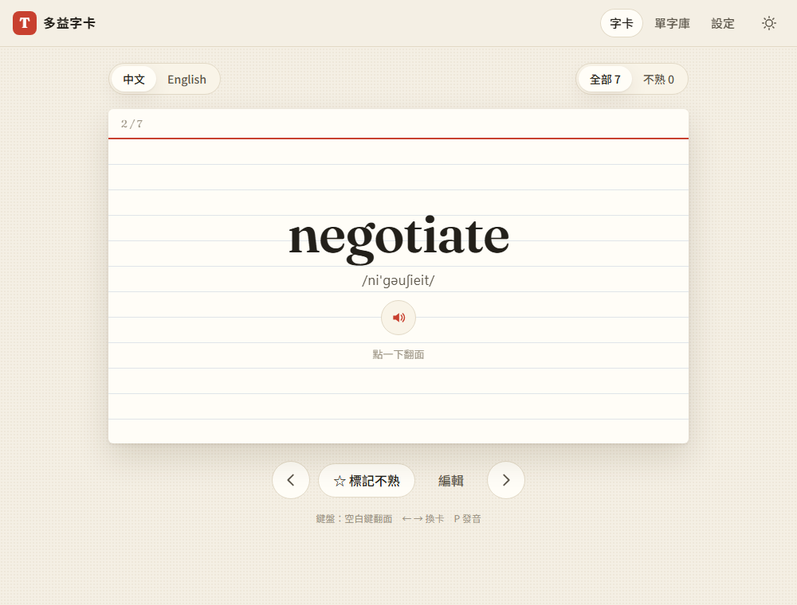
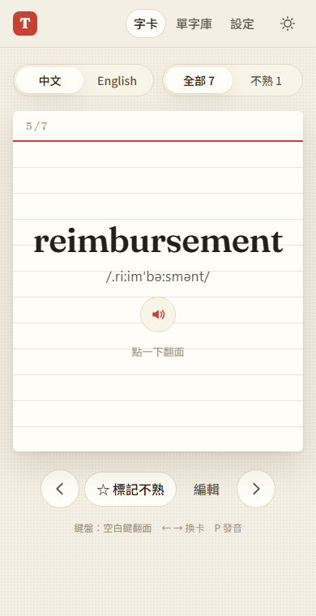

# 01：專案骨架與單字卡

## 目標
先做出能用的單字卡：可以新增、刪除、翻卡、切換中英文背面、標記不熟。資料存在瀏覽器裡，重新整理後也不會消失，並支援深色模式。

## 做法
- **技術**：純 HTML／CSS／JavaScript（ES modules），不需要建置步驟（見 [decisions #6](../decisions.md)）
- **檔案結構**
  ```
  index.html          頁面骨架、編輯單字的對話框
  css/style.css       全部樣式，淺色／深色兩套色彩變數
  js/app.js           依網址 #/cards、#/words、#/settings 切換頁面；深色模式
  js/store.js         資料層：單字和設定存在 localStorage，資料變更時通知畫面重畫
  js/ui.js            共用工具：HTML 跳脫、提示訊息、編輯視窗
  js/views/cards.js   字卡頁
  js/views/words.js   單字庫頁
  js/views/settings.js 設定頁
  ```
- **資料流**：畫面呼叫 `store.addWords()`、`updateWord()` 等函式 → 寫入 localStorage → `subscribe()` 通知目前的頁面重畫
- **視覺風格**：以紙本索引卡為靈感，包括米白卡紙、頂端紅線、淡藍橫線，英文用 Fraunces 襯線字體。深色模式像夜晚桌上的卡片。翻卡使用 CSS 3D 動畫（`rotateY` 加上 `backface-visibility`）
- **防止深色模式閃白**：在 `<head>` 用一小段內嵌程式碼，在頁面畫出來之前就先套用主題

## 遇到的問題與解法
- **用鍵盤翻卡會觸發兩次**：焦點在卡片按鈕上時，按空白鍵或 Enter 會同時觸發按鈕本身的點擊和全域的鍵盤事件，導致卡片翻過去又翻回來。解法是當焦點在按鈕或連結上時，全域鍵盤事件就不處理，交給按鈕自己處理
- **單字重複的判斷**：使用者可能輸入 `Deadline` 或多打空白，所以統一用 `normalizeWord()` 轉小寫、去掉頭尾空白，再比較是否重複

## 測試結果
用 `webapp-testing`（Playwright）跑了 23 項測試，全部通過（[tests/test_step1.py](../../tests/test_step1.py)）：
- 新增 3 個字，重複的字和非英文輸入會被擋下，大寫會自動轉小寫
- 編輯中文、詞性、例句後，列表和卡片都會更新；可以用中文搜尋
- 點擊和空白鍵翻卡、← → 換卡、切換中英文背面時保持翻面狀態
- 標記不熟會在卡片上蓋印章，也可以只看不熟的字
- 重新整理後資料和設定都還在；深色模式重新整理後也會保留
- 手機寬度（375px）不會出現橫向捲動




