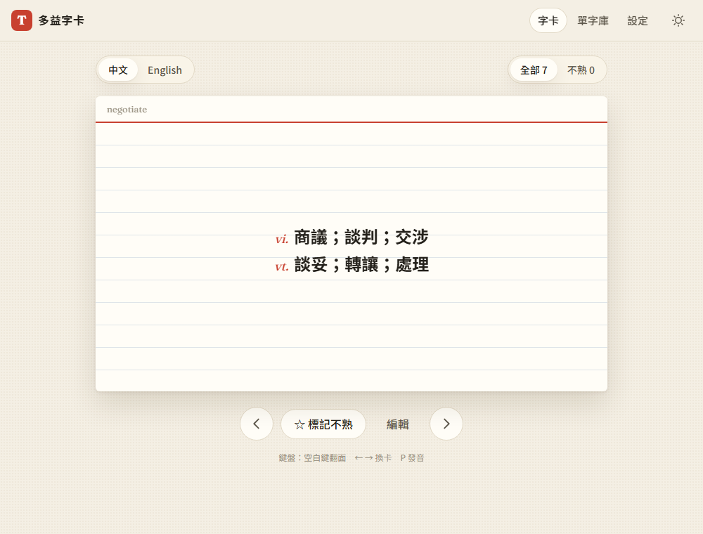

# 02：字典資料與發音

## 目標
使用者只要輸入英文單字，就會自動填入繁體中文意思、詞性、音標和英文解釋，而且不需要 API 金鑰也能用。另外加上發音功能。

## 做法
- **本機字典**：用 [ECDICT](https://github.com/skywind3000/ECDICT)（MIT 授權，77 萬字）整理出常用字子集
  - `tools/build_dict.py` 篩出 32,812 個常用字，用 OpenCC `s2twp` 轉成台灣繁體
  - 每個字最多留 4 行詞性、每行最多 5 個意思，並依首字母拆成 `data/dict/a.json` ~ `z.json`，總共 2.75MB
  - 網站用到哪個字母，才下載那個檔案（見 [decisions #7、#8](../decisions.md)）
- **英文解釋**：呼叫 Free Dictionary API，並依本機字典的詞性挑選對應的解釋。例如 *approve* 會挑動詞的解釋，而不是名詞的
- **發音**：`js/speech.js` 使用 Web Speech API，可以設定美式／英式口音和三種速度。卡片、列表上都有喇叭按鈕，鍵盤按 P 也會發音
- **新檔案**：`js/dictionary.js`（查詢與排隊）、`js/speech.js`、`tools/build_dict.py`、`data/dict/*.json`
- **資料模型**：新增 `phonetic`（音標）、`src`（每個欄位的資料來源）、`lookup`（查詢紀錄）三個欄位

## 遇到的問題與解法
- **ECDICT 的資料不乾淨**
  - 音標用的是西里爾字母 `ә`，不是 IPA 的 `ə`，所以統一替換
  - 有些釋義帶著字面上的 `\r`，要清掉
  - 有些行是 `[計]`、`[醫]` 這類專業領域或 `[網絡]` 網路釋義。有一般釋義時就丟掉這些行；只有專業釋義時，保留內容但拿掉標籤
- **片語太多**：ECDICT 有 25 萬條片語，全部放進來太大，所以決定交給 LLM 處理（[decisions #9](../decisions.md)）
- **Free Dictionary API 開發時剛好掛掉（HTTP 522）**：原本的程式不會出錯，但查失敗的字會被標記成「查過了」，之後就不會再查。現在改成依失敗原因處理：404 查無此字就不再查；網路錯誤或 5xx 下次開網站時會自動重試（[decisions #10](../decisions.md)）
- **一張卡片裡放不了兩層按鈕**：字卡原本是 `<button>`，裡面不能再放發音按鈕，所以改成 `
`，保留鍵盤操作
- **測試工具在 Windows 上會留下沒關掉的伺服器**：`with_server.py` 結束後，`http.server` 的子程序還在跑，佔住了 port，導致下一輪測試連不上。解法是改成自己在 port 8123 開伺服器，用完就關掉
- **音標顯示時字距不正常**（第 4 步截圖時才發現）：Fraunces 字體沒有 `ʃ` 等 IPA 字元，瀏覽器會改用其他字型來顯示這些字，所以字距忽大忽小。解法是音標改用內建就支援 IPA 的系統字型

## 測試結果
20 項測試全部通過（[tests/test_step2.py](../../tests/test_step2.py)），Free Dictionary 和語音都用假的回應：
- *approve* 填入繁體中文「vt. 贊同；核准…／vi. 讚許」，音標正確，英文解釋挑的是動詞的意思
- 查不到的字會留空，畫面顯示「尚無中文」
- 手動改過的中文，重新查字典後也不會被覆蓋
- 發音按鈕不會讓卡片翻面；口音和速度設定確實生效
- API 回傳 522 時，中文照樣會填入；API 恢復後重新開網站，會自動補上英文解釋

