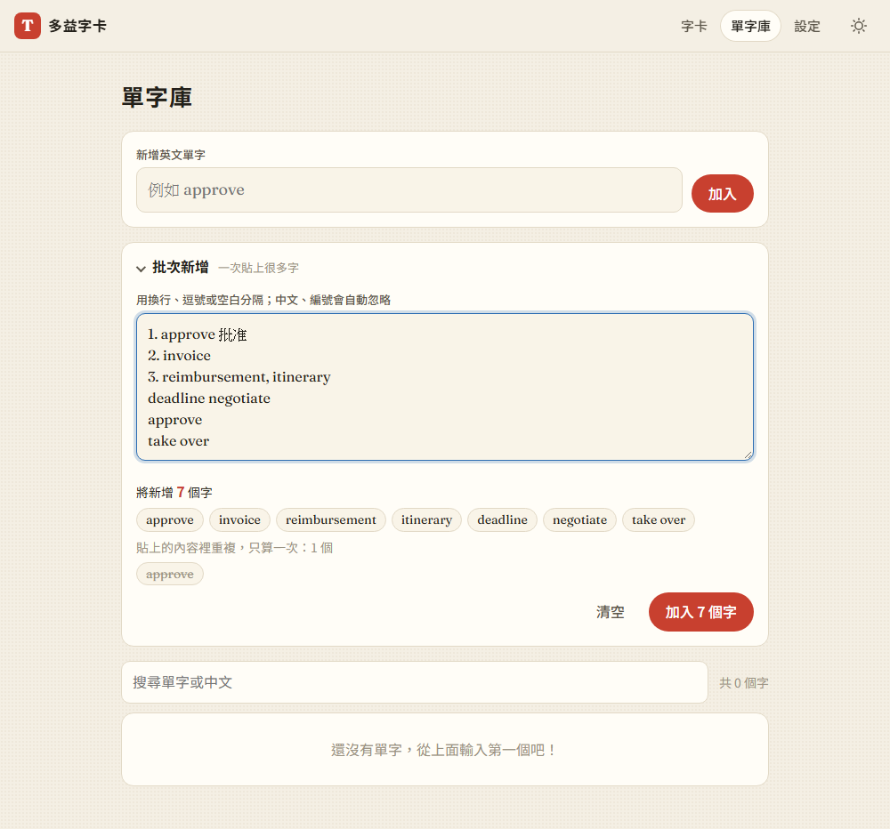
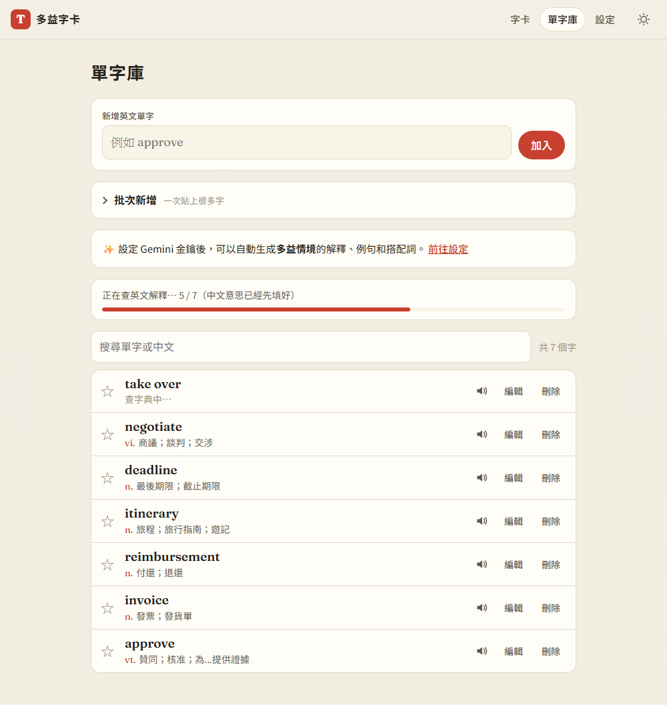

# 03：批次新增單字

## 目標
一次貼上很多單字，例如從講義、筆記或網頁複製一整段。系統會自動拆字，並去除重複的字和已經在字卡裡的字。

## 做法
- **`js/parse.js`**（純函式，可以單獨測試）
  - `splitWords(text)`：拆字
    - 換行、逗號、分號、tab、斜線、頓號都是分隔符號
    - 中文、數字、項目符號一律當成空白，所以「1. reimbursement 報銷」只會得到 *reimbursement*
    - 有空白的一段如果像片語（2～4 個字，而且含 up、over、of、to 等小字），就保留成片語，否則依空白拆開（見 [decisions #13](../decisions.md)）
  - `analyzeInput(text, existing)`：分成三類，`fresh` 是要新增的字、`dupes` 是這次貼上的內容裡重複的字、`existing` 是已經在字卡裡的字
- **畫面**：單字庫多了一個可以展開的「批次新增」區塊
  - 輸入時即時預覽「將新增 N 個字」，會被略過的字用刪除線標出
  - 加入按鈕上會顯示要加入幾個字
- **查詢改成兩個階段**（見 [decisions #12](../decisions.md)）
  1. 本機字典整批處理，只寫入一次 localStorage（新增 `store.updateWords()`）
  2. 英文解釋排隊查詢，並顯示進度條
- 原本的單個輸入框也改用同一套解析，貼上「agenda, payroll」也能一次加入兩個字

## 遇到的問題與解法
- **「空白分隔」和片語會衝突**：*approve deadline invoice* 應該拆成三個字，但 *look forward to* 應該保留成一個片語。最後用「是否含有小字」來判斷，並靠預覽讓使用者在加入前看到結果
- **清單編號被當成單字**：從「a. b. c.」這種編號留下的單一字母會被當成單字，所以過濾掉所有單一字母
- **大量新增時中文出現得很慢**：原本每個字都要依序查完中文和英文，100 個字要等英文全部查完。改成兩個階段後，100 個字的中文 **0.26 秒**就全部顯示
- **進度條的說明不夠清楚**：中文一下子就好了，進度條實際上是在等英文解釋，所以文字改成「正在查英文解釋…（中文意思已經先填好）」

## 測試結果
25 項測試全部通過（[tests/test_step3.py](../../tests/test_step3.py)）：
- 7 種拆字情境：逗號、空白、中文加編號、片語、項目符號、各種中文標點、大小寫重複
- 預覽正確顯示要新增 5 個字、已存在 1 個、重複 1 個
- 100 個字：中文 0.26 秒全部出現；英文每個字只查一次，排隊依序查完；進度條顯示「/ 100」
- 同一批字再貼一次會全部被略過，加入按鈕會停用
- 重新整理後 108 個字都在；手機版沒有橫向捲動

