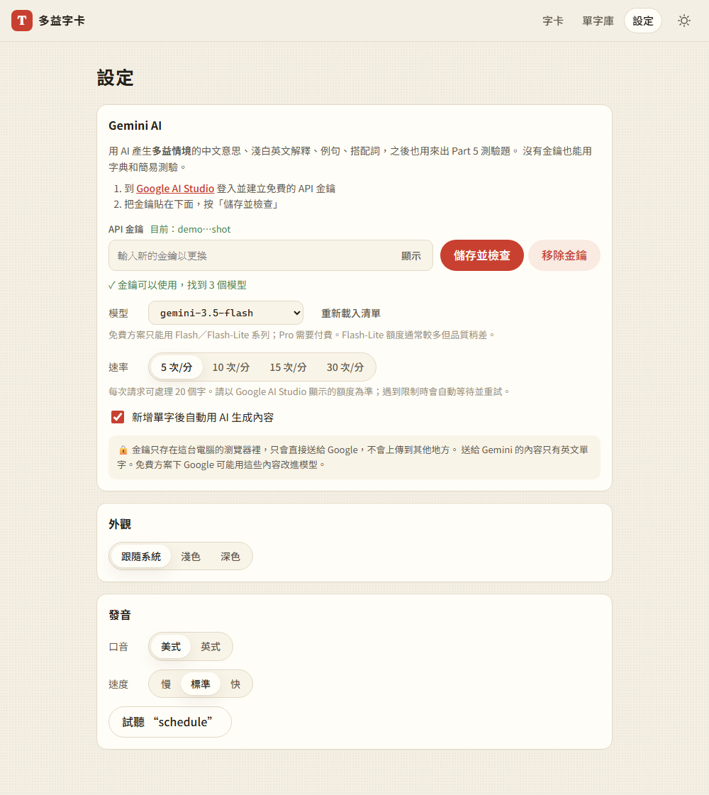
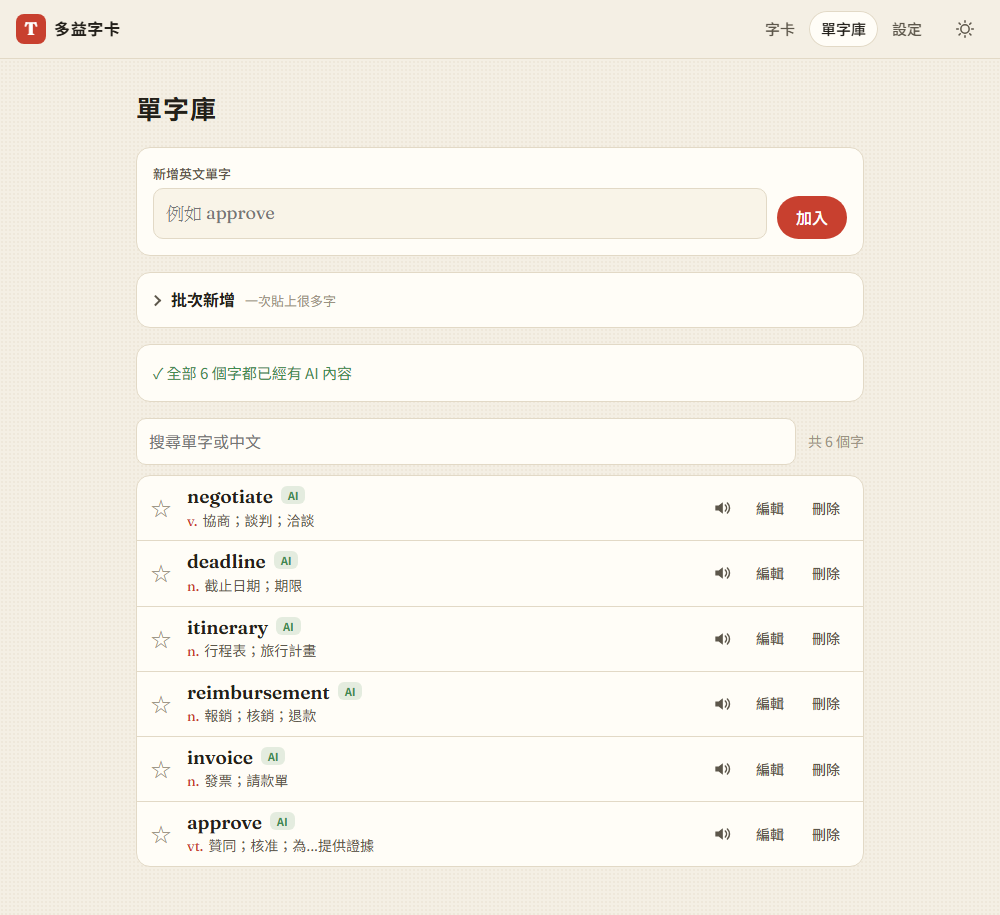

# 04：Gemini 批次生成

## 目標
使用者填入自己的 Gemini 金鑰後，網站會一次為很多字生成**多益情境**的內容：繁體中文意思、淺白英文解釋、2 句例句、搭配詞、詞性變化和同義詞。過程要不超過免費額度，失敗的字可以重試，而且每個字只生成一次就存起來。

## 做法
- **`js/llm.js`**：負責所有和 Gemini 溝通的部分
  - 金鑰放在 `x-goog-api-key` 標頭，不放在網址（見 [decisions #18](../decisions.md)）
  - `listModels()` 會查詢這把金鑰能用的模型，`pickDefaultModel()` 自動挑出最新的 Flash 模型（[decisions #16](../decisions.md)）
  - `generateJSON()`：
    - 依「每分鐘請求上限」平均間隔送出請求
    - 遇到 429 時，依 Google 建議的 `retryDelay` 等待後重試，最多重試 3 次
    - 遇到 5xx 時用退避的方式重試
    - 錯誤分成 key、model、quota、network、server、parse 幾種
- **`js/generate.js`**：負責批次生成
  - 每 20 個字放進一個請求，並用 `responseSchema` 規定 JSON 格式（[decisions #14](../decisions.md)）
  - 回應被截斷（`MAX_TOKENS`）時，自動把這批拆成兩半重送
  - 如果回應漏掉某個字，只把那個字標成失敗，可以單獨重試
  - 金鑰、模型、額度出問題時，整個佇列會停下來，剩下的字不算失敗
  - 合併資料時，依每個欄位的來源 `src` 決定：手動改過的欄位不會被覆蓋（[decisions #17](../decisions.md)）
- **設定頁**：可以設定金鑰（顯示時會遮罩）、選擇模型、設定速率（5／10／15／30 次/分）、是否在新增單字後自動生成，並附上隱私說明
- **單字庫的 AI 面板**：
  - 顯示「N 個字還沒有 AI 內容」和生成按鈕
  - 生成時顯示進度條，限速等待時會倒數
  - 可以停止生成，也可以重試失敗的字
  - 每個字旁邊標示狀態：AI、AI 生成中、AI 失敗

## 遇到的問題與解法
- **模型名稱和免費方案常常改**：查到的資料互相矛盾，有的說每分鐘 5 次、每天 100 次，有的說每分鐘 15 次、每天 1,500 次，模型名稱也一直在變。所以不寫死模型名稱，改成用金鑰向 Google 查詢；速率也讓使用者自己設定，預設用最保守的值
- **回應可能被截斷**：一批 20 個字，每個字都有例句，輸出很長，可能超過 token 上限，導致 JSON 不完整。偵測到解析失敗時，自動把這批拆成兩半重送
- **Gemini 偶爾會改掉單字的大小寫**：用單字對不上回應時，如果回傳的筆數和送出的一樣，就改用順序對應
- **倒數計時每秒都會重畫整個列表**：只有字的狀態（完成數、失敗數）改變時才重畫列表，倒數時只更新 AI 面板
- **安全規則**：開發時不能使用真的金鑰測試，所以所有情境都用 Playwright 攔截請求、回傳假的 Gemini 回應來測試（[decisions #20](../decisions.md)）

## 測試結果
37 項測試全部通過（[tests/test_step4.py](../../tests/test_step4.py)），第 1～3 步的測試也重跑過，都通過：
- 錯的金鑰會顯示「金鑰無效」；對的金鑰會列出模型，並自動選出最新的 Flash，圖片和嵌入模型會被排除
- 第一次請求遇到 429，會自動重試並成功
- 45 個字分成 20、20、5 三批；漏掉的字會標成失敗，可以單獨重試
- 有金鑰時不會呼叫 Free Dictionary
- 手動改過的中文和搭配詞會保留，沒改過的英文解釋會更新
- 回應被截斷時，15 個字會拆成 8、7 兩批重送，最後全部完成
- 一直遇到 429 時，最多重試 3 次就停下來，並顯示額度錯誤，這些字不算失敗
- 限速時會顯示倒數；按停止後就不會再送出請求
- 所有請求的網址裡都沒有金鑰

> 上述測試使用模擬的 Gemini 回應；實際的生成品質要用真的金鑰確認。

