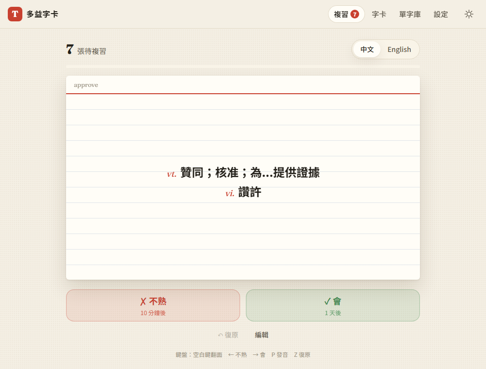
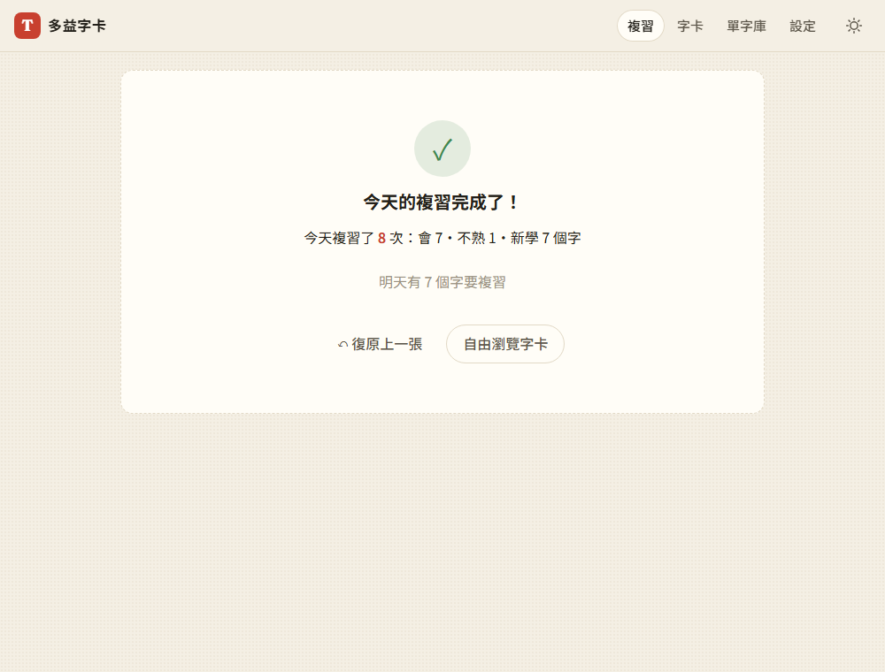

# 05：間隔重複與滑卡手勢

## 目標
- **間隔重複**：答錯的字很快再出現，答對的字間隔越來越長，每天打開網站就知道今天要複習哪些字
- **滑卡手勢**：在手機上，往右滑表示「會」、往左滑表示「不熟」。電腦上可以用按鈕或鍵盤做到同樣的事

## 做法
- **`js/srs.js`**：簡化版 SM-2 演算法，全部是純函式（見 [decisions #21](../decisions.md)）
  - 答「不熟」：10 分鐘後到期，連續答對次數歸零，難易係數 ease 降 0.2（最低 1.3）
  - 答「會」：第 1 次隔 1 天、第 2 次隔 3 天，之後每次乘上 ease（約 2.5 倍）
  - 一天從早上 4 點開始算（[decisions #22](../decisions.md)）
  - `buildQueue()`：到期的舊字優先，越早到期越先；再補新字，越早加入越先，有每日上限
- **`js/log.js`**：每日學習紀錄（複習幾次、會、不熟、新學幾個字），第 7 步的統計會用到
- **`js/views/review.js`**：新的「複習」頁，成為網站首頁
  - 按鈕上會顯示答完後多久會再出現，例如「✗ 不熟 10 分鐘後」「✓ 會 8 天後」
  - 這一輪答「不熟」的字，隔 3 張後會再出現一次
  - 可以「復原」上一張，複習排程、不熟標記和每日紀錄都會一起還原
  - 完成畫面會顯示今天的統計，並提供「再學 10 個新字」
  - 導覽列的「複習」旁邊有徽章，顯示今天還剩幾張
- **`js/swipe.js`**：用 Pointer Events 寫的滑卡手勢，滑鼠和觸控都能用
  - 拖超過 90px，或快速甩一下，就算滑出；不夠的話卡片會彈回去
  - 用 `touch-action: pan-y`，上下滑動仍然可以捲動頁面
  - 拖曳時，「會 ✓」或「✗ 不熟」標籤會依拖曳距離慢慢浮現
- **`js/cardview.js`**：把卡片的畫面抽出來，讓複習頁和瀏覽頁共用。瀏覽頁也可以左右滑動換卡，而且不會影響複習排程
- **「不熟」標記和複習結合**：答「不熟」會自動標記不熟；間隔達到 21 天就自動取消（[decisions #23](../decisions.md)）
- **程式品質**：把 `normalizeWord` 移到 `parse.js`，讓 `parse.js` 和 `srs.js` 不依賴瀏覽器，可以直接用 Node 跑單元測試（`tests/unit/`）

## 遇到的問題與解法
- **翻卡的 3D 效果消失**：卡片外面多包了一層 `swipe-wrap` 後，翻卡看起來變平了。原因是 CSS 的 `perspective` 只對直接子元素有效，所以把 `perspective` 移到新的外層
- **滑動標籤會跟著翻面**：一開始把「會／不熟」標籤放在卡片裡面，翻到背面時標籤會變成鏡像。改成放在卡片外層
- **在手機上從發音按鈕開始滑，會滑不動**：原本只要拖曳是從按鈕上開始的就忽略，但手機卡片的正中間剛好是發音按鈕，很多人會從那裡開始滑。改成從哪裡開始拖都可以：沒有移動就當成按按鈕，有拖動就當成滑卡，並擋掉那次點擊
- **滑完一張後馬上點下一張，卻沒有翻面（Chrome 的行為）**：
  - 測試時發現，快速滑動後大約 1 秒內，Chrome 會把下一次點擊當成「停止慣性滑動」，只送出 `pointerdown`／`pointerup`，不送出 `click`
  - 在真的手機上，這代表滑掉一張、馬上點下一張要翻面，卻沒有反應
  - 解法：滑卡模組自己用 pointer 事件判斷「點一下」，直接呼叫 `onTap`，並擋掉之後可能跟著來的 `click`，避免動作重複。用鍵盤操作時還是走原本的 `click`（[decisions #24](../decisions.md)）
- **同一批加入的字，複習順序反過來**：批次加入的字建立時間都是同一毫秒，排序時就退回陣列順序（最新的在前面），所以會先出現最後貼上的字。改成同一批的字建立時間各差 1 毫秒
- **測試工具的限制**：用 Chrome DevTools 模擬觸控時，不能和 Playwright 自己的 `tap()` 混用，否則手勢狀態會錯亂。所以觸控測試全部改走同一個 DevTools 通道

## 測試結果
- **單元測試**：Node 內建的 test runner 跑 15 項全部通過（`node --test "tests/unit/*.test.mjs"`）
  - 間隔計算 1→3→8→20 天、答「不熟」後重設、ease 下限、早上 4 點換日、複習清單的排序與新字上限、按鈕的間隔顯示格式
- **端對端測試**：用 `webapp-testing` 跑 42 項全部通過（[tests/test_step5.py](../../tests/test_step5.py)），第 1～4 步的測試也都通過
  - 首頁是複習頁，徽章顯示 5（到期 2 個＋新字上限 3 個），最早到期的字最先出現
  - 用按鈕、← → 鍵、數字鍵 1／2、滑鼠拖曳、手指滑動評分都正確
  - 拖不到門檻會彈回，不評分也不會翻面；上下滑動不會評分
  - 復原後，排程、不熟標記和每日紀錄都會還原
  - 間隔從 9 天變成 23 天時，自動取消「不熟」
  - 完成畫面的統計正確；「再學 2 個新字」可以用，新字用完後就不再顯示
  - 滑完 0.4 秒內馬上點發音按鈕，也能正確發音（這是修好的 Chrome 問題）
  - 瀏覽頁滑動換卡不會改變複習排程；批次加入的新字照貼上的順序複習

