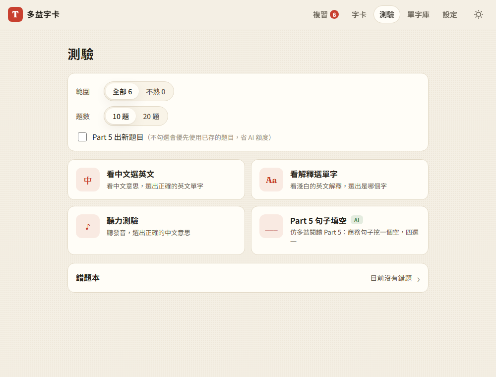

# 06：測驗與錯題本

## 目標
用字卡裡的單字出四選一測驗：
- **簡易模式**（不需要 AI）：看中文選英文、看英文解釋選單字
- **聽力測驗**：聽發音，選中文意思
- **多益 Part 5 句子填空**（需要 Gemini）：商務情境的英文句子挖一個空，錯誤選項優先從使用者的字卡挑
- 答錯的字自動標記「不熟」，並收進**錯題本**，之後可以重做

## 做法
- **`js/quiz.js`**：出題邏輯，全部是純函式，有 14 項單元測試
  - `pickDistractors()`：挑錯誤選項，不能是答案、選項文字不能重複，而且**同詞性優先**（動詞配動詞比較像真的考題）
  - `maskWord()`：「看解釋選單字」時遮住解釋裡出現的答案，例如 approve 連 approved、approval 也會一起遮住
  - `pickTargets()`：挑要考的字時，「不熟」的字比較容易被抽到
  - `normalizePart5()`：檢查 AI 出的題目能不能用：只能有一個空格、四個選項不重複、答案不能已經出現在句子裡
- **`js/part5.js`**：Part 5 出題（見 [decisions #27、#28](../decisions.md)）
  - 每 10 題一次請求
  - 錯誤選項由程式從字卡挑好，再請 Gemini 改成和答案相同的詞形，例如都改成過去式
  - 題目存在單字上（每個字最多 3 題），下次優先用最久沒考過的；勾選「出新題目」才會重新請 AI 出題
- **`js/mistakes.js`**：錯題本，存完整的題目（[decisions #29](../decisions.md)），重做時不需要再呼叫 AI；重做答對就移除，又答錯就把次數加 1。刪除單字時，相關的錯題也會一起清掉
- **`js/views/quiz.js`**：測驗頁
  - 可以選範圍（全部／不熟）和題數（10／20）
  - 每個模式的卡片都會說明能不能用、為什麼不能用（例如「需要至少 4 個有中文意思的字」「需要 Gemini 金鑰，前往設定」）
  - 作答後顯示對錯、正確答案、單字發音；Part 5 會把空格填上答案，並附上中文翻譯和解析
  - 結果頁有分數、每題對錯，可以「重做錯的」或「再測一次」
  - 鍵盤操作：1–4 或 A–D 作答，Enter 下一題，P 再聽一次
- **每日紀錄**：`log.js` 多記錄測驗題數和答對數，第 7 步的統計會用到

## 遇到的問題與解法
- **聽力測驗的第一題不會自動播放**：自動播放只寫在「下一題」裡，開始測驗時沒有呼叫。補上之後，測試確認開始時會唸一次、按 P 和按鈕可以再聽、換題時會自動播放
- **「前往設定」連結點不到**：一開始把連結放在模式卡片的 `<button>` 裡面，但 HTML 規定按鈕裡不能放連結，Playwright 也把它當成停用的元素。改成按鈕和說明文字（含連結）分開放
- **同樣的中文不能同時當答案和錯誤選項**：例如 *invoice* 和 *bill* 的中文都是「發票」。挑錯誤選項時用「選項上顯示的文字」來判斷是否重複，而不是用單字本身
- **一個偶爾才會出現的競態 bug**（第 3 步留下的，這次截圖時才發現）：
  - **現象**：截圖裡 *approve* 的中文偶爾是字典版本「贊同；核准…」，而不是 AI 版本「核准；批准；贊成」
  - **一開始的推測錯了**：以為是「查字典時等待下載，AI 在中間寫好了」。但寫了單字測試，舊程式也通過，因為程式讀到的是同一個物件，還是看得到 AI 的結果
  - **真正的原因**：一批字的字典資料是逐字查、最後才一次寫入。如果在下載後面字母（例如 `n.json`）的期間 AI 寫好了內容，前面已經算好的 *approve* 字典資料還是會在最後被寫回去，蓋掉 AI 的中文
  - **解法**：先把字典檔全部下載好，再讀取最新的資料，一次檢查並寫入，中間沒有任何等待（[decisions #31](../decisions.md)）
  - **驗證**：測試讓 `a.json` 先到、0.5 秒後 AI 回來、1.5 秒後 `n.json` 才到。用這個時間順序，舊程式穩定重現 bug，新程式通過。這個測試加在 `test_step4.py`
- **測試裡的小錯誤**：假的 Gemini 回應一開始把答案字放進句子，結果被 `normalizePart5()` 正確地拒絕了。改用「反過來的答案」當記號。這也順便證明了題目檢查真的有作用

## 測試結果
- **單元測試**：29 項全部通過，其中第 6 步新增 14 項（[tests/unit/quiz.test.mjs](../../tests/unit/quiz.test.mjs)）
  - 錯誤選項不含答案、不重複、同詞性優先（30 組亂數種子）
  - 中文一樣的字不會同時出現、答案位置是隨機的、不熟的字優先
  - Part 5 題目的 6 種不合格情況都會被拒絕
- **端對端測試**：用 `webapp-testing` 跑 48 項全部通過（[tests/test_step6.py](../../tests/test_step6.py)）；第 1～5 步加上新的競態測試，共 196 項也都通過
  - 只有 3 個字時不能測驗，並說明原因；沒有金鑰時 Part 5 停用，「前往設定」連結可以點
  - 看中文選英文 8 題：故意答錯第 1 題 → 顯示正確答案、標記不熟、加入錯題本；「重做錯的」答對後從錯題本移除
  - 看解釋選單字：解釋裡不會出現答案；聽力：自動播放、P 鍵和按鈕可以再聽、作答前不顯示英文
  - Part 5：8 個字只用 1 次請求；錯誤選項都來自字卡而且同詞性；有兩個空格的題目被丟掉；第二次只為沒有題目的字呼叫 AI；「出新題目」會全部重新出題、舊題目保留；金鑰錯誤時顯示原因
  - 錯題本：列表、移除單題、重做全部（答對移除、又答錯次數 +1）、刪除單字時一起清掉
  - 手機寬度下頁面和 5 個導覽項目都沒有橫向捲動

> Part 5 測試使用模擬的 Gemini 回應；實際出題品質要用真的金鑰確認。

