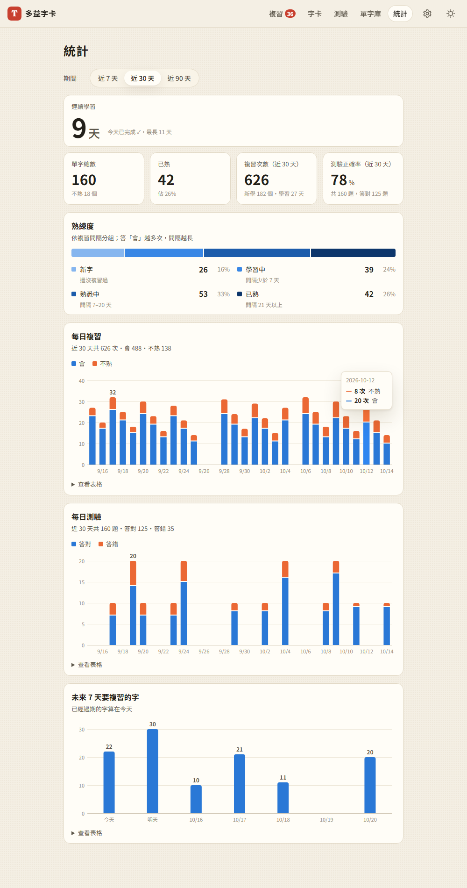
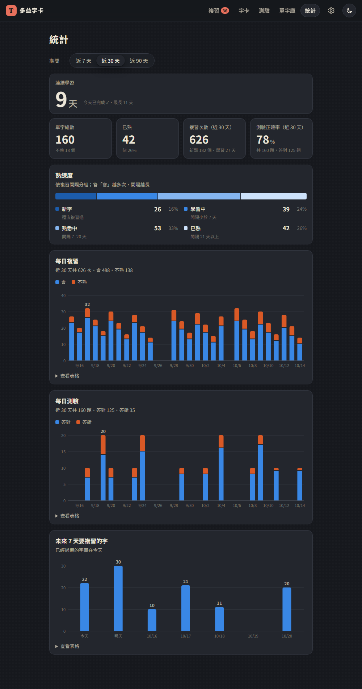
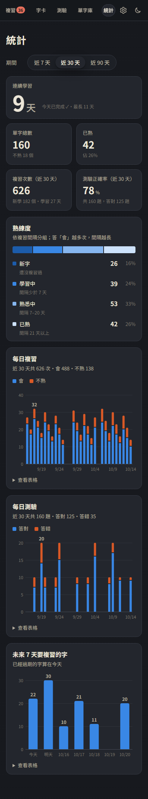

# 07：學習統計

## 目標
讓使用者看到自己的進度，保持動力：
- 連續學習天數
- 單字總數、熟／不熟比例
- 每日複習量、每日測驗量（圖表）
- 未來幾天有多少字要複習

## 做法
- **資料來源**：第 5、6 步就開始記錄的每日紀錄（`log.js`：複習次數、會、不熟、新學、測驗題數、答對數），加上每個字的複習間隔（`word.srs`）。不需要額外記錄
- **`js/stats.js`**：統計的計算，全部是純函式，有 11 項單元測試
  - `streak()`：連續學習天數。今天還沒學習時從昨天開始算，避免一大早打開網站就看到「0 天」；只做測驗也算有學習；一天從早上 4 點開始算（和複習排程一致）
  - `longestStreak()`：歷史上最長的連續天數，可以跨月
  - `masteryBuckets()`：依複習間隔分成 4 組：新字、學習中（少於 7 天）、熟悉中（7–20 天）、已熟（21 天以上）
  - `forecast()`：未來 7 天每天有多少字到期，已經過期的算在今天
  - `niceScale()`：Y 軸刻度用 1、2、5 × 10 的次方，最多 4 格，而且一定是整數
- **`js/charts.js`**：直條圖，自己用 SVG 畫，不用圖表套件（[decisions #32](../decisions.md)）
- **`js/views/stats.js`**：統計頁
  - 最上面是期間篩選（近 7／30／90 天），套用到下面所有和「期間」有關的數字和圖表
  - 數字卡片：連續學習天數（最大的數字）、單字總數、已熟、複習次數、測驗正確率
  - 熟練度用一條橫條加上圖例（數量和百分比）；每日複習、每日測驗、未來 7 天各一張直條圖
- **導覽列**：多了「統計」。6 個文字項目在手機上排不下，所以「設定」改成齒輪圖示

## 使用 dataviz skill
這一步依照 `dataviz` skill 的流程，先決定圖表形式，再決定顏色，而且顏色一定要用工具驗證：
1. **選形式**：
   - 單一數字用數字卡片，不用只有一根柱子的圖
   - 「會／不熟」的比例用堆疊直條圖
   - 熟練度是有順序的分組，所以用 100% 堆疊橫條
2. **配色看用途**：
   - 「會」和「答對」用系列 1（藍），「不熟」和「答錯」用系列 2（橘），兩張圖的意思一致
   - 熟練度用同一個藍色由淺到深（有順序的色階）
   - 沒有用綠／紅，因為那是保留給「狀態」的顏色（[decisions #33](../decisions.md)）
3. **跑驗證工具，不靠肉眼判斷**：`validate_palette.js` 是對**本站的卡片底色**驗證，不是用工具預設的背景色
   - 兩個系列在淺色、深色模式都通過，色盲模擬下的色差是 24.7 和 26.8，門檻是 8
   - 熟練度色階在深色模式**沒有通過**：最深的 `#184f95` 對本站的深灰底色只有 1.87:1，低於 2:1。所以往淺一階換成 `#1c5cab`（2.28:1）再驗證就通過了。深色模式的色階也改成「越熟越亮」（[decisions #34](../decisions.md)）
4. **柱子和格線的規格**：柱子最寬 24px、頂端 4px 圓角；堆疊的兩段之間留 2px 空隙（不畫外框）；格線是 1px 實線而且很淡
5. **標示與互動**：
   - 只標最高的那根柱子；柱子少（例如未來 7 天）時才每根都標
   - 2 個系列以上一定有圖例，只有一個系列時就不顯示
   - 滑鼠移上去或用鍵盤聚焦會顯示提示框，先顯示數值再顯示名稱，用短線條代表系列
   - 每張圖都有「查看表格」，數字不會只能從提示框看到
   - 提示框的文字用 `textContent` 插入，不用 `innerHTML`
6. **深色模式**另外挑過顏色並重新驗證，不是自動反轉
7. **截圖用眼睛檢查**：驗證工具只檢查顏色，版面要自己看。這一步因此抓到兩個問題（見下方）

## 遇到的問題與解法
- **手機導覽列的字被折成兩行**（「字／卡」「測／驗」「單字／庫」）：測試只檢查有沒有橫向捲動，但這裡是換行不是溢出，所以沒抓到；是看截圖才發現的。解法是導覽文字設成不換行，並且在 420px 以下藏起品牌圖示、縮小間距。測試也補上「每個導覽項目都是單行高度」的檢查
- **手機上未來 7 天的圖少了「明天」**：X 軸文字的最小間距設成 44px 太保守，7 根柱子只能隔一根標一次。改成 36px（「10/16」大約 30px 寬）之後，7 天全部都標得出來，30 天時仍然會自動跳著標
- **深色模式的熟練度色階對比不足**：用驗證工具抓到後換掉了（見上方第 3 點）
- **測試工具的小坑**：Playwright 的 `inner_text()` 對 SVG 的 `<text>` 無效，要改用 `text_content()`
- **截圖的小坑**：滑鼠移到圖表上時頁面會捲動，整頁截圖就把置頂的導覽列拍在頁面中間。截圖時把視窗設得夠高，就不會捲動

## 測試結果
- **單元測試**：40 項全部通過，其中第 7 步新增 11 項（[tests/unit/stats.test.mjs](../../tests/unit/stats.test.mjs)）
  - 連續天數：今天有學、今天還沒學、中斷、只做測驗、半夜 1 點、跨月的最長紀錄
  - 沒有測驗時正確率是「—」而不是 0%；熟練度在 7 天和 21 天的邊界；未來到期的分組；刻度
- **端對端測試**：用 `webapp-testing` 跑 39 項全部通過（[tests/test_step7.py](../../tests/test_step7.py)）；第 1～7 步合計 235 項也都通過
  - 用一份已知的學習紀錄驗證數字：連續 3 天、最長 5 天、近 30 天複習 37 次（40 天前的 50 次不算）、近 7 天 27 次、正確率 9/14 = 64%、熟練度 2／2／1／2
  - 柱子最寬 24px、堆疊之間 2px、只標最高的 12、兩個系列有圖例、一個系列沒有圖例
  - 滑鼠移上去和鍵盤聚焦都會顯示提示框；表格的數字正確；期間切換會儲存
  - 在複習頁複習一張後，統計會跟著更新（27 → 28）
  - 深色模式的顏色確實換成深色版本；手機上沒有橫向捲動、導覽文字不換行

