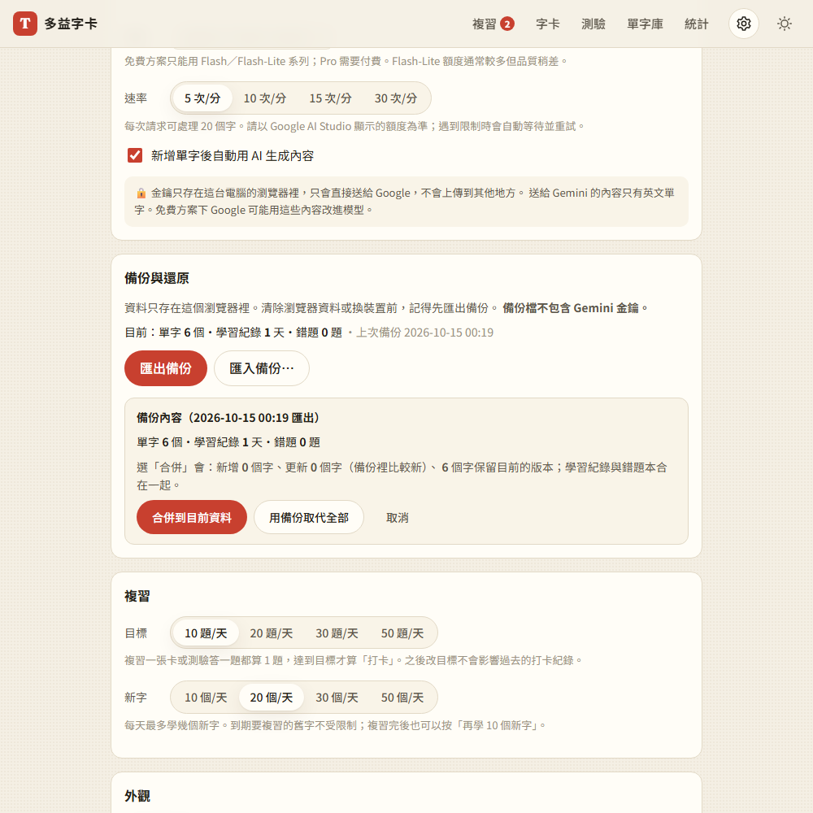

# 08：匯出／匯入

## 目標
資料只存在瀏覽器裡，所以要能**備份**、**換裝置**，清除瀏覽器資料後也能**還原**。

## 做法
- **備份檔格式**：`{ app: 'toeic-cards', version: 1, exportedAt, counts, data: { words, settings, log, mistakes } }`
  - 單字裡包含 AI 生成的內容、複習排程、存檔的 Part 5 題目，換裝置後**不用重新生成**
  - **不包含 Gemini 金鑰**（[decisions #40](../decisions.md)），換到新裝置要重新填
- **`js/backup.js`**：純函式，有 11 項單元測試
  - `parseBackup()`：先判斷是不是這個網站的備份檔、版本是否支援，再逐欄**檢查和清理**：型別不對的改成預設值、不認得的欄位丟掉、壞掉的單字略過（[decisions #41](../decisions.md)）
  - `mergeBackup()`：合併的規則（[decisions #42](../decisions.md)）
    - 新的字直接加入
    - 同一個字，留下「最後修改時間」比較新的版本，`id` 沿用目前的
    - 每日紀錄：同一天每個欄位取較大的值，所以同一份備份匯入兩次也不會重複計算
    - 錯題本：取聯集，並把備份裡的單字 `id` 換成合併後的 `id`
- **`js/views/backup-panel.js`**：設定頁的「備份與還原」
  - 顯示目前有多少資料、上次備份時間
  - 「匯出備份」會下載 `toeic-cards-backup-日期.json`
  - 「匯入備份」會先**預覽**備份內容，並先算出合併的結果（新增、更新、保留各幾個字），再讓使用者選「合併到目前資料」「用備份取代全部」（會再確認一次）或「取消」

## 遇到的問題與解法
- **寫入順序會導致錯題被誤刪**：程式裡有個機制是「單字被刪掉時，相關的錯題也一起清掉」，每次單字或設定改變都會執行。如果先寫入錯題本或設定，這個機制會拿「舊的單字清單」去檢查新的錯題，把它們全部刪掉。所以固定照「單字 → 錯題本 → 學習紀錄 → 設定」的順序寫入
- **匯入時跳出「目標達成」**：第 8b 步的慶祝機制會監聽學習紀錄的變化，匯入的紀錄裡如果今天已達標，就會跳出慶祝訊息。所以匯入時用不會觸發通知的 `replaceLog()`
- **取代後設定頁沒有更新**：備份裡的設定（主題、口音、目標）寫入後，設定頁上的選項還是舊的。改成取代之後請主程式重畫整個頁面
- **「略過幾筆」算少了**（單元測試抓到的）：備份裡同一個字出現兩次時，如果比較新的那筆在後面，前一筆被取代時沒有被計入「略過」。改成只要有重複就計入
- **測試裡讀到上一次的錯誤訊息**：連續測試好幾個壞檔案時，畫面上還留著上一個檔案的錯誤訊息，測試就讀到舊的。改成每次匯入前先清空

## 測試結果
- **單元測試**：新增 11 項，合計 53 項全部通過（[tests/unit/backup.test.mjs](../../tests/unit/backup.test.mjs)）
  - 匯出再匯入資料完整；不含金鑰、不收不認得的設定；拒絕 5 種錯誤的檔案
  - 壞掉的單字被略過、型別被修正；學習紀錄和錯題的清理
  - 合併的三種情況（新增、更新、保留）；`id` 衝突時換新的；**合併兩次結果不變**；錯題本的 `id` 會跟著換
- **端對端測試**：用 `webapp-testing` 跑了 30 項，全部通過（[tests/test_step8.py](../../tests/test_step8.py)）
  - 裝置 A 匯出：檔名、格式、筆數正確，**檔案裡沒有金鑰**
  - **模擬換裝置**：在全新的瀏覽器匯入並取代 → 單字、AI 內容、複習排程、不熟標記、學習紀錄、錯題本、設定（深色主題立刻套用）全部還原，新裝置沒有金鑰，也不會跳出慶祝訊息
  - 合併：保留 B 裝置新加的字和比較新的修改，紀錄取較大值；同一份備份合併兩次，結果不變
  - 取消不會改變資料；壞掉的 JSON、別的檔案、空檔案都會被拒絕，並清楚說明原因
  - 被竄改過、含有 `` 的備份，HTML 只會當成文字顯示，不會被執行
- 全部合計：304 項端對端測試、53 項單元測試全部通過

