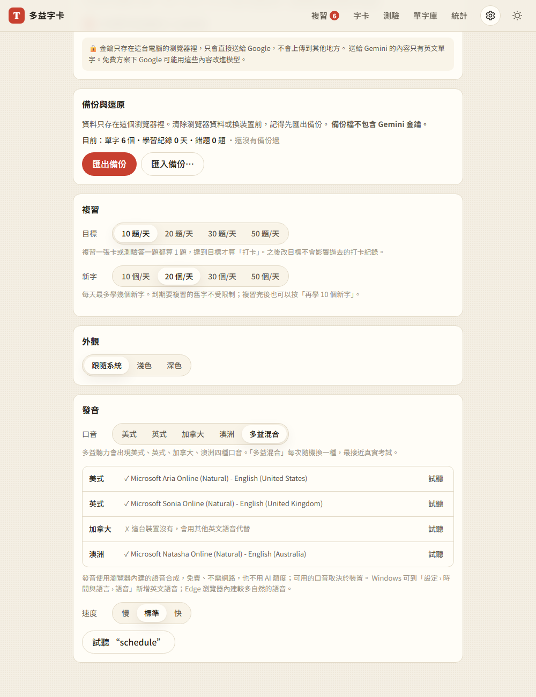
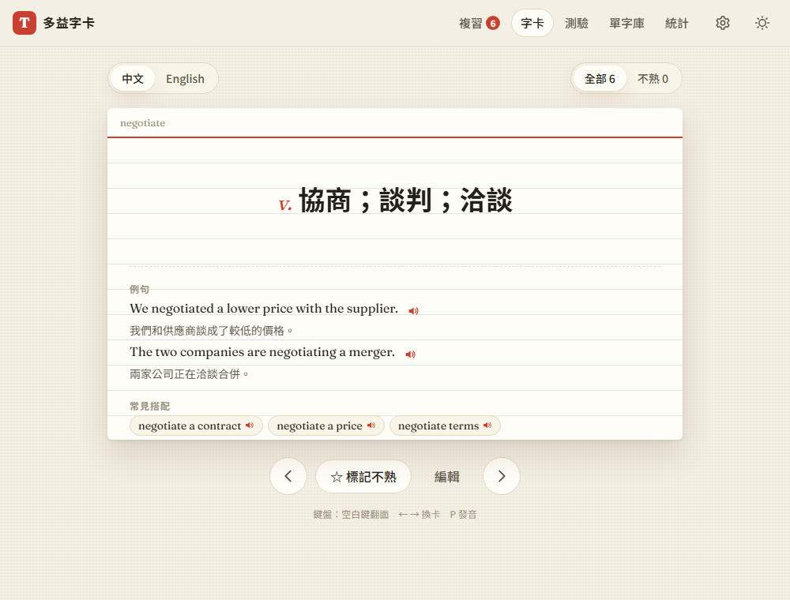

# 08a：多益口音與例句發音

> 使用者在第 8 步開始前追加的需求。原本的發音功能在第 2 步就做好了（單字的喇叭按鈕、P 鍵、美式和英式口音），這次再加強。

## 目標
- 多益聽力會出現**美式、英式、加拿大、澳洲**四種口音，練習時也要能聽到這四種
- 卡片背面的**例句**、**常見搭配詞**也可以發音

## 做法
- **發音的原理**（使用者問到「是不是用 LLM」）：不是。用的是瀏覽器內建的語音合成（Web Speech API），聲音來自作業系統或瀏覽器內建的語音。免費、不需要網路、也不用 AI 額度；可用的口音和音質依裝置而不同
- **`js/speech.js`**
  - `ACCENTS`：美式 `en-US`、英式 `en-GB`、加拿大 `en-CA`、澳洲 `en-AU`
  - 「**多益混合**」：每次從這台裝置**有語音**的口音中隨機挑一種，最接近真實考試（[decisions #37](../decisions.md)）
  - 同一個口音有好幾個語音時，優先挑名稱含 Natural、Online、Google 的，因為通常比較自然
  - `accentAvailability()`：列出每種口音在這台裝置上有沒有語音
  - `speak()` 會回傳實際使用的口音和語音
- **設定頁**：五個口音選項。逐一列出每種口音「✓ 使用的語音名稱」或「✗ 這台裝置沒有，會用其他英文語音代替」，每種都可以試聽，並說明在 Windows 怎麼新增語音
- **卡片背面**：每個例句後面有小喇叭；搭配詞改成可以點的按鈕。新增共用的 `handleCardTap()`，讓複習頁和瀏覽頁的行為一致：點發音按鈕只發音，點其他地方才翻面
- **聽力測驗**：每題在開始時就決定口音（多益混合時每題隨機），按 P 或「再聽一次」都用同一個口音；作答後顯示「這題是英式口音」
- **Part 5**：作答後可以「朗讀整句」，空格會填入答案再唸，也能當聽力練習

## 遇到的問題與解法
- **語音清單是非同步載入的**：Chrome 一開始呼叫 `getVoices()` 會拿到空陣列，要等 `voiceschanged` 事件。所以加了 `onVoicesChanged()`，設定頁的口音清單會自動重畫
- **測試環境沒有語音**：無頭（headless）Chrome 沒有任何語音，所以測試時替換成假的語音清單（有美、英、澳，**故意沒有加拿大**），用來驗證「沒有這個口音時」的處理。另外 Chrome 規定 `utterance.voice` 只能放真的 `SpeechSynthesisVoice` 物件，所以測試時連 `SpeechSynthesisUtterance` 也一起換成假的
- **鍵盤按例句的發音按鈕沒有反應**（真的 bug）：滑卡模組為了避免「點一下」觸發兩次，會擋掉點擊後 0.7 秒內的 click，結果鍵盤觸發的 click 也被擋掉了。瀏覽器會把鍵盤觸發的 click 標成 `detail = 0`，所以改成只擋滑鼠或觸控產生的 click（[decisions #38](../decisions.md)）

## 測試結果
用 `webapp-testing` 跑了 18 項，全部通過（[tests/test_pronunciation.py](../../tests/test_pronunciation.py)）：
- 五個口音選項；美式優先挑 Natural 語音；沒有加拿大語音時有清楚說明
- 試聽澳洲口音用的是澳洲語音；沒有加拿大語音時仍然設定 `en-CA`，交給瀏覽器的預設語音
- 多益混合唸 60 次，只出現這台裝置有的三種口音，而且會輪流變換
- 例句、搭配詞的發音正確，而且不會翻面；用鍵盤也可以觸發；複習頁也一樣
- 聽力題重聽時用同一個口音，作答後顯示是哪種口音；Part 5 朗讀整句時空格已填入答案

