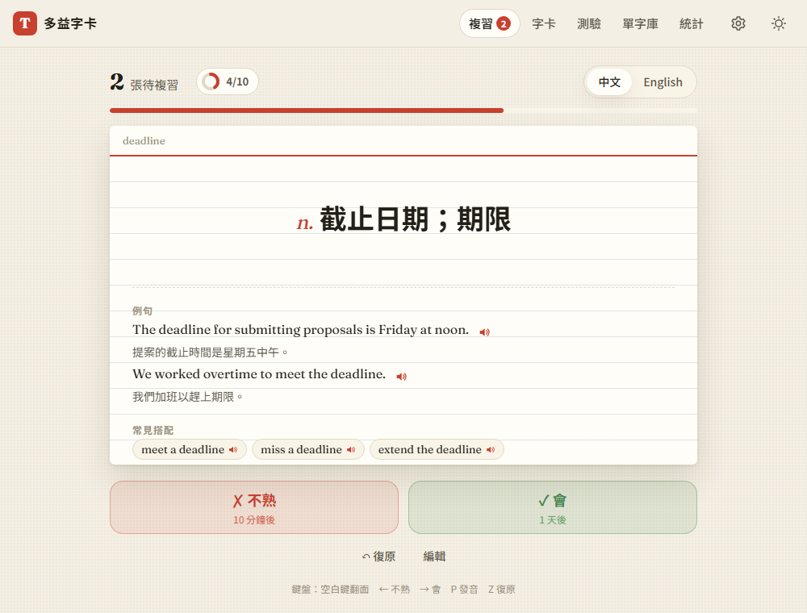

# 08b：每日目標與連續打卡

> 使用者在第 8 步開始前追加的需求。第 7 步的統計頁已經有「連續學習天數」（有學習就算），這次改成依每日目標計算。

## 目標
- 設定每天要完成幾題，用來督促自己
- **達標才算打卡**（使用者選的規則），連續打卡天數要能持續累積

## 做法
- **進度怎麼算**：複習一張卡或測驗答一題都算 1 題，預設目標 20 題，可以選 10／20／30／50 題
- **每天的紀錄會記下當天的目標**（`log.js` 的 `goal` 欄位，[decisions #39](../decisions.md)）
  - 過去的日子用當時記下的目標，所以之後把目標調高，過去的打卡也不會消失
  - **今天一律用目前的目標**，今天把目標調高，今天就要重新達標
- **`js/stats.js`**：
  - `goalMet()` 判斷某一天有沒有達標
  - `streak()`、`longestStreak()` 改成計算「連續打卡天數」；今天還沒達標時從昨天開始算
- **畫面**
  - 複習頁標題旁有進度環徽章，例如「12/20」，達標後變成綠色並打勾
  - 達標時跳出「🎉 今日目標達成！連續打卡 N 天」，一天只跳一次；用「復原」退回目標以下再達標，也不會重複跳出
  - 完成複習時，如果還沒達標，會提示「還差 N 題」，並提供「去測驗」連結
  - 統計頁最上面改成「連續打卡」，並顯示今日進度
- 新增 `log.js` 的 `onLogChange()`：紀錄一改變就檢查是否需要慶祝。匯入備份時刻意不觸發（`replaceLog` 不通知），以免匯入資料時跳出慶祝訊息

## 遇到的問題與解法
- **今天的目標要不要也凍結**：一開始把「當天的目標」套用在所有日子，包括今天，結果今天達標後把目標調高，今天還是算達標。改成今天一律用目前的目標，過去的日子才用記下的目標，並補上單元測試
- **改了判斷規則，舊的測試要更新**：第 5 步的測試原本逐欄比對每日紀錄，現在紀錄多了 `goal` 欄位，所以改成只比對複習相關的欄位。第 7 步的測試在種子資料裡加上每日目標，並重新計算預期的數字

## 測試結果
- **單元測試**：新增 3 項，合計 53 項全部通過
  - 合計達標才算打卡；用當天記下的目標；今天把目標調高後就要重新達標
- **端對端測試**：用 `webapp-testing` 跑了 21 項，全部通過（[tests/test_daily_goal.py](../../tests/test_daily_goal.py)）
  - 預設 20 題、設定會儲存；徽章進度 0/3 → 2/3 → 3/3，達標時慶祝並打勾
  - 復原後再達標不會重複慶祝；測驗題數也算在進度裡
  - 前兩天用當時的目標 10 也算打卡，所以連續 3 天；目標調到 50 後今天變成沒達標，從昨天算 2 天，並顯示「還差 45 題」
  - 完成畫面的提示和「去測驗」連結都正常

