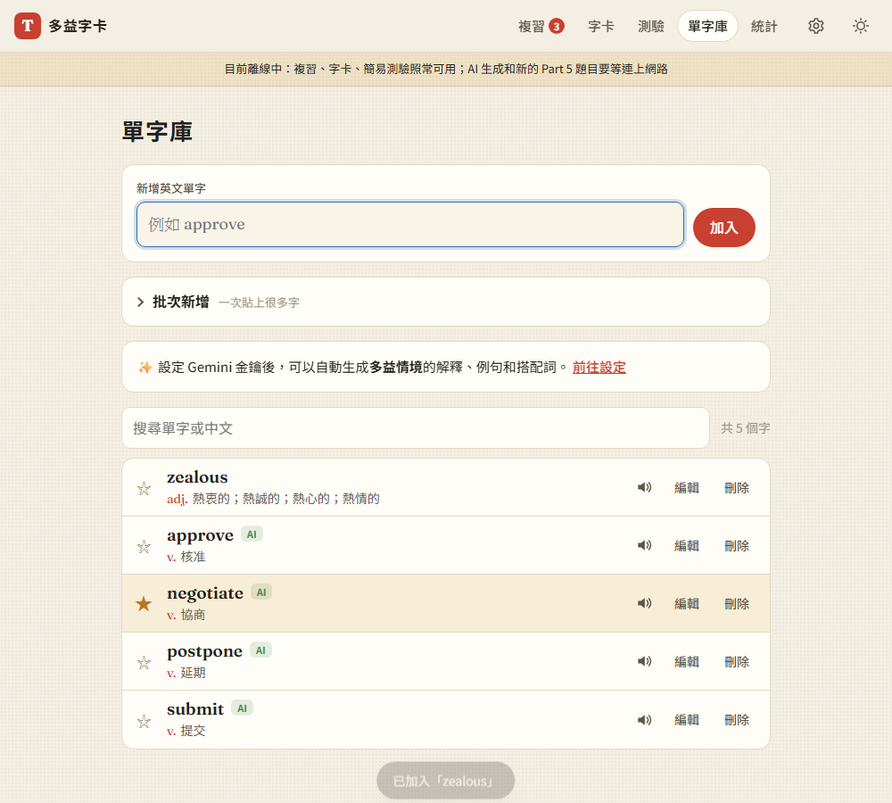
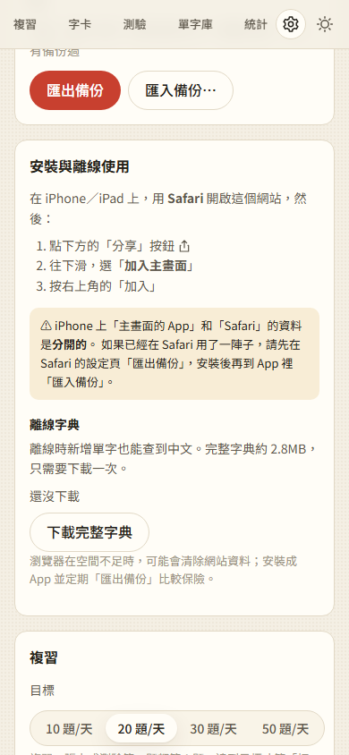

# 09：PWA（安裝到主畫面、離線使用）

## 目標
- 網站可以「安裝」到手機主畫面或電腦桌面，開起來像 App（全螢幕、有圖示）
- **沒有網路也能用**：複習、翻卡、簡易測驗、查字典

## 做法
- **App 圖示**（`tools/make_icons.py`）：用 Playwright 把一段 HTML 截圖成 PNG，和網站左上角的標誌一樣（紅底、米白色 Fraunces 字體的「T」）
  - 一般圖示（192、512px，四角透明）
  - **maskable**：Android 會自己裁成圓形或圓角，所以背景滿版、字放在中間 80% 的安全區
  - iPhone 的 `apple-touch-icon`：180px，不能透明，因為 iPhone 會自己加圓角
  - 瀏覽器分頁的 SVG 和 32px 圖示
- **`manifest.webmanifest`**：設定 App 名稱、圖示、`display: standalone`（全螢幕）、主題色，以及長按圖示時出現的捷徑（複習、測驗、新增單字）
  - 網址全部用相對路徑（`./`），部署到 GitHub Pages 的子路徑（`/repo/`）也能正常運作
- **`sw.js`（Service Worker）**：讓網站可以離線使用，快取策略見 [decisions #43](../decisions.md)
  - 網站本身的檔案：**先連網**，連不上或超過 4 秒才用快取 → 有網路時一定是最新版，**不需要手動管理版本號**
  - 字典檔、字型：有快取就用快取
  - Gemini、Free Dictionary：一律不快取
  - 第一次開網站時 Service Worker 還沒接手，所以頁面載入完成後，會把「這次用到的檔案清單」傳給 Service Worker，讓它一次存起來，不需要手動維護檔案清單（[decisions #44](../decisions.md)）
- **`js/pwa.js`** 與設定頁的「安裝與離線使用」（[decisions #46](../decisions.md)）
  - **安裝按鈕**：攔截 Chrome／Edge 的 `beforeinstallprompt` 事件，改在設定頁顯示「安裝」按鈕
  - **iPhone**：Safari 不支援安裝按鈕，所以改成顯示「分享 › 加入主畫面」的教學，並提醒「主畫面 App 和 Safari 的資料是分開的，要先匯出備份」
  - **離線字典**：可以一次下載 26 個字典檔（約 2.8MB），離線時新增單字也查得到中文
  - **離線提示列**：斷線時說明哪些功能可以用、哪些要等連上網路
  - 要求瀏覽器「持久保存」資料（`navigator.storage.persist()`），降低空間不足時被自動清除的風險
  - 用非 HTTPS 的網址（例如區網 IP）開啟時，清楚說明「離線功能要部署到 HTTPS 後才能使用」
- **離線時的 AI 生成**（[decisions #45](../decisions.md)）：連不上 Gemini 時改成「暫停」，不再把字標成「生成失敗」。重新連上網路後，自動補查字典並繼續生成
- **iPhone 瀏海**：App 模式下，頂端留出瀏海和狀態列的空間（`env(safe-area-inset-top)`）

## 遇到的問題與解法
- **使用者用區網 IP 在 iPhone 上開網站**：Service Worker 只能在 HTTPS 或 localhost 使用，`http://192.168.x.x` 不行。所以設定頁會偵測 `isSecureContext`，說明原因，並隱藏用不到的「離線字典」區塊。真正的離線功能要等第 10 步部署到 GitHub Pages（HTTPS）
- **Google Fonts 的快取有兩種不同的情況**：
  - 字型的 CSS 是透過 `<link>` 跨網站載入的，屬於「不透明」回應（`ok` 是 false），一般的寫法存不進快取，要用 `no-cors` 另外抓
  - 字型檔本身是用 CORS 方式要求的，存的也必須是 CORS 回應，存成不透明回應會被瀏覽器拒絕
  - 兩種分開處理之後，離線時字型也能正常顯示（有測試驗證 `document.fonts.check`）
- **網路很慢時一直等**：先連網的策略加上 4 秒逾時，超過就改用快取，背景的網路請求回來後仍然會更新快取
- **離線時的請求失敗會出現「未處理的錯誤」**：逾時之後網路請求才失敗，就變成沒人處理的 Promise 錯誤，所以另外接住它
- **測試工具的限制**：
  - Playwright 的「假回應」在離線模式下還是會回應，所以要自己模擬 Gemini 斷線
  - 我寫的快取檢查只把含「google」的網址標成外部網站，漏掉了 `fonts.gstatic.com`，是測試寫錯，不是程式的問題

## 測試結果
用 `webapp-testing` 跑了 26 項，全部通過（[tests/test_step9.py](../../tests/test_step9.py)）：
- manifest 使用 standalone 和相對路徑；三種圖示尺寸正確，而且有 maskable 版本；iPhone 圖示 180px
- Service Worker 接手網頁；36 個網站檔案和 15 個字型檔都存進快取；字典檔不混在網站檔案的快取裡
- 下載完整字典（26 個檔案）
- **真正離線**（Playwright `set_offline`）時重新整理，網站照常開啟，而且顯示離線提示列；字型仍然可用；可以複習、做簡易測驗
- 離線時新增單字，也能查到中文（*zealous* → 「熱衷的；熱誠的…」）
- 離線時 AI 生成顯示「連不上 Gemini」，字也不會被標成失敗；連上網路後自動繼續生成，提示列消失
- 安裝按鈕會叫出瀏覽器的安裝視窗，安裝後按鈕消失；在 App 模式下顯示「已經安裝」
- iPhone 顯示「分享 › 加入主畫面」，並提醒資料是分開的；手機版面沒有橫向捲動
- 用區網 IP（非 HTTPS）開啟時，會說明離線功能需要 HTTPS
- 第 1～9 步加上追加功能，合計 330 項端對端測試、53 項單元測試全部通過

> 沒辦法在真的 iPhone 和 Android 手機上驗證。真機上的安裝和離線行為，要等部署到 HTTPS 之後再確認。

