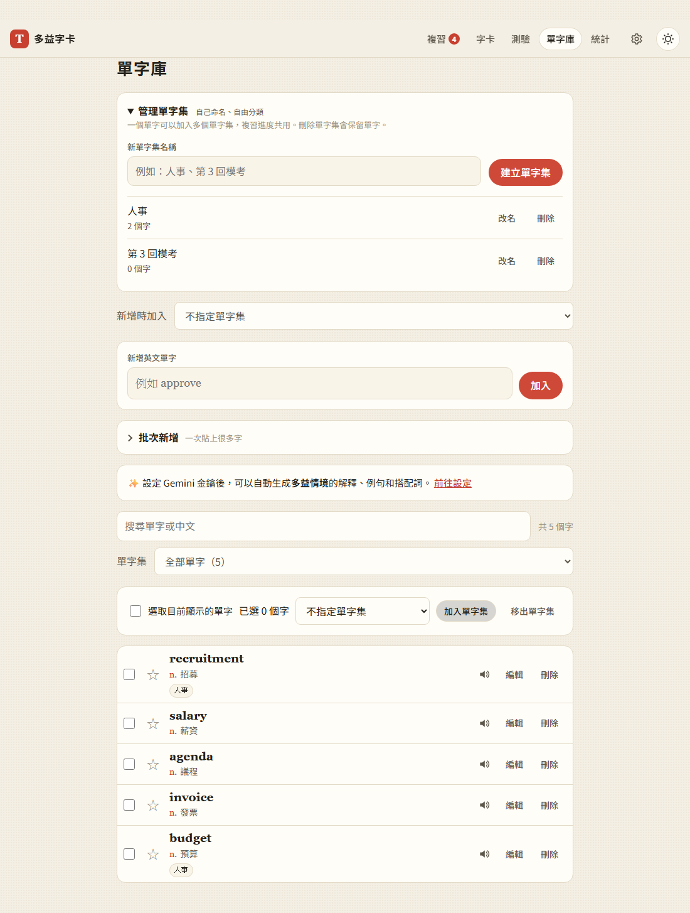
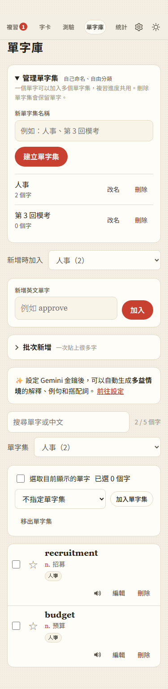

# 12：自訂單字集

## 目標

讓使用者自己建立「人事」「財務」「第 3 回模考」等分類，並只複習、瀏覽或測驗指定單字集。同一個單字可以同時屬於多個集，內容與學習進度共用，也為之後加入內建多益單字包準備歸類入口。

## 做法

- **資料規則**（`js/word-sets.js`）：每個集有固定 id、可修改的名稱、刪除紀錄，以及各成員的加入／移出時間。以單字本身對應，不依賴不同裝置各自的卡片 id；篩選與合併都是純函式。
- **本機儲存**（`js/store.js`）：分類另外存在 `toeic-cards:wordSets`。新增、改名、刪除、批次歸類沿用既有的訂閱通知。改單字拼字時保留歸屬，分類不修改 SRS 或使用者編輯的內容。
- **單字庫**（`js/views/sets-panel.js`、`js/views/words.js`）：折疊的管理區可建立、改名和刪除；勾選單字後可以批次加入／移出。單筆與批次新增可指定單字集，已存在的字只新增歸屬。切換範圍後，新增預設加入目前的集。
- **學習範圍**（`js/set-ui.js`、複習／字卡／測驗頁）：共用「全部／未分類／自訂單字集」選單。範圍留在本機；複習維持間隔排程與全站每日新字上限，自由瀏覽不限到期，四選一測驗要求集內至少四個符合題型的字。錯題本也限定目前單字集，清空只移除這個範圍的錯題。
- **備份**：格式升為版本 2，匯出分類與移出紀錄，仍可匯入舊版備份。合併保留雙方；取代時留下新的刪除／移出紀錄，避免下次同步復活舊分類。
- **同步**（`js/firebase-remote.js`、`js/sync.js`）：在使用者自己的 `meta/wordSets` 文件內，用 Firestore 交易逐集、逐成員合併；改名與成員修改互不覆蓋。沿用既有帳號權限規則，Gemini 金鑰不參與。

重要選擇與取捨見 [決策 58–60](../decisions.md#第-12-步自訂單字集)。目前使用單一分類文件，適合個人的數千字單字庫；非常大量的分類或成員關係需要改為分文件。

## 遇到的問題與解法

- **整份分類最後寫入者勝出會丟操作**：將名稱／刪除和每個成員分開記時間，再用交易合併，避免兩台裝置同時新增、移出時互相覆蓋。
- **取代備份後，雲端把舊分類加回來**：取代還原視為新的操作，為被取代的分類與成員寫入新的刪除／移出時間；用舊版備份還原後，舊分類也不會復活。
- **新錯誤區塊影響既有測試定位**：分類表單一開始有一個隱藏的 `.ai-error`，既有離線測試因此等到錯的區塊。改用分類自己的 `.set-error`，不干擾原本的 AI 錯誤訊息。
- **測試環境不同**：原本 `python` 不在 PATH，可用的 Python 也沒有 Playwright。經使用者同意，把 Playwright、Chromium 和 Firebase CLI 安裝在不進 Git 的 `.test-tools/`；Firebase CLI 設定也改放本機測試目錄。Google Fonts 與 Firebase 公開 SDK 需要可連線的測試程序，資料和帳號仍只寫到 `demo-toeic` 本機模擬器。
- **登入回歸測試曾等待逾時**：一次 iPhone 密碼登入情境未在期限內完成；補上失敗時的畫面診斷後重跑完整測試通過，未修改登入產品流程。

## 測試結果

- **74 項單元測試全部通過**：新增 10 項單字集測試，涵蓋多集歸屬、未分類、成員合併、刪除／移出、合併順序一致、資料清理、特殊物件欄位名稱，以及新舊版備份。
- **自訂單字集瀏覽器測試全部通過**（`tests/test_word_sets.py`）：管理操作、重複名稱、同字多集、批次歸類、已有單字加入、保留進度、限定題目與選項、字數不足、空集、備份還原與舊分類不復活、編輯拼字、HTML 名稱、375px 手機版面、深色與離線操作。
- **Firebase 模擬器回歸全部通過**（`tests/test_step11.py`）：新增六項分類檢查，驗證兩台同時建立、卡片 id 不同的歸屬、改名／新增／移出合併、離線重連不復活已刪分類、保留卡片及他人帳號讀取遭拒。
- **相關既有瀏覽器測試通過**：`test_step1.py`、`test_step3.py`、`test_step5.py`、`test_step6.py`、`test_step8.py`、`test_step9.py`；包含原有翻卡、新增、批次輸入、排程、測驗、備份與 Service Worker 離線流程。未設定 `LAN_URL`，區網非 HTTPS 的選用情境未執行。
- JavaScript 語法檢查與 `git diff --check` 通過。正式 Firebase 未建立測試帳號、未執行正式登入。

