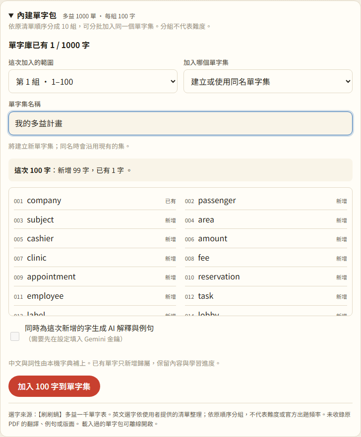
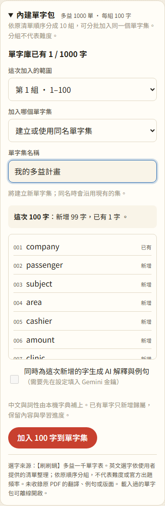

# 13：內建多益單字包

## 目標

提供內建的多益 1,000 字選字清單，讓使用者不用自行貼上整份單字表，就能預覽、每 100 字分批或全部加入自己的單字集。已經整理過的單字保留原內容與進度，批量加入也不會直接使用個人的 Gemini 額度。

## 做法

- **資料整理**：`tools/extract_toeic_pack.py` 只抽取使用者提供 PDF 的英文單字，檢查每頁 10 筆、總數與唯一性皆為 1,000。輸出 `data/packs/toeic-1000.json`，記錄原檔 SHA-256 與拼字修正；不收錄原翻譯、例句或 PDF 本身，詳見 [資料來源說明](../../data/packs/README.md)。
- **資料邏輯**：`js/word-packs.js` 負責格式驗證、分組和新字／已有字／已在目標集的預覽計數。保留原順序，每 100 字一組，不另推定難度。
- **加入介面**：單字庫新增可折疊的「內建單字包」（`js/views/word-pack-panel.js`）。可選第 1～10 組或全部，預覽完整清單，建立自訂名稱或加入現有集，同名時沿用既有分類。加入後切換至目標集，重複加入不建立副本。
- **已有單字保留**：只為新字建立卡片、查字典或排入使用者勾選的 AI 生成。已有單字僅新增成員關係，不改內容、來源標記、id 或 SRS。
- **基本詞義**：既有字典缺少的 15 詞由 `js/dictionary-extra.js` 提供自行整理的基本中文，並修正 `download` 在原字典子集中的明顯錯義。全部 1,000 字都可取得本機中文；原 ECDICT 檔案不變。
- **AI 選擇**：預設不勾選。新字記下 `autoGenerate: false`，避免重連時被全站自動生成撈進去；標記隨現有備份、同步保留。手動生成仍可執行；明確勾選時，只有這次新增的字會使用個人 Gemini 金鑰生成，已有字不會被重寫。
- **離線**：資料按需載入，由既有 Service Worker 快取。第一次尚未載入過且沒有網路時會提示重試；載入後可離線重新整理並預覽單字包。

此版提供英文選字、本機中文與選用生成流程，尚未附預先生成的英文解釋、例句或搭配詞。固定單字包可在後續以經檢查的靜態內容補齊，讓使用者不用個人金鑰或等待生成。

## 遇到的問題與解法

- **原 PDF 本身有三筆錯字**：抽出 `aprove`、`nconvenience`、`ompulsory` 後，對照原 PDF 畫面與同筆英文例句，修正為 `approve`、`inconvenience`、`compulsory`。修正後仍為 1,000 個不重複字，頁碼與原拼字記錄在資料中。
- **重音與排版字距**：保留 `résumé`，直接用清單陣列加入，不走一般貼上解析器；共用的正規化補上 NFC，組合形式不同仍視為同一字。`c r e a t e` 則還原為 `create`。
- **只在當下不呼叫 AI 還不夠**：原本重新連線會生成所有缺內容的字。新增每張卡的自動生成排除標記，並保留手動生成入口，避免稍後突然送出整包請求。
- **Service Worker 會繞過頁面的本機資料路由**：失敗／重試測試使用停用 Service Worker 的隔離環境；真正離線測試使用另一個啟用 Service Worker 的環境，分別確認錯誤處理與快取行為。
- **補充詞義的物件原型**：使用沒有原型的資料表，避免查詢 `constructor` 之類的字時誤讀 JavaScript 內建屬性。

技術取捨見 [決策 61–63](../decisions.md#第-13-步內建多益單字包)。

## 測試結果

- **81 項單元測試通過**：新增 7 項，驗證總數、去重、三筆修正、十組順序、資料拒絕規則、預覽計數、全部選字的本機中文、Unicode 重音與自動生成標記的備份／同步。
- **34 項單字包瀏覽器檢查通過**（`tests/test_word_packs.py`）：按需載入、失敗重試、分批與全部加入、已有字保留、同名沿用、重音拼字、本機詞義、AI 預設與明確勾選、重連排除與手動生成、備份、375px 手機與深色版面、真正離線重新整理。
- **相關回歸測試通過**：`test_step2.py`、`test_step3.py`、`test_step4.py`、`test_ai_speed.py`、`test_word_sets.py`、`test_step9.py`。PWA 測試未設定 `LAN_URL`，選用的非 HTTPS 區網情境未執行。
- JavaScript 語法檢查與 `git diff --check` 通過；字典與 Gemini 外部 API 使用假回應，未使用真實金鑰或正式帳號。本次未修改 Firestore 交易流程，標記的同步保留以共用清理／套用純函式驗證。

