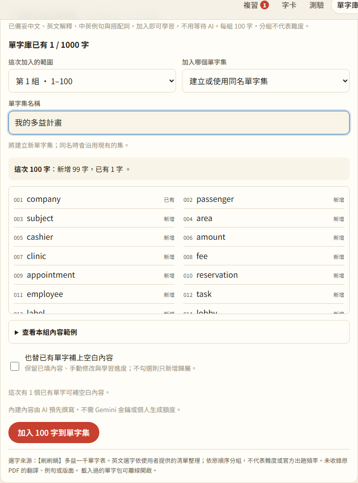

# 第 14 步：多益 1000 單字包預製內容

## 目標

固定清單先準備好學習內容，使用者加入即可背，不必提供 Gemini 金鑰、等待生成或耗用個人額度。單字庫入口直接寫出名稱，並提供可展開的直接連結。

## 做法

- `tools/word-pack-content.txt`：為 1,000 字另行撰寫詞性、中文、淺白英文解釋、一組雙語例句與搭配詞，不複製來源 PDF 的翻譯或例句。
- `tools/word-pack-related.json` 與 `tools/build_pack_content.py`：補充部分同義詞與詞族，詞形參考既有 ECDICT；編成 `data/packs/toeic-1000/01.json`～`10.json`，總計約 336 KB。
- 開啟「多益 1000 單字包」才讀取十組內容。全部驗證成功才提供加入；任一份下載失敗可重試。由既有 Service Worker 快取，離線重新整理後也能加入整包。
- 新字在同一次儲存就帶入完整內容；`pack` 版本及逐欄位來源隨備份、同步保留。完整內建卡不進入生成缺項或批次重試，也不再提示等待 AI。
- 舊卡預設維持內容與學習進度；使用者勾選「也替已有單字補上空白內容」後，才補未標記為手動修改的空欄位。
- 單字庫入口標明免金鑰，提供內容範例；`#/words?pack=toeic-1000` 可直接展開入口。加入仍由使用者選組別與目的單字集。

## 遇到的問題與解法

1. 只在加入當下不生成，仍可能在重新連線或「生成缺項」時重送：依完整內容識別，並保留 `autoGenerate: false`，批次重試也略過舊失敗標記已補齊的卡片。
2. ECDICT 有些複數變化與原字相同：編製時排除原字及重複變化，依本次詞性選取；例如 `found` 使用 `founded`，不把它當作 `find` 的過去式來教。
3. 開啟後只載入選中組別會讓其他組無法離線加入：入口首次載入就取回並驗證十組，仍避免首頁預先下載。
4. 舊回歸測試期待「全部已有 AI 內容」：介面改稱「已有學習內容」，涵蓋內建與個人生成，測試隨實際文案更新。

## 測試結果

使用本機 `webapp-testing` skill 的 Python Playwright 流程，外部 Gemini／字典均模擬；沒有使用真實金鑰或正式 Firebase 帳號。

- Node 單元測試 88 項全部通過，包含完整字序、1,000 組例句唯一性、錯誤內容格式拒絕、舊卡保護，以及備份／同步資料轉換。
- `tests/test_word_packs.py` 全部通過：主檔與內容檔失敗重試、十組與整包加入、去重、同名／現有集、自訂內容與進度保留、舊卡補空白、雙語例句翻卡、英文解釋測驗、直接展開入口。
- 實際斷網後重新整理，再加入全部 1,000 張完整字卡成功。已設定測試金鑰時，加入、重連、生成缺項與完整卡片批次重試均無 Gemini 請求。
- `test_step4.py`、`test_ai_speed.py`、`test_word_sets.py`、`test_step8.py`、`test_step9.py` 回歸通過；PWA 測試未設定區網網址，略過非 HTTPS 區網情境。
- 桌面、375px 手機、深色模式均確認沒有橫向捲動。全數內容另檢查例句含原字或其變化形；這些檢查不代表已經教師逐字審訂。

