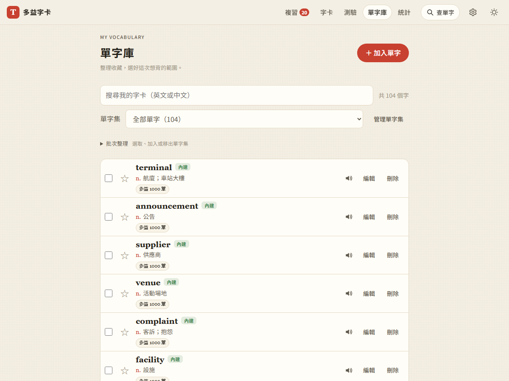
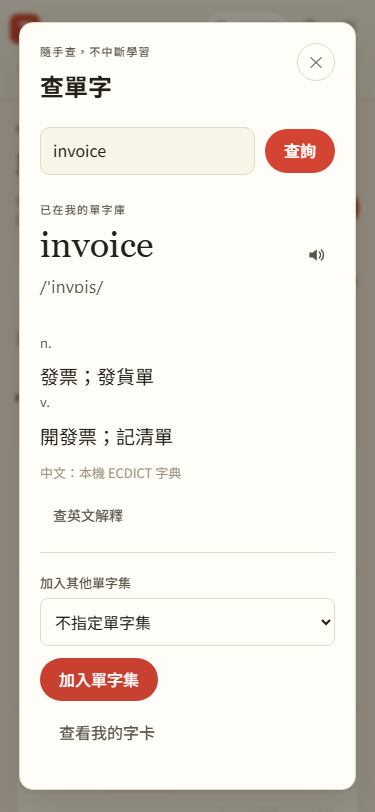
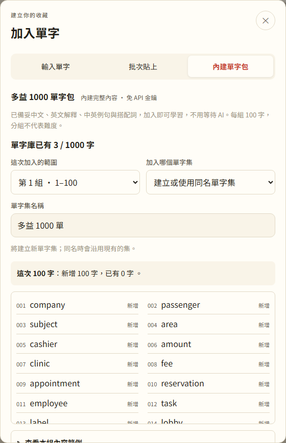

# 第 15 步：全站查字與單字庫整理（B 方案）

## 目標

解決單字庫同時堆疊新增、內建包、分類、生成與搜尋造成的混亂。查字典、加入收藏、管理收藏分成明確入口，使用者在複習或測驗時也能查意思。

## 做法

- 頂列新增「查單字」，支援 Ctrl／⌘ K。`js/word-lookup.js` 負責原生查詢視窗、本機中文與發音、使用者明確要求的免費英文解釋，以及收藏到單字集。
- 查詢不切換路由、不寫學習紀錄；收藏才寫入卡片，重複字只增加分類。已收藏的字可在視窗裡查看自己的內容。
- 單字庫保留「搜尋我的字卡」、範圍與清單；「＋加入單字」開啟輸入／批次貼上／內建包三種方式，管理單字集另開視窗。
- 批次整理與閒置 AI 工具預設收合；生成中或失敗時直接顯示狀態。原 `#/words?pack=toeic-1000` 連結仍可打開內建包。
- 沿用紙本字卡配色與字型；窄螢幕頂列分兩排，查字按鈕保留文字。

## 問題與處理

- 搜尋輸入框原生 Escape 可能只清空內容，沒有關閉視窗：明確處理 Escape 並保留原生焦點返回。
- 較舊英文查詢可能晚於新查詢返回：用序號忽略過期結果，關閉／換字時 abort；英文請求超過八秒也中止，保留中文與重試能力。
- 原先測試直接操作常駐表單：更新為從真實入口開啟工具；`tests/library_helpers.py` 讓舊功能測試共用新入口，沒有加入產品測試專用模式。
- 非同步功能測試隔離 Firebase 設定，避免不相關的公開 SDK 載入失敗影響字卡與滑卡測試；沒有登入正式專案。

## 驗證

使用 `webapp-testing` 的 Python Playwright 流程；Gemini 與 Free Dictionary 全部使用假回應。

- JS 語法檢查、88 項 Node 單元測試通過。
- `test_library_ui.py` 通過：六頁查字、關閉留在原頁、英文失敗重試、收藏去重、分類／新增／批次／包入口、清單篩選與批次整理、查字期間不誤評或作答、320／375／768px 版面。
- `test_step1.py`～`test_step5.py`、`test_ai_speed.py`、`test_word_sets.py`、`test_word_packs.py` 回歸通過。
- `test_step9.py` 通過：離線重新整理後仍能開全站查字並讀取已下載的中文；原離線複習、測驗與新增也正常。未設定區網網址，略過非 HTTPS 區網情境。
- 查詢本機中文不對外呼叫 API；英文由按鈕明確查詢，整個全站查字流程不使用 Gemini。

