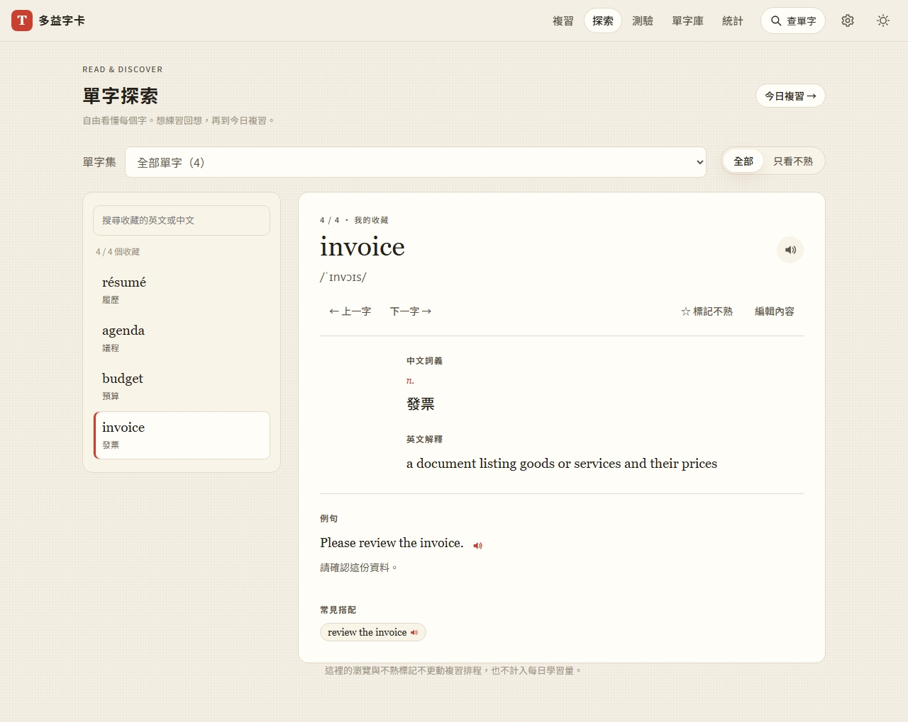
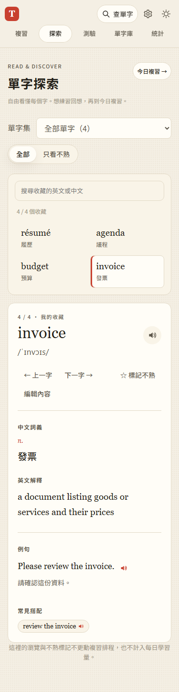

# 第 16 步：單字探索與今日複習分工

## 目標

將自由翻卡改為直接閱讀收藏內容的「單字探索」；今日複習保留回想、翻面與 SRS 評分，減少兩頁操作重複。

## 第一階段：篩選與選字邏輯

- `js/explore.js` 只接受目前範圍的字卡，支援英文／中文搜尋、不熟篩選，以及上一字／下一字循環。
- 保留目前選字；當它不在篩選結果內時選第一個有效字。空結果維持空狀態，不跳出篩選範圍。
- 不使用到期日與每日新字上限，不修改字卡、SRS 或紀錄。
- 新增五項單元測試，涵蓋 Unicode、組合篩選、空範圍、選字保留及進度不變；第一階段測試通過後獨立提交。

## 第二階段：閱讀介面與複習分工

- 導覽「字卡」改名「探索」，原 `#/cards` 路由仍可用。桌面採清單與詳情並排，手機清單在上、詳情在下。
- 直接顯示中文、英文解釋、雙語例句、搭配詞、詞形與同義詞；提供發音、編輯、上一字／下一字及不熟標記。沒有翻面或評分。
- 保留單字集與不熟篩選，另加收藏內容搜尋；輸入節點不因背景更新而重建，空結果不混入其他分類。回到探索保留工作階段內選字。
- 今日複習新增用途說明，維持原本排程、翻面、滑動與評分行為。

## 問題與處理

- 探索與複習沿用閱讀內容 renderer，新增雙語模式並限定探索樣式，避免影響複習的正反面。
- 舊測試將所有內容閱讀都視為翻卡：改以直接閱讀驗證探索，翻面與手勢仍由複習測試覆蓋。
- 離線測試需要等待初次載入的全部 ES modules 完成快取，而非只等 Service Worker 接手。另重啟長時間運作、間歇載入逾時的本機測試伺服器，日誌改存忽略的測試資料夾。

## 測試結果

使用 `webapp-testing` 的 Python Playwright 流程，外部 Gemini／字典採假回應，不登入正式 Firebase。

- JS 語法與 93 項 Node 單元測試通過。
- `test_explore.py` 通過：直接雙語閱讀、搜尋、分類與不熟篩選、空結果、發音、編輯、選字保留／刪除，以及 320／375／768px 無橫向溢出。
- 比對全部字卡 SRS 與每日紀錄，確認探索瀏覽、搜尋、換字及不熟標記不會更動它們；今日複習按「會」後才增加間隔。
- 回歸涵蓋 `test_step1.py`、`test_step2.py`、`test_step4.py`、`test_step5.py`、`test_pronunciation.py`、`test_word_sets.py`、`test_word_packs.py`、`test_library_ui.py` 與 `test_step9.py`。

