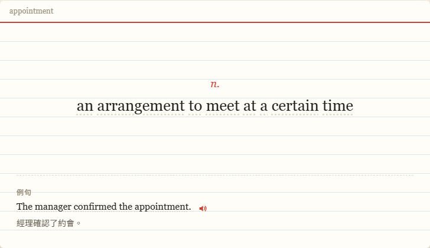
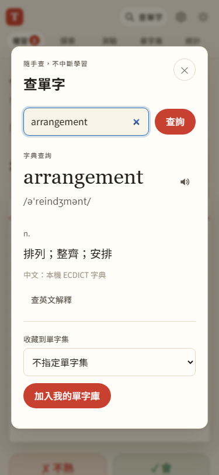

# 第 17 步：英文解釋與例句點字查詢

## 目標

閱讀英文解釋時遇到不懂的字，直接點字查中文、聽發音或收藏，不必離開目前的探索與複習。

## 做法

- 第一階段獨立提交逐字解析 `js/word-tokens.js` 與三項單元測試（`9b2afc5`）。保留原句大小寫、空白、標點、重音拼字、撇號及連字號，查詢值另外正規化。
- 共用 `cardview.js` 將英文解釋及英文例句渲染為行內文字按鈕，淡點狀底線提示可查詢；保留既有發音按鈕。
- 沿用全站查字視窗，自動帶入並查詢被點的字。使用本機 ECDICT，不呼叫 Gemini；免費英文解釋仍需明確按下查詢。
- 收藏沿用既有去重與單字集功能。關閉後恢復原查字按鈕的焦點；資料更新重建卡片時，改找同字按鈕恢復焦點。

## 問題與處理

- 複習的滑卡與點擊會翻面，因此點字按鈕從手勢辨識中排除；透過獨立事件開啟查詢，避免翻面或誤評分。手機測試點擊正面單字來翻面，避免卡片中心剛好落在發音按鈕。
- 收藏新字會改變複習範圍的成員。若相同單字集只是增加字，保留當輪佇列、目前卡與翻面狀態，新字下一輪才加入；刪字或切換範圍仍重新建立佇列。
- 所有來源文字仍經 HTML 跳脫；英文含有 `` 等字樣不會變成可執行標記。
- 第一版不猜測變化形，也不將整段解釋重新送給 AI；字典未收錄時，可手動修改查詢框或查免費英文。

## 測試結果

使用 `webapp-testing` 的 Python Playwright 流程測試隔離的瀏覽器資料，不使用正式 Firebase 或個人金鑰。

- 全部 JS 語法檢查、96 項 Node 單元測試通過。
- `test_inline_lookup.py` 通過桌面、375px 觸控與鍵盤操作：解釋與例句點字、直接顯示中文、收藏與去重、焦點恢復、原卡／待複習數／翻面／SRS／每日紀錄保留、探索選字保留及 HTML 安全顯示。整個流程沒有 Gemini 或 Free Dictionary 請求。
- 回歸通過 `test_explore.py`、`test_step5.py`、`test_library_ui.py`、`test_pronunciation.py`、`test_word_packs.py`，涵蓋詞性間距、滑卡評分、全站查詢、發音及真正離線加入完整單字包。

