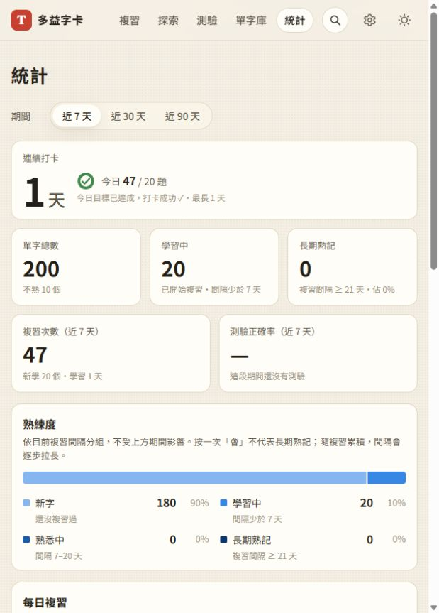
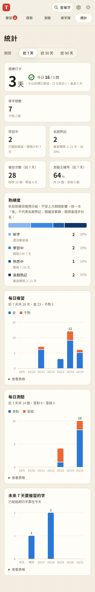

# 第 18 步：讓早期學習進度與熟記門檻清楚可見

## 目標

使用者已複習 47 次，但看到「已熟 0」以為沒有進度。將長期記憶門檻說清楚，也顯示剛開始複習的字數。

## 做法

- 上方新增「學習中」卡片，沿用既有分類：已複習、目前間隔少於 7 天。未複習的新字不算入，間隔 7～20 天仍列為「熟悉中」。
- 「已熟」統一改為「長期熟記」，在卡片與下方分布說明「複習間隔 ≥ 21 天」；不改 SRS、資料格式或門檻。
- 補充熟練度依目前排程分組，不受 7／30／90 天篩選影響，按一次「會」不代表已長期熟記。
- 桌面先列單字總數／學習中／長期熟記，下一排放期間相關統計；手機總數獨占一排，其他數字兩欄排列。
- 依既有版本參數方式更新入口、統計頁／純計算模組與樣式引用，確保原有瀏覽器取得此次介面。

## 測試結果

沿用 `webapp-testing` 的 Python Playwright 流程，Firebase 停用、字典假回應。

- `test_step7.py` 通過：7 字樣本含 2 個學習中、1 個熟悉中、2 個長期熟記及 2 個新字；上方數字與分布一致。期間切換不改變熟練度數量，原有複習與測驗統計、即時更新、圖表鍵盤操作、深色模式均正常。
- 手機 375px 與 320px 無橫向溢出。舊測試使用過時的導覽固定高度，改以實際單行字高加內距判斷換行，保留原本驗證目的。
- 修改的 JS 語法檢查及全部 96 項 Node 單元測試通過。
- 在使用者原有瀏覽器確認：200 字、學習中 20 字、長期熟記 0 字、複習 47 次，既有進度保留。

