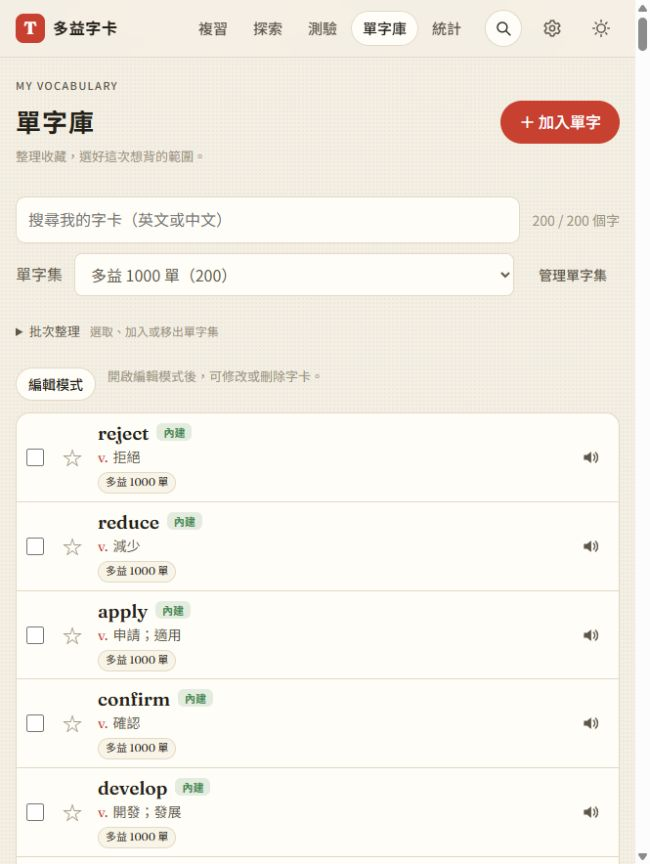
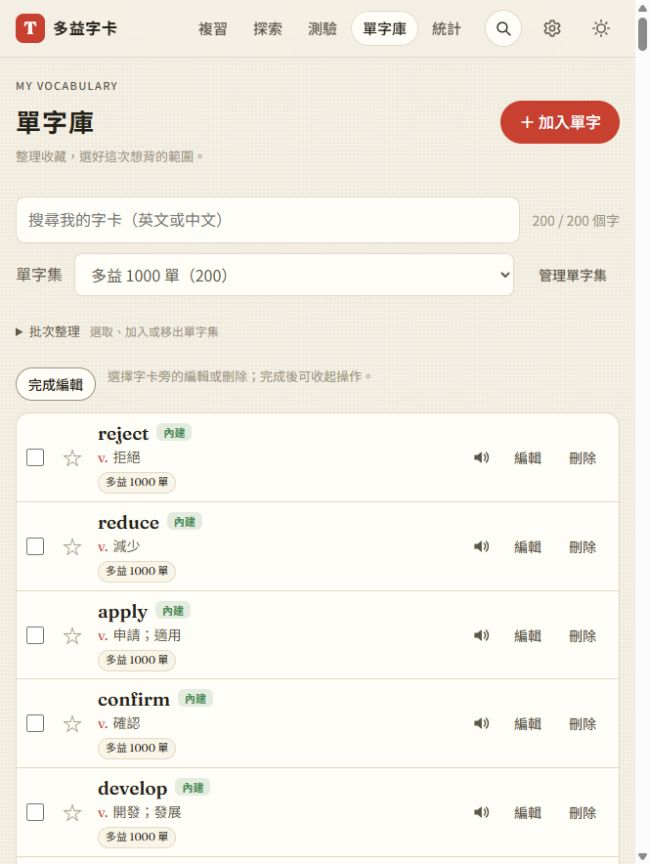

# 第 19 步：單字庫反應速度與編輯保護

## 目標

改善進入單字庫、點星星時的延遲；將每列編輯與刪除預設隱藏，避免誤觸。

## 做法

- 原本每次點星星都重建全部列、重畫分類與單字包等工具。本機星星現在只更新該列的星號、樣式、標籤及 `aria-pressed`；儲存、全站訂閱和同步仍走原流程。
- 清單保留所有字，使用 `content-visibility: auto` 延後畫面外列排版，並設定估計高度；不改搜尋、全選或批次歸類範圍。只解析清單會用到的第一行中文，每次繪製只檢查一次語音支援。
- 增加「編輯模式／完成編輯」，預設隱藏編輯與刪除；事件處理也檢查模式，不能只靠隱藏樣式。星星、發音持續可用。模式只存在本次單字庫頁面，離開再回來恢復關閉，不寫入設定或同步。
- 更新入口、單字庫模組及樣式版本，讓既有瀏覽器取得新介面。

## 測量

隔離的 Chromium 以完整多益內容建立 1,000 字及單字集，同一台電腦測量；單位毫秒，僅為本機樣本，不代表所有裝置。

| 操作 | 修改前 | 修改後 |
|---|---:|---:|
| 進入單字庫並計算清單版面 | 271.5 | 約 40 |
| 標記不熟的同步處理 | 43.8 | 約 5～6.2 |

前後測量保留原儲存流程；穩定的回歸條件是星星操作不替換原列節點，不以固定毫秒門檻判定通過。

## 測試結果

依 `webapp-testing` 的 Playwright 流程，在隔離資料與外部 API 假回應下驗證：

- `test_library_interactions.py`：1000 字完整範圍、星星原節點與焦點、本機儲存、SRS 不變、編輯視窗、開關模式、標記後模式保留、離頁重置、搜尋與375px排版。
- `test_step1.py`、`test_step2.py`、`test_step4.py`、`test_step6.py`、`test_library_ui.py`、`test_word_sets.py`、`test_word_packs.py` 回歸通過，包含背景字典／生成、編輯刪除、分類及真正離線載入。
- 舊測試調整為先開啟編輯模式；畫面外文字的顯示檢查先捲入畫面。`test_step11.py` 的刪除操作也更新入口，這次未重跑 Firebase 模擬器；儲存與同步模組沒有變動。
- 全部 JS 語法檢查與 96 項 Node 單元測試通過。
- 使用者原瀏覽器的 200 字完整保留；預設沒有可見編輯按鈕，開啟模式後顯示 200 個，完成後收起。未改動使用者字卡。

