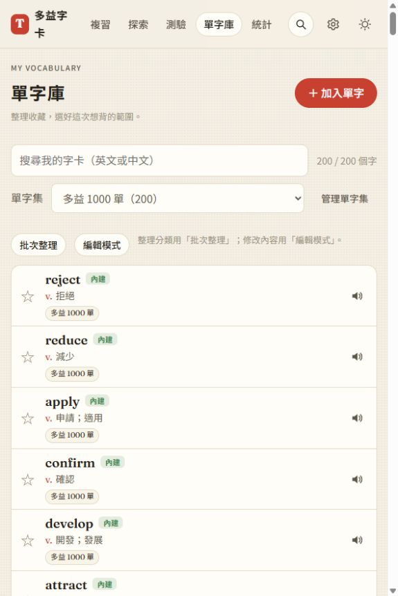
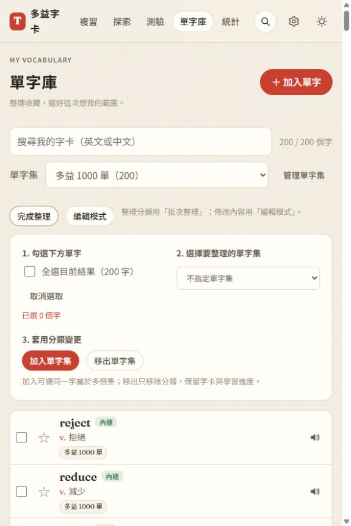
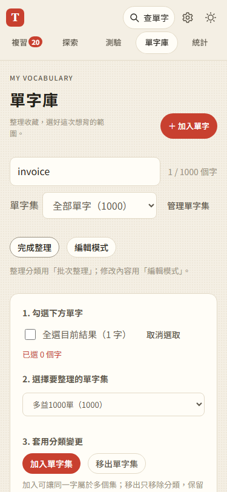

# 第 20 步：批次整理改為按需開啟的三步驟模式

## 目標

原本的批次工具將全選、計數、目的集與兩種動作擠在同一排，而每列勾選框始終可見。讓一般瀏覽維持乾淨，需要分類時才顯示完整流程。

## 做法

- 以「批次整理／完成整理」按鈕取代不明顯的 details 展開入口，使用 `aria-expanded` 與 `aria-controls` 表達狀態。
- 預設隱藏每列勾選框；開啟整理後顯示三步驟：勾選下方單字、選擇單字集、加入或移出。加入／移出的既有資料操作與 SRS 不變。
- 全選明示目前結果的字數，提供「取消選取」及即時已選數量。未選字或未選單字集時禁止套用。選中列以背景提示。
- 完成整理清空暫存選取並收起方框；開啟編輯模式會先結束整理，反向切換亦然，避免兩種操作混在一起。
- 全選與取消選取只更新 checkbox，不重建整份清單；保留上一輪星星局部更新與畫面外延後排版的效能改善。
- 桌面前兩步並排、套用區在下方；手機直排。手機一般瀏覽與批次選字維持緊湊單列，僅編輯模式讓操作按鈕另起一排。

## 測試結果

沿用 `webapp-testing` 的 Python Playwright 流程，以隔離資料與假 API 驗證。

- `test_library_interactions.py` 通過：預設隱藏方框、進入整理、已選數量、取消選取、搜尋後只全選一筆結果、按鈕啟用條件、完成後清空、兩模式互斥、編輯與星星仍正常、320／375px 無橫向溢出。
- `test_word_sets.py`、`test_library_ui.py` 通過實際加入／移出、搜尋範圍、分類保留與全站查詢回歸。
- JS 語法與 96 項 Node 單元測試通過。1000 字樣本的進頁約 38～39ms，星星約 5ms，原列節點保留；只記錄觀察值，不以固定時間判定測試。
- 使用者原有 200 字的本機頁面確認：預設所有方框隱藏，開啟後顯示三步驟與目前 200 字結果；未套用任何分類變更。

