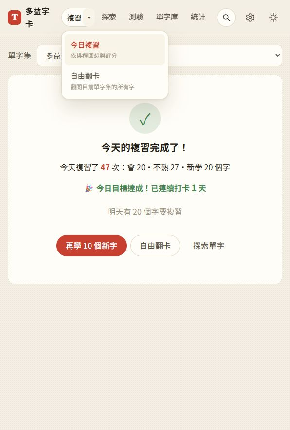
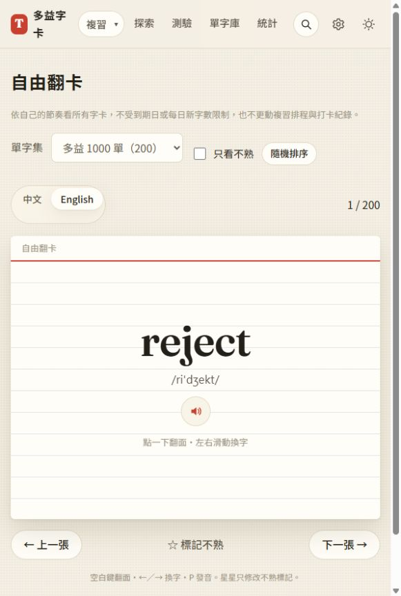
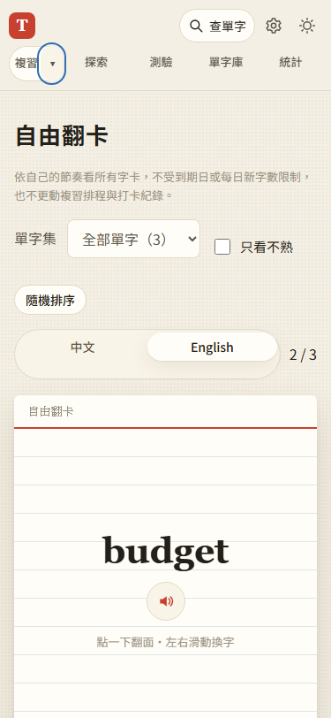
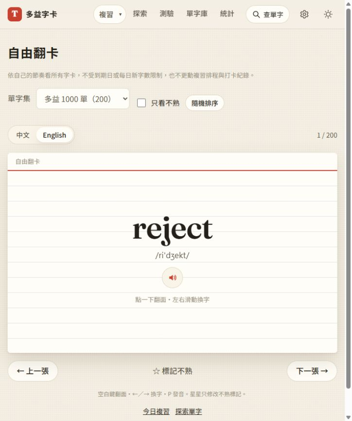

# 第 21 步：保留探索，另提供自由翻卡

## 目標

使用者希望保留翻卡方式瀏覽所有字，不只靠直接閱讀的探索，也不必等字卡到期。

## 做法

- 新增 `js/views/free-cards.js` 與 `#/free`，沿用共用卡面、中英切換、發音及點字查詢；範圍來自目前單字集，不限制到期或每日新字數。
- 提供前後換字、循環、隨機排序、只看不熟及標記不熟。桌面方向鍵與手機滑動只換字；點擊與空白鍵翻面。換字回正面。
- 瀏覽不匯入評分／每日紀錄模組；星星只更新原卡標記。隨機順序、篩選、翻面與目前位置只屬於自由頁面，離開後清除；共用背面語言設定。
- 「複習」直達原本今日複習，旁邊 ▾ 展開兩種入口。選擇後自動收起，支援 Escape 返回焦點、外側點擊及目前模式標示；選單鍵盤事件不穿透評分與換字。
- 完成畫面將「自由瀏覽字卡」改為「自由翻卡」，另保留「探索單字」入口。探索原 `#/cards` 與排程 `#/review` 不變。
- 離頁時解除手勢及訂閱，並防止尚未結束的滑動動畫回呼覆寫新頁面。

## 測試與處理

依 `webapp-testing` 的 Playwright 流程，使用隔離資料及假字典回應，不使用正式帳號或個人 API。

- `test_free_cards.py` 通過：未到期的三字仍全部可翻閱、翻面／換字、隨機、中英切換、單字集與空範圍、不熟篩選、點字／例句發音、完成入口及選單鍵盤操作。
- 比對完整 SRS 與每日紀錄，確認上述操作與手機真實觸控滑動不會改動進度；320／375px 自由頁與選單沒有橫向溢出。
- 回歸通過 `test_step5.py`、`test_explore.py`、`test_inline_lookup.py`、`test_step7.py`、`test_library_ui.py`、`test_word_packs.py`。離線測試新增真正離線重新整理後翻閱 1000 張字卡。
- 導覽加入選單按鈕後，容器會隨最高的按鈕伸展；統計測試改量測文字本身來檢查換行。320px 圖表檢查等待 ResizeObserver 完成，避免剛切尺寸的瞬間誤報。
- 全部 JS 語法與 96 項 Node 單元測試通過。
- 使用者原有 200 字的本機頁面確認新選單與「1 / 200」自由翻卡，未變更字卡或評分。

## 排版修正：中英切換被張數段落撐高

使用者指出中英切換膠囊高度異常。自由翻卡的 `.card-toolbar` 沿用 flex 預設 stretch，旁邊張數 `
` 的上下 margin 把整排與切換容器一起撐高。

- 自由頁工具列改為垂直置中，張數段落 margin 歸零，讓切換維持內容高度；樣式限定自由翻卡，不影響今日複習。
- `test_free_cards.py` 新增 1280／768／375／320px 幾何量測，驗證外框只比文字選項高出內距與邊線，且與張數中心對齊；全套自由翻卡測試通過。
- 使用者本機頁重新載入後確認切換高度約 40px、張數 margin 為 0。樣式版本更新為 `free-cards-2`。

