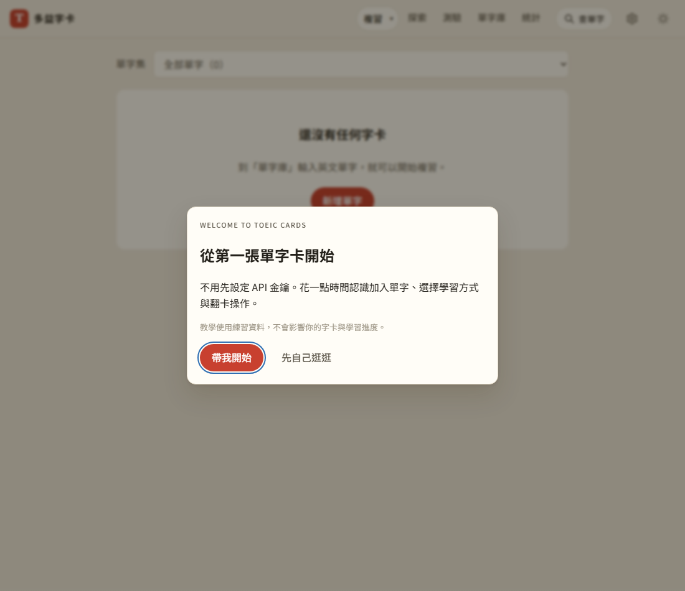
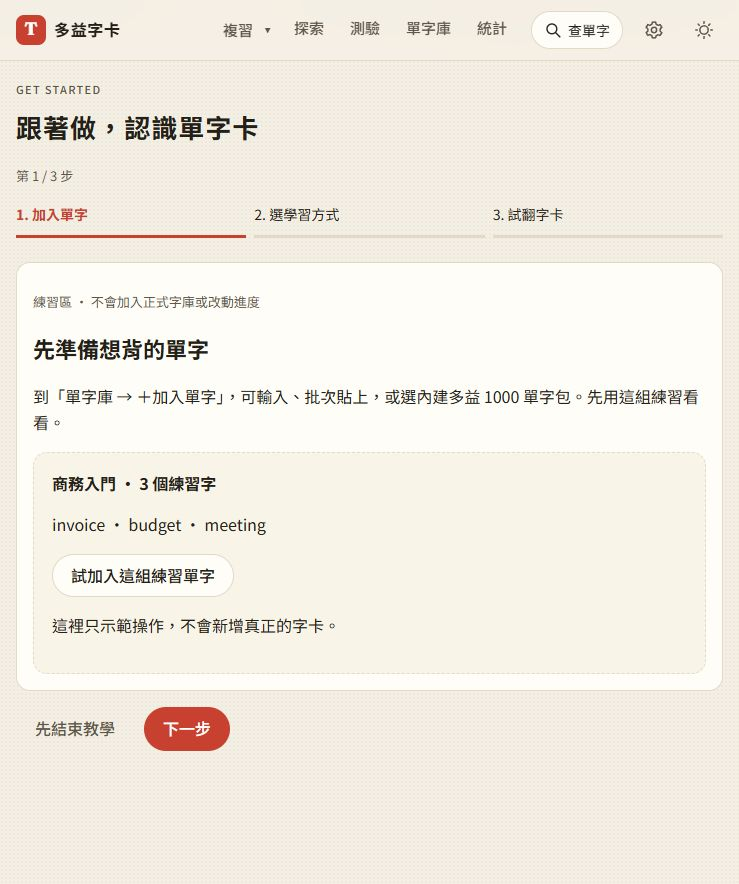
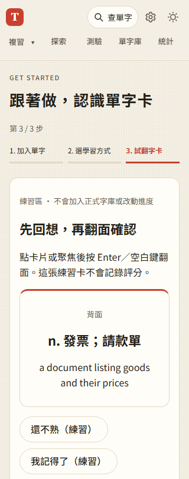

# 第 22 步：首次歡迎、三步練習與可重看的教學

## 目標

新手能知道怎麼加入第一組單字、區分三種學習方式並試翻一張卡；舊使用者不被新的教學打斷。

## 分階段實作

- 先將新舊使用者判斷抽為 `onboarding-state.js`，以三項純函式測試驗證空資料、既有資料、有效狀態及損壞紀錄；獨立提交 `415fa59`。
- `onboarding.js` 管理本機 `toeic-cards:onboarding`。有 started／completed／skipped 不再自動提醒；無教學紀錄且無字卡、單字集或每日紀錄時顯示歡迎視窗，否則只顯示可關閉的提示列。
- 新人可選「帶我開始／先自己逛逛」，Escape 也會記為略過。已有其他視窗開啟的直達單字包不疊加歡迎視窗；直接開教學頁亦不另跳歡迎。
- `#/help` 提供完整教學與常見操作，設定頁提供「查看使用教學／重新觀看導覽」。
- 三步練習：模擬加入商務入門三字、選擇今日複習／自由翻卡／探索、點擊或鍵盤翻卡與試評分。可上一步、下一步或提早結束，不強制完成示範動作。
- 練習頁沒有 store 寫入、SRS 評分或每日紀錄操作；正式單字包與學習模式使用明確連結進入，不自動新增字卡，也不需要 API 金鑰。
- 細部步驟只保留在目前頁面；完成／退出會移除 `?tour=1`，重新整理不重啟。教學狀態不放入雲端同步或備份；儲存失敗時仍可在本次頁面完成。

## 問題與處理

- 自動歡迎視窗會攔住既有空資料測試的點擊。新增 `onboarding_helpers.py`，讓舊功能測試先建立已略過教學的本機狀態，維持原本測試目的；新手流程另用真正空白瀏覽器測試，沒有在產品加入測試用開關。
- 教學開始後不再自動打擾，即使尚未完成也可從設定重看；更新教學不會強制清除舊狀態。
- 手機第三步縮小中文詞義字級，避免單一字落到下一行；選擇學習方式在窄螢幕直排，深色模式沿用全站色彩。
- 設定與入口新增版本參數，避免舊設定頁沒有教學入口。

## 測試結果

使用 `webapp-testing` 的 Python Playwright 流程，使用隔離資料與字典／Gemini 假回應，不登入正式 Firebase。

- `test_onboarding.py` 通過首次歡迎、開始、略過、Escape、完成後重整、前後步驟、選擇模式、鍵盤翻面、練習評分、設定重看、舊字卡及僅學習紀錄的提示列、直接教學／單字包連結與儲存受阻。
- 比對正式字卡、單字集、設定及學習紀錄，確認練習操作前後完全一致；練習沒有外部 API 請求。
- 歡迎與導覽在 320／375px 不溢出，另檢查手機三種模式及深色畫面。
- 回歸通過 `test_step1.py`、`test_step2.py`、`test_step7.py`、`test_library_ui.py`、`test_free_cards.py`、`test_inline_lookup.py`、`test_library_interactions.py`、`test_word_packs.py`。其中 `test_inline_lookup.py` 並行執行時初次載入逾時，單獨重跑完整通過。
- `test_word_packs.py` 新增真正離線重新整理後的教學翻面與練習評分，確認教學所需依賴也已快取。
- 全部 JS 與 Python 語法檢查、99 項 Node 單元測試通過。其他既有測試檔只更新已略過教學的初始資料；本次未重新執行全部 Firebase／正式部署測試。
- 使用者原有瀏覽器確認只有非阻擋提示，進教學後顯示第一步。沒有更動使用者字卡或學習進度。

