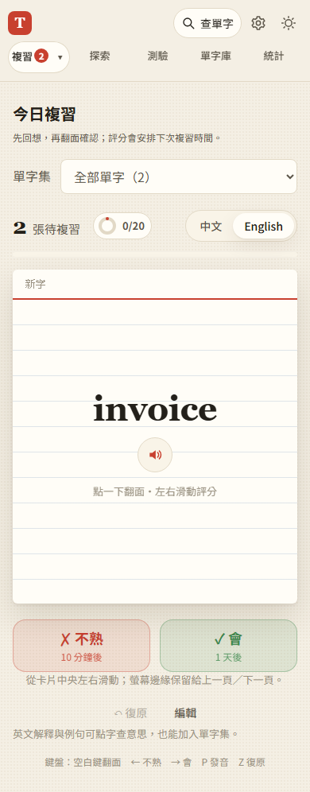

# 第 24 步：手機滑卡與瀏覽器導覽手勢分工

## 目標

改善使用者回報 iPhone Safari 與主畫面 App 的導覽動畫和卡片左右滑動互搶，保留上下捲動、點字查詢及發音。

## 做法

- 今日複習與自由翻卡共用 `js/swipe.js`，只在卡片內確認單指水平滑動後取消預設觸控動作，搭配 `pan-y` 與橫向 overscroll 限制。未全頁攔截觸控，也未改寫瀏覽歷史。
- 左右各 24 CSS px 的觸控起點不啟動拖卡，留給瀏覽器導覽；移動途中經過邊緣仍可完成原本的滑卡。手機顯示從卡片中央滑動的提示。
- 指標取消、多指、失焦、切至背景或切頁時歸位；飛出動畫的舊回呼失效，避免延遲評分或換字。今日複習重畫與離開時新增解除手勢監聽，和自由翻卡一致。
- 自由翻卡補上拖動時取消 transition、放手後飛出／回彈的樣式，並遵守減少動態效果設定。
- 更新入口、樣式、兩個頁面與共用手勢模組的版本參數，讓既有瀏覽器取得本次版本；沿用離線快取流程。

## 問題與解法

- 新增捕捉遺失處理後，原本子元素的隱式 capture 轉交給外層也觸發了取消，造成滑動無法完成。以瀏覽器事件紀錄定位後，限定只處理外層本身的 `lostpointercapture`。
- iOS 導覽由瀏覽器／系統控制。局部 `touchmove` 攔截是改善措施，不能保證所有版本在系統接管前都可攔截；邊緣保留與中斷歸位提供穩定退路。

## 測試結果與限制

使用專案 `webapp-testing` 的 Python Playwright 流程，隔離資料與外部 API，不登入正式 Firebase。

- `test_swipe_isolation.py`：左右邊緣起點不拖卡／評分、水平觸控取消預設動作、真正上下捲動、touchCancel／第二指／失焦歸位、飛出途中切頁不評分、點字／翻面／發音與窄螢幕提示。
- 回歸 `test_step5.py`、`test_free_cards.py`、`test_inline_lookup.py`、`test_word_packs.py` 通過，包含真實 CDP 觸控、滑鼠、鍵盤與真正離線重新整理後的自由翻卡、逐字查詢及教學。
- 全部 JavaScript 語法檢查、103 項 Node 單元測試通過。
- **尚未驗證**：iPhone Safari 與主畫面 App 的原生上一頁／下一頁動畫。Chromium 手機模式不是 iOS 系統模擬，仍須真機從卡片中央及螢幕兩側分別操作。此版本不宣稱完全停用系統導覽。

