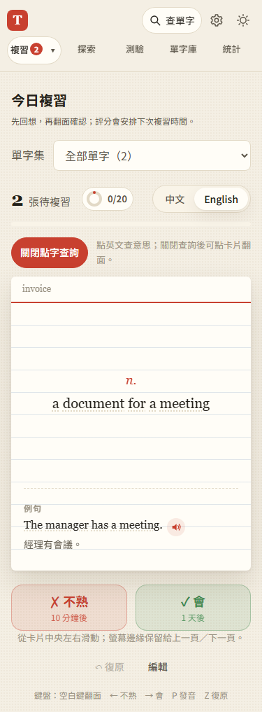
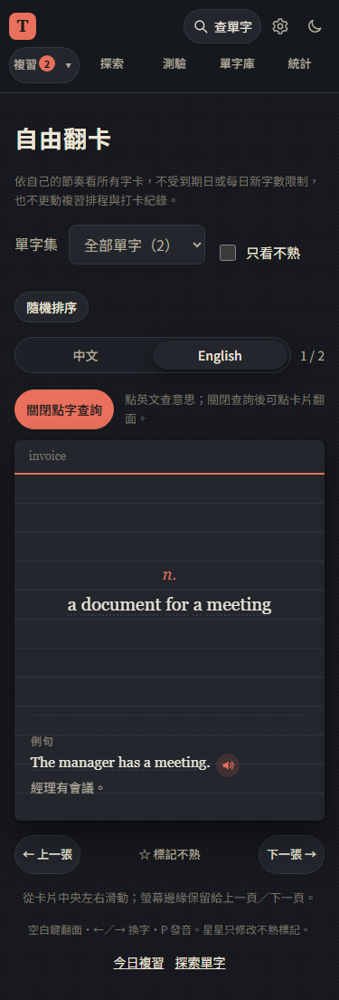

# 第 25 步：手機查字模式

## 目標

使用者確認滑動動畫已改善，但在手機想點卡片翻面時會誤開查字。將翻面與點字查詢分成明確模式，維持既有收藏與學習進度保護。

## 做法

- `js/card-lookup-mode.js` 管理單頁、單卡的暫時狀態，供今日複習與自由翻卡共用。觸控裝置預設關閉，桌機沿用直接點字；探索頁不加模式，仍直接查字。
- 關閉時英文解釋與例句渲染成經 HTML 跳脫的純文字，沒有隱藏的逐字按鈕，點文字也可翻面／拖卡。發音仍獨立運作。
- 卡片上方提供至少 44px 高的「開啟點字查詢」按鈕，以 `aria-pressed`、文字及色彩表示狀態。開啟直接顯示背面，英文恢復逐字按鈕，空白處不翻面；關閉仍保留目前面。
- 換卡、評分、復原、切換單字集／背面語言、離開或重新整理重設；同一卡的背景資料更新或查字收藏不重設，也不改當輪複習佇列。
- 模式不寫入 store、localStorage、備份或同步。更新入口、兩個翻卡頁及共用 cardview 的版本參數；新共用模組納入既有 PWA 自動依賴快取。

## 問題與解法

- 不能只把逐字按鈕設成 disabled，因為點擊與鍵盤行為容易和外層翻卡衝突。直接依模式渲染純文字或可查字按鈕，讓手勢與無障礙操作有一致語意。
- 收藏會重畫原卡。模式以單字、單字集與背面語言辨識，而非每次重畫都清除；評分與手動換卡則明確重設，包含同一個字再次出現的情況。
- 舊手機點字測試原本直接點英文，更新成先啟用模式；探索與桌機測試維持直接查詢。手勢回歸的 class 比對改成檢查 `is-flipped`，不依賴重畫後的空白字元。

## 測試結果

使用專案 `webapp-testing` 的 Python Playwright 流程，隔離資料、模擬外部 API，不使用正式 Firebase 帳號或個人金鑰。

- `test_card_lookup_mode.py` 驗證兩種手機翻卡頁的預設翻面、開關、空白區、發音、收藏後模式與原卡保留、SRS／紀錄／設定不變、換卡及切語言／重整重設、桌機／探索直接點字，以及 320／375px、深色與真正離線重整後的模式和中文查詢。
- 回歸 `test_inline_lookup.py`、`test_free_cards.py`、`test_swipe_isolation.py`、`test_step5.py`、`test_word_packs.py`，保留原滑動、鍵盤、點字收藏與離線能力。
- 全部 JavaScript 語法與 103 項 Node 單元測試通過。iPhone Safari／主畫面 App 的觸控手感仍需使用者真機確認。

