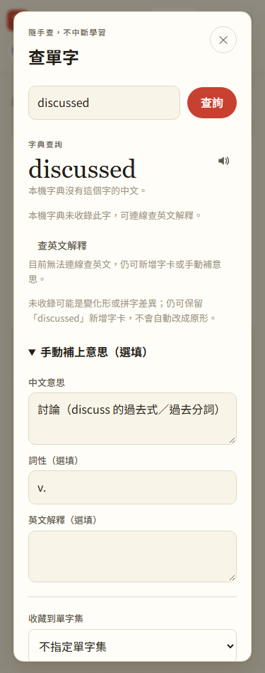

# 第 27 步：未收錄字仍可保留拼字建卡

## 目標

使用者想收藏 `discussed`，即使本機字典只有 `discuss`，也不必改存原形。查不到與外部字典失敗，不應阻擋建立自己的字卡。

## 做法

- 全站查字視窗在未收藏且沒有中文的結果旁，說明未收錄可能是變化形或拼字差異，不自行判錯或替換。
- 新增可展開的「手動補上意思（選填）」：中文、詞性、英文解釋。未填也能照原拼字建空白卡；存完提示可由單字庫編輯或使用 AI 內容工具補內容。
- 手動內容標記 `src: user`，延用後續 AI 不覆蓋的保護；查字建卡依舊不偷偷呼叫 Gemini。已有字卡不顯示這些新增欄位，分類動作也不覆寫原卡。
- 英文字典查詢造成重畫時保留手動草稿，改查另一個字才清空；新增後改顯示自己的字卡，讓使用者看得到已存內容。
- 入口、字典／生成／共用字卡與相關頁面引用統一更新版本參數，避免已開網站混用新舊佇列或查字程式；資料與進度不用清除。

## 問題與解法

- 未收錄不是拼字檢查結果；保留像 `disscussed` 這種輸入也不擅自更改，但提醒使用者確認。第一版不自動把原形意思冒充成變化形字義，也不加入不可靠的去字尾猜測。
- 查字後原本重新渲染字典結果，可能看不到剛填的手動內容；新增成功後顯示自己的字卡，並保留來源標示。

## 測試結果

使用專案 `webapp-testing` 的 Python Playwright 流程，外部 API 都是假回應，不登入正式 Firebase。

- `test_unknown_words.py`：未收錄 `discussed` 原樣收藏、手動欄位的 user 來源、英文成功與失敗後草稿保留、空白卡提示、原拼字保留、HTML 安全顯示、原學習紀錄不變及重整後內容仍在。
- 回歸 `test_library_ui.py`、`test_word_sets.py`、`test_word_packs.py`，包含全站查字、指定分類、去重、既有卡不覆寫與新版依賴離線快取；效能回歸另見第26步。
- JavaScript 語法與 103 項 Node 單元測試通過。

