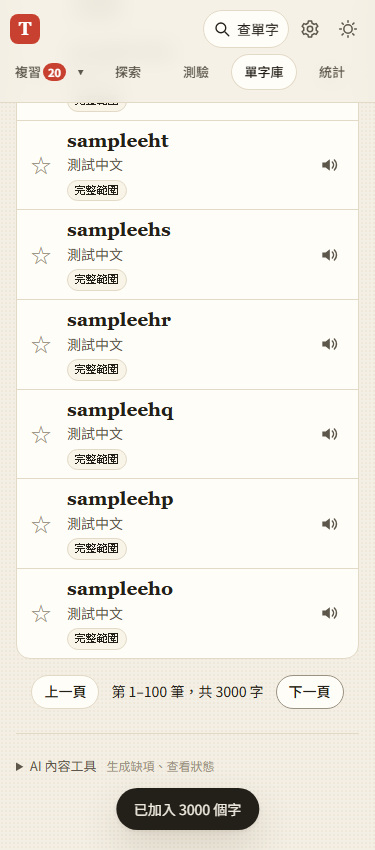

# 第 29 步：大量單字庫的分頁與局部更新

## 目標

改善進入單字庫時的延遲。原本即使只閱讀螢幕上的幾個字，仍會建立全部字卡的 DOM；字典或 AI 回填時也會重建整份清單。

## 做法

- 每頁固定 100 列，搜尋仍走訪完整範圍；換搜尋／單字集回第一頁，刪除最後一頁後修正頁碼。
- 用 `Map<id, {node, html}>` 對照現有列，只有畫面內容改變才換列；未變列保留節點與焦點。
- 選取用 `Set<id>`，跨頁保留，全選及批次分類涵蓋完整結果。
- 分類用 `Map<word, sets>` 反向索引，一次走訪成員建立標籤與計數；批次去重也使用 Set。
- 移除原本的 `content-visibility` 列延後繪製，分頁後不再需要依估計高度處理整份清單。

## 驗證

使用 `webapp-testing` 的 Playwright 流程。`test_library_paging.py` 測 3,000 張卡、跨頁勾選、全選全部分類、頁外搜尋、局部更新保留焦點、最後一頁刪除，以及 320／375／768px 排版。

本機 Chromium 在 CPU 慢 4 倍的模擬下，3,000 字進入清單約 141ms，僅建立 100 列／1,400 個子節點。這是測試環境的觀測值，不代表所有手機的固定耗時。

原有 `test_library_interactions.py`、批次新增、分類及單字包測試配合分頁語意檢查完整資料與當頁列數。批次新增 100 字仍只寫入單字儲存兩次；觀察器以更新批次及列異動量共同驗證，避免把每列 DOM 異動誤算成整份清單重建。

