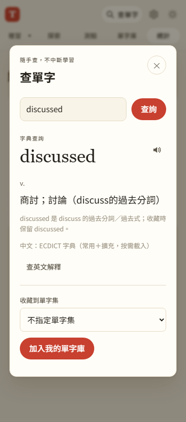

# 第 30 步：擴充中文字典與有上限的按需載入

## 目標

讓 `discussed`、`discussing` 等變化形及更多專業詞可查中文，同時避免每台手機載入整本大型字典。

## 做法

保留原本 32,812 字的常用字典，與專案勘誤優先查詢；查無才讀擴充資料。由本機既有 ECDICT CSV 透過 OpenCC s2twp 產生 672,241 筆字條（含片語、專業詞與明確記錄的詞形），共 42,061,381 bytes，約 40.1 MiB。來源雜湊與統計存於 `data/dict/extended-v1/meta.json`。

- FNV-1a 32-bit 雜湊取模 1024，直接計算分片檔名，不必先下載完整單字索引。
- 1,024 片平均約 40 KiB，最大 47,730 bytes；瀏覽器只載入所需檔案。
- `dictionary-data.js` 以 Map 實作 LRU：記憶體最多保留 16 個擴充分片，同片進行中請求共用 Promise。HTTP、解析或連線失敗不留下空字典快取。
- 大量查字最多四個工作者並行；字典請求八秒逾時，可重試。填入資料仍整批保存，並保護已填或手動編輯的欄位。
- Service Worker 將擴充資料放入獨立快取，以 FIFO 最多保留 128 片，序列化寫入避免競態；常用字典的 26 檔離線下載仍獨立保留。
- 從 ECDICT 的 `exchange` 讀取原形與詞形代碼，優先保留精確字條。對來源明確記錄但沒有獨立字條的詞形補 541 筆。查詢視窗顯示原形關係，收藏保留原拼字；不猜測移除字尾，也不把 `disscussed` 改成 `discussed`。

產生流程與授權見 `data/dict/README.md`。

## 遇到的問題與解法

- 整本字典約 40 MiB，不能讓每台手機整本下載：用雜湊分片直接算出檔名，只取需要的那一片，記憶體與離線快取都設上限（見上方做法）。
- 擴充字典走「有快取就用快取」，重產資料時舊檔可能和新檔混用：檔名包含 `extended-v1`，未來重產資料須使用新資料版本及對應快取名稱。

## 測試結果

使用 `webapp-testing` 的 Playwright 流程。`test_dictionary_scale.py` 實際查 `discussed`／`discussing`、收藏原拼字、合併同片請求；重新整理以清除模組記憶體後真正離線查字，確認未快取檔提示載入失敗、恢復連線可重試。實際讀取 130 片後確認快取只留 128 片、舊片淘汰、常用字典仍在。

Node 測試逐一核對全部 672,241 筆的前端雜湊與中文內容、精確詞形、錯字未被產生，以及 LRU 淘汰／失敗重試。全套 Node 測試共 108 項通過。另回歸既有查字、100 字批次新增、手動建卡、分類、單字包與手機查字模式。

## 限制

新增罕見字第一次需連線取得分片；擴充快取被淘汰後也需重新取得。來源不是拼字檢查器，也不保證每個字都有音標或符合多益語境。英文解釋仍由既有免費 API 或明確啟用的 AI 工具提供。本次沒有把字卡儲存改為 IndexedDB，極大量字卡的全量序列化仍可能成為下一個瓶頸。

