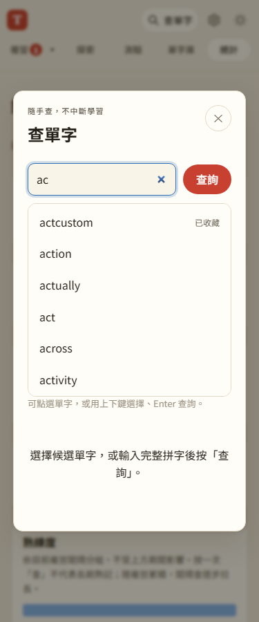

# 第 31 步：查單字的輸入候選

## 目標

讓「查單字」可以在輸入 `a` 時看到 `apple`、輸入 `ac` 時看到 `act`，不必先拼完整再送出；保留直接查詢自訂拼字的能力。

## 做法

- 在查字視窗加入最多 8 個候選，按開頭匹配。常用字及來源詞頻優先；單字母另挑一個常見入門字，如 a → apple。最多三個已收藏字優先顯示並標記。
- `tools/build_suggestions.py` 從既有 672,241 字條與 ECDICT 詞頻產生獨立候選索引，不載入字義。約 99.4 KiB 的路由索引記錄短前綴候選；較大的開頭繼續分割，4,193 份葉片每份最多 32 KiB，合計約 10.3 MiB，按需取得。
- 葉片預先按候選順序排列，在固定大小檔案內做前綴比對；沿前綴路由尋找檔案，不掃描精確查字的 1,024 個雜湊分片。索引生成流程不改動既有字典。
- 輸入延遲 150ms 才查候選，同片請求合併；葉片記憶體 LRU 最多 8 片。Service Worker 的候選快取獨立限制 32 片；路由索引保留於不受此淘汰影響的常用字典快取。
- 使用 combobox／listbox 與 aria-activedescendant。滑鼠／觸控可選字，上下鍵移動、Enter 查選中的字；沒有選中時 Enter 直接查原輸入。Escape 先收候選，再按才關閉視窗。
- 每次輸入、送出及關閉都使舊候選回應失效；查字本身也會取消舊結果，避免輸入已改卻收藏前一個字。輸入法組字期間不發候選請求。

## 問題與解法

手機點候選時，瀏覽器可能先把焦點移出輸入框，才送出 click。若立刻清空清單，點擊會失效；因此讓候選可接收指標焦點（tabindex=-1，不加入 Tab 順序），焦點移入清單不視為離開查詢，選取後回到輸入框。仍允許清單上下捲動；桌機滑鼠則直接保留輸入框焦點。

## 驗證

使用 `webapp-testing` 的 Playwright 流程。`test_lookup_suggestions.py` 測 a／ac 示例、觸控與桌機滑鼠、鍵盤、收藏標記、最多 8 個、快速輸入的回應競態、清空、Escape、輸入法組字、未收錄字直接查詢、離線重整、恢復連線，以及 320／375／768px 排版。實際載入 33 份葉片後確認只留 32 片且路由索引仍在；輸入不呼叫 Gemini／Free Dictionary、不新增字卡或改學習紀錄。

新增六項 Node 測試，核對全部索引字條與前綴、32 KiB 上限、候選合併、請求去重、離線重試及物件原型名稱。全套共 114 項通過，並回歸原查字視窗、手動建卡與擴充字典的離線流程。

## 取捨

候選按前綴匹配，不做模糊拼字修正；只顯示前八個，不代表字典只有這些字。越多輸入可縮小範圍，也能直接按查詢。第一次使用或候選片已被淘汰時需連線；離線仍保留收藏字候選，並提示未快取的字典索引。

