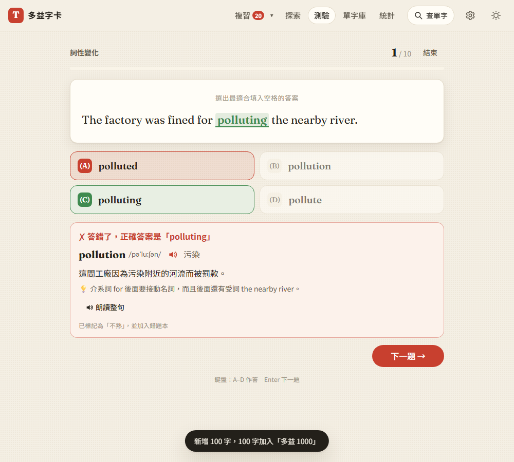

# 第 32 步：詞性變化題

## 目標

多益 Part 5 很大一部分在考「詞性變化」：同一個字的四種形式（approve／approval／approving／approved），看句子結構選出正確的那一個。網站原本的 Part 5 是「不同單字選一個」，沒有練到這個題型。

## 做法

- **新題型 `forms`**：沿用 Part 5 的作答畫面（挖空句子、A–D、鍵盤、朗讀整句、中文翻譯與解析）；答錯一樣標記不熟、進錯題本、計入每日目標。
- **題目來源**（`js/forms-quiz.js`，依序）：
  1. 內建題庫 `data/packs/toeic-1000-forms.json`：多益 1000 單字包的 471 個字，不用金鑰、離線可用；第一次進測驗頁時在背景下載。
  2. 字卡上存過的 AI 題目 `formQs`：最多 3 題，輪流使用最久沒考過的。
  3. 有 Gemini 金鑰時，替還沒有題目的字出題（每 10 個字一次請求）。
  沒有金鑰時只從有題目的字出題，不會考到一半卡住；範圍裡完全沒有可考的字時，模式停用並說明原因。
- **題庫的製作**：`tools/form-questions/01.txt`～`10.txt` 每行一題（目標字｜句子｜答案｜錯誤選項｜翻譯｜解析），`tools/build_form_questions.py` 逐題檢查後編成 JSON。每題都有讓答案唯一的文法線索：助動詞後接原形、has 後接過去分詞、冠詞後接名詞、副詞位置、時間副詞決定時態等。
- **品質檢查**（`normalizeFormQ`，建置腳本和網站共用同一套規則）：只有一個空格、四個選項不重複、都是同一個字族、任何選項都不能已經出現在句子裡（[decisions #93](../decisions.md)）。
- **備份與同步**：`formQs` 經過和 Part 5 題目相同的清理；錯題本接受 `forms` 題型。
- 修改的模組加上版本參數 `forms-1`，避免舊快取的 `quiz.js` 少了新函式導致測驗頁打不開。

## 遇到的問題與解法

- **原本「不用 AI」的做法行不通**：打算直接把字卡例句挖空、用「詞性變化」欄位當選項。檢查資料後發現兩個問題：(1) 單字包的「詞性變化」大多是複數、過去式這類詞形，真正跨詞性的字族（approve → approval）只有約 90 個字；(2) 例句沒有線索時會有兩個正確答案，例如「Our company **opened** a branch」裡 opens 也對。只取文法上答案唯一的位置，1000 字只能出 67 題。向使用者說明後改成「內建題庫＋AI 補充」（[decisions #92](../decisions.md)）。
- **撰寫題目時避開的陷阱**：
  - 兩個選項都合文法：例如 brand strategy 和 branding strategy 都對，這種字就不出題。harmful／harmless、economic／economical 這種「詞性一樣、只有意思不同」的組合，也不放在同一題。
  - 審題時抓到一題只靠意思判斷（Our yoga ___：instructor 和 instruction 都是名詞），改成只有一個名詞的選項組合。
- **同字族檢查太嚴**：payment 的 paid 和 payment 開頭只有 pa 相同，被誤擋。規則改成「和目標字相同，或和其他已確定同字族的選項相同」（paid 透過 pay），網站和建置腳本一起改，並補單元測試。

## 測試結果

使用 `webapp-testing` 的 Python Playwright 流程，Gemini 用假回應。

- **新增 `tests/test_forms_quiz.py`（22 項）**：沒有字時停用；單字包的字沒有金鑰也能考、10 題全部來自題庫且不呼叫 Gemini；A–D 鍵盤作答、答錯顯示正確答案、翻譯與解析、朗讀整句會把答案填回；進錯題本、標記不熟、計入每日紀錄、結果頁、錯題本重做；自己加的字沒有金鑰時停用並說明；有金鑰時一次請求出題並存起來、再考不再呼叫；AI 混進別的字的題目被丟掉；題庫載入後判斷範圍裡沒有內建題目的字；手機 375px 版面。
- **新增 `tests/unit/forms.test.mjs`（9 項）**：同字族判斷、題目檢查、出題打亂選項、題庫解析、測驗模式檢查、AI 提示、備份與錯題本清理。全套單元測試 123 項通過。
- **回歸**：測驗、Part 5、備份、離線、資安、發音、自由翻卡、每日目標、單字包、跨裝置同步（Firebase 模擬器）全部通過。

