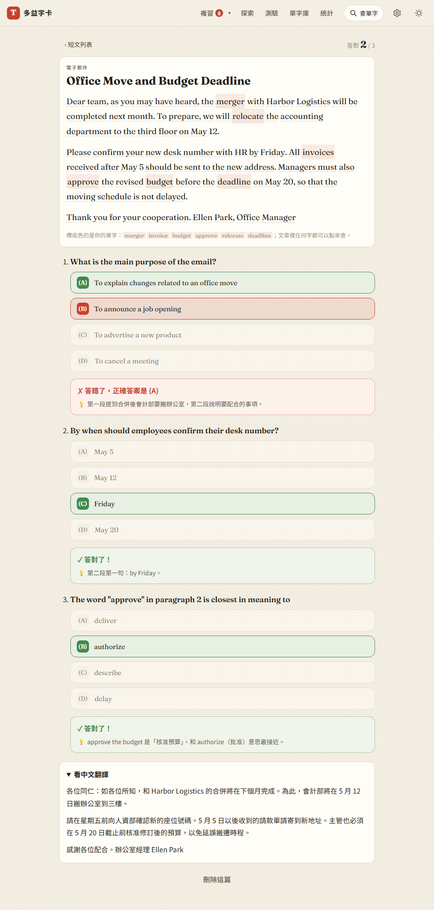

# 第 33 步：多益短文閱讀（Part 6／7 風格）

## 目標

使用者原本想「匯入新聞、點字收藏」，後來決定以多益為主，改做多益風格的短文閱讀：用**自己正在背的單字**讓 AI 寫一篇商務短文（Email、公告、廣告、報導、公司備忘錄），附 Part 7 閱讀理解題。一方面練閱讀，一方面在文章情境裡複習單字。

## 做法

- **入口**：測驗首頁新增「短文閱讀（Part 6／7）」，進入 `#/reading`（`js/views/reading.js`）。
- **產生短文**：從目前單字集挑 6 個字，「不熟」的優先、其次是學習中的字；可選文章類型或隨機。一次 Gemini 請求回傳整篇（[decisions #94](../decisions.md)）。
- **純邏輯**（`js/reading.js`，有單元測試）：挑字、組 AI 提示、檢查回傳格式（60～450 字、3～4 題、四個不重複選項、答案 0～3）、只保留真的出現在文章裡的目標字（變化形也算，例如 approve 對到 approved）、計分。
- **閱讀**：文章裡每個英文字都可以點來查（沿用全站查字視窗，可以直接收藏）；自己的字加底色標示，下方列出這篇用到哪些字。
- **作答**：每題選完立即顯示對錯與中文解析，計入每日測驗量；全部答完才能看中文翻譯，避免先看翻譯再作答。
- **儲存**：存在這台裝置，最多 20 篇，重新整理後作答紀錄還在；可以刪除。
- 沒有金鑰時仍可閱讀已存的短文，只是不能產生新的，畫面會說明並提供設定連結。

## 遇到的問題與解法

- **離開頁面時 AI 還在寫**：如果請求完成時使用者已經切到別的頁面，原本的寫法會把短文頁畫到目前的頁面上。加上「頁面是否還在」的旗標，離開時也會取消請求。
- **截圖裡的導覽列**：整頁截圖時，置頂的導覽列會出現在圖片中間。開發紀錄的截圖改成截圖時暫時取消置頂。
- **測試用的假短文**：一開始用重複的句子湊字數，截圖看起來不自然；改寫成一封真實的搬遷通知 Email，把測試用的 8 個字自然地放進去。

## 測試結果

使用 `webapp-testing` 的 Python Playwright 流程，Gemini 用假回應。

- **新增 `tests/test_reading.py`（17 項）**：測驗首頁入口；沒有金鑰時不能產生並說明；一次請求產生 Email、不熟的字優先；標題與段落、自己的字有標記、題目；點文章裡的字打開查字視窗；答錯顯示正確答案與解析、每題計入每日測驗量、答完顯示分數與中文翻譯；重新整理後保留；AI 回傳不完整時不存並顯示錯誤；AI 回傳的 HTML 只當文字顯示；刪除；手機 375px 版面。
- **新增 `tests/unit/reading.test.mjs`（7 項）**：挑字順序、提示內容、變化形比對、格式檢查、存檔清理（id 格式、作答紀錄範圍、最多 20 篇）、計分。全套單元測試 130 項通過。
- **回歸**：資安（CSP 檢查加入閱讀頁，沒有違規）、測驗、詞性變化、教學、離線全部通過。

