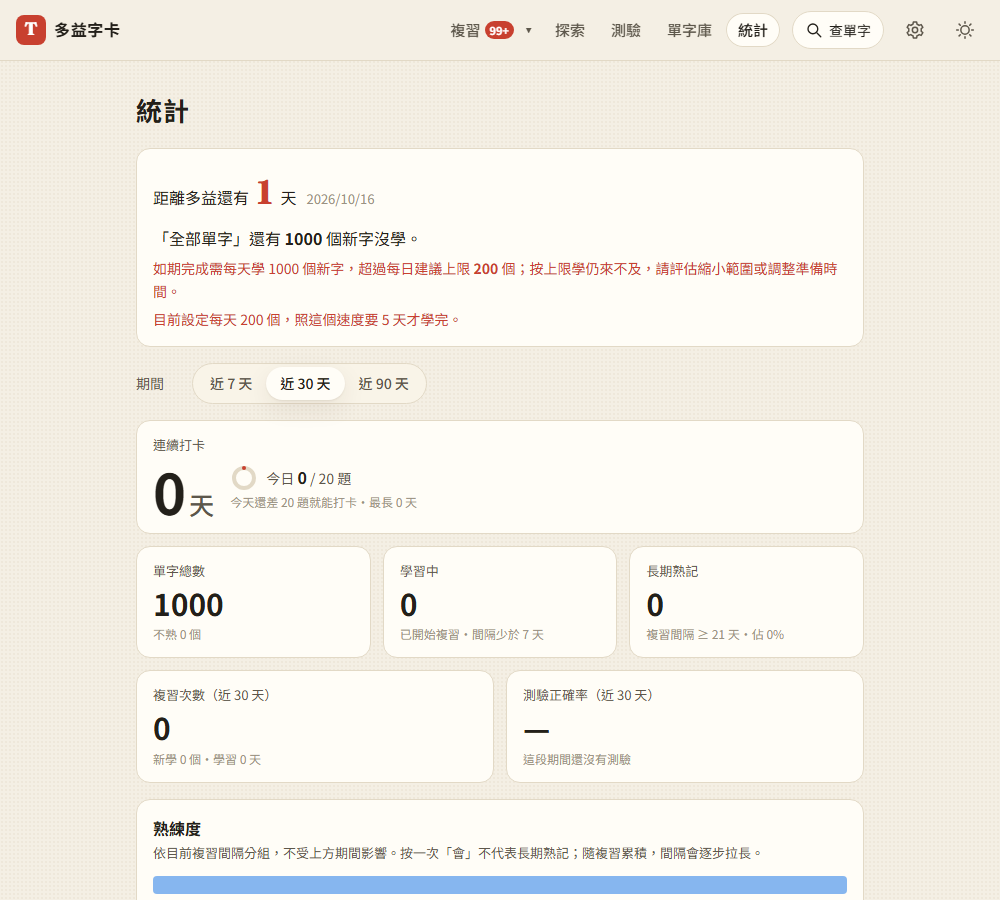

# 第 36 步：審查後的儲存、測驗與讀書計畫修正

## 目標

修正第 32～35 步新增功能在儲存失敗、慢速／離線題庫與讀書計畫上限時的邊界問題，保留原有分批繪製、id 索引及 50ms 合併存檔。

## 儲存失敗後重試

原本 `flushWords()` 在寫入前就清除 dirty 標記。暫時失敗後，即使瀏覽器空間恢復，`pagehide` 也會把資料當成已存，重整後遺失修改。

改為寫入成功後才清除標記；失敗仍提示錯誤，保留記憶體資料及待存狀態，後續修改、切背景或離頁時可再嘗試。不加入無限重試迴圈，也不改變正常操作的合併存檔行為。

使用 `webapp-testing` 的 Playwright 流程，延伸 `test_performance.py`：模擬 QuotaExceededError、確認提示、恢復寫入、觸發離頁後檢查資料，並重整確認修改仍在。原本 3,000 張字卡的查找／更新與分批清單測試也通過。

瀏覽器儲存一直被封鎖或空間一直不足時仍無法保存；這個修正讓恢復儲存後的下一次保存有機會成功，不保證強制結束程序時仍能保存。

## 測驗頁生命週期與題庫備援

背景題庫載入完成時，原本只檢查共用的 `state.view`，離開測驗頁後仍可能對共用根節點重畫。每次掛載加入 alive 狀態，卸載時停用；同一次掛載的題庫完成通知也合併，避免重複註冊回呼。

題庫下載失敗時，改用字卡上已保存的 `formQs`；無已存題目時仍顯示連線錯誤。備援期間不發 AI 請求，即使有金鑰或勾選出新題也會提示這次只使用已存題目，避免把原本免費的內建字誤送 AI。失敗不快取為空題庫，恢復連線後可重新載入。取消的測驗不會因備援而重新開始。

新增 `test_review_regressions.py`：延遲回應後仍留在統計、回測驗正常；題庫 503 下使用已存題、有金鑰及要求新題也不花 AI 額度；真正離線重整後仍能開始測驗；恢復連線後重新納入內建題；無已存題時顯示重試提示。外部 API 全部模擬，不使用正式 Firebase 帳號。

## 讀書計畫分開計算實際需求與建議上限

原本先將每日所需字數截成 200，再用這個值判斷是否跟得上，造成「明天考、剩 1,000 字、每天 200 字」仍顯示達標。

新增未截斷的 `requiredPerDay`，進度依實際需求判斷；可一鍵套用的 `suggested` 仍最多 200。超出上限時明確顯示所需字數及來不及的提醒，不宣稱套用 200 就能考前學完；已設定 200 時不再顯示相同值的無效套用按鈕。

`exam-plan.test.mjs` 新增兩項邊界測試，涵蓋上限誤判、恰好 200、實際速度足夠，以及保留複習週時的計算。`test_exam_plan.py` 驗證完整畫面、套用後仍不誤報與手機排版。全套 Node 測試共 139 項通過；原詞性題、短文閱讀及效能瀏覽器測試也通過。

部署冒煙測試改為核對實際載入、含版本參數的測驗模組快取，不再固定尋找舊的裸路徑。

