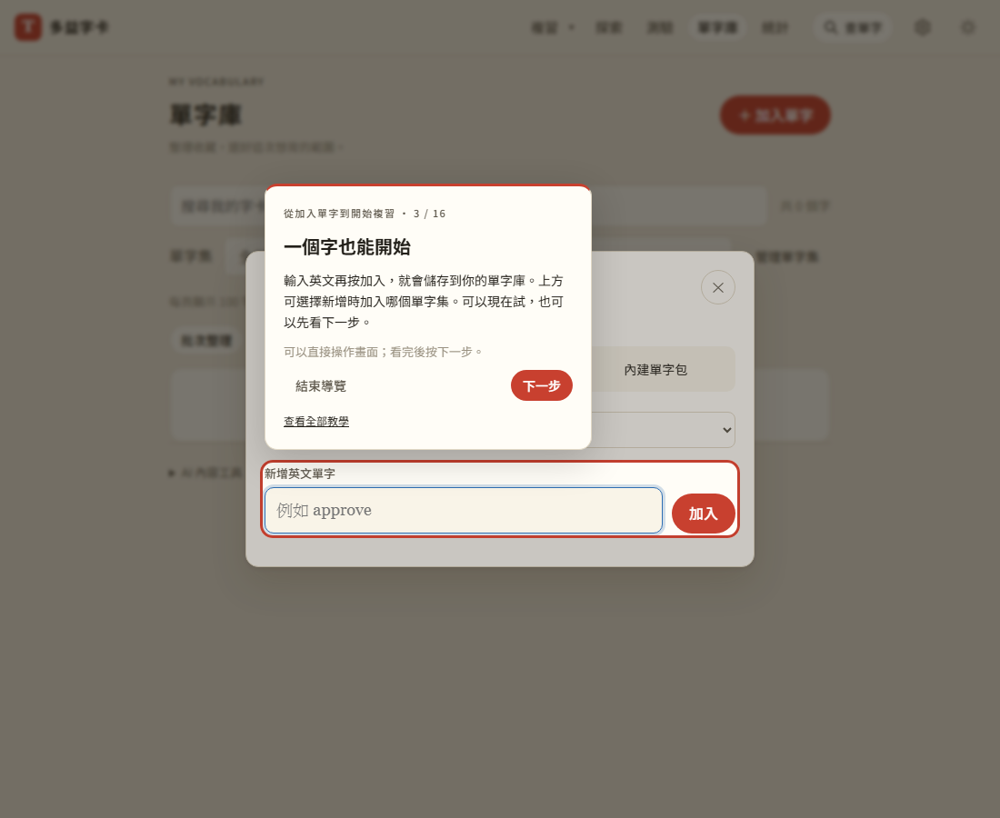
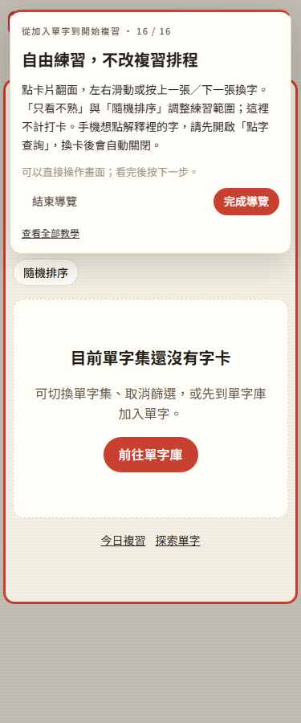

# 第 37 步：在真正的頁面學會操作

## 目標

舊教學用獨立的 invoice 練習卡，內容、按鈕與實際使用畫面不同。使用者反映練習翻卡／評分沒有反應，而且缺少許多功能說明。依這次需求移除模擬練習，改成在真正頁面指引操作。

## 做法

新增 `js/tour.js`，用宣告式步驟描述目標、說明及實際操作。首次選「帶我開始」後，從複習頁的新增入口走到單字庫，點真正的加入按鈕，依序介紹單字輸入、批次貼上、內建包、搜尋與分類，再回到複習、模式選單與自由翻卡，共 16 步。使用者點實際入口後繼續；純說明可按下一步，需要操作的步驟也可先略過。

教學頁另提供七個可獨立重看的主題：新增整理、複習、查字、探索、測驗、統計與設定。補足點字查詢、候選字、原拼字收藏、詞性變化、錯題、短文、每日目標、21 天熟記、考試計畫、備份、同步、AI 額度及離線範圍。設定重看入口保留。

## 遇到的問題與解法

- **原生視窗會讓外部提示失效**：提示移入目前開啟的 dialog，再以手動 popover 顯示在上層；光圈不攔截事件，真正按鈕照常使用。
- **手機空間不足**：依目標位置選擇上方或下方，限制提示寬高並可捲動；支援深色與減少動態效果。DOM、捲動、視窗尺寸變動時合併更新位置。
- **更新提示搶走輸入焦點**：定位與初次焦點處理合併於同一幀，已有輸入框焦點時保留，避免查字候選因 focusout 被清除。
- **不應把使用者鎖在教學**：隨時結束、Escape 或自行切頁都能離開；缺少目標可略過，結束後解除監聽與觀察器。沿用舊狀態判斷，已看過舊教學的人不會再次被強制開啟。
- **真實操作的影響要說清楚**：導覽本身不新增、評分或呼叫 AI，但使用者親自按正式操作就正常記錄。歡迎、教學頁與評分／新增步驟均標示。

## 測試

使用專案 `webapp-testing` 流程，以 Playwright 實際開瀏覽器：

- `test_onboarding.py`：1100／375／320px 完整 16 步、真正跨頁、原生視窗與新增分頁；七個主題各自完成；導覽內正式新增、重整保留與正式評分；單純看教學不修改學習資料或呼叫外部 API；查字輸入保留候選；手動換頁、重看、略過、Escape、舊使用者、儲存受阻、深色與減少動態效果。
- `test_word_packs.py`：內建包完整回歸，真正離線重整後仍可啟動導覽並操作實際字卡。
- `test_card_lookup_mode.py`：手機翻面與點字模式、資料保護與離線回歸。
- `test_security.py`：CSP、各頁載入與外部資料注入保護；外部 API 使用模擬回應，不登入正式 Firebase。
- 全部 JS 語法檢查與 139 項 Node 單元測試通過。

手機版以 Chromium 觸控模擬驗證；未以實體 iPhone Safari 驗證。
