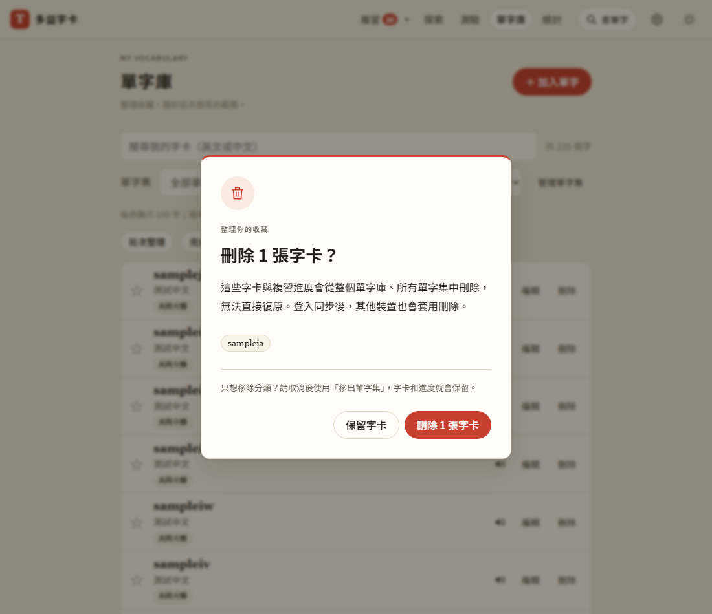
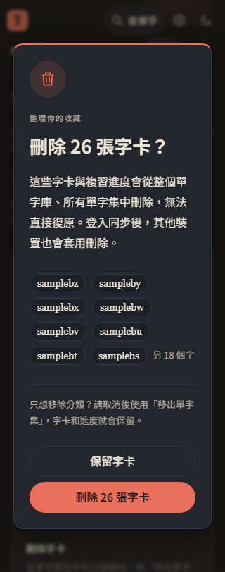

# 第 38 步：符合網站風格的刪除視窗與批次刪除

## 目標

取代字卡刪除時的瀏覽器確認框，並解決大量字卡只能逐筆刪除的問題。

## 做法

`js/delete-confirm.js` 共用單筆／批次確認視窗：米白底、紅色上緣、圓角、垃圾桶圖示，支援深色與手機。顯示張數及最多八個單字，預設聚焦「保留字卡」，Enter 可取消、Escape 可關閉。說明刪除會移除所有分類中的字卡及其複習進度，同步後其他裝置也套用；只改分類應使用移出單字集。

單字庫的「批次整理」增加獨立刪除區，沿用跨頁勾選與全選搜尋結果，不要求選擇目的單字集。確認開啟後固定原選取 id，期間新增的字不會被刪。離開頁面取消未完成的確認。

`store.deleteWords` 使用 Set 掃描字卡，一次寫入同步刪除紀錄、更新 id 索引及通知畫面，單筆刪除也共用。先寫刪除紀錄，寫入失敗則保留記憶體資料。字卡延後存檔沿用既有錯誤提示與重試；資料格式不變。舊版 store 尚在 HTTP 快取時使用舊單筆 API 相容路徑，避免匯入新函式失敗。

## 測試

使用 webapp-testing／Playwright 的隔離測試資料，外部 API 模擬、不登入正式 Firebase。

- `test_bulk_delete.py`：單筆取消與預設焦點、Escape、跨頁刪除、搜尋全選、八字預覽、一次通知、同步刪除紀錄、其他字卡內容及分類保留、重整保存、確認期間新增字保留、切頁取消、刪除紀錄儲存失敗保留原卡、320／375px與深色。
- `test_step1.py`：真正確認單筆刪除及新增、編輯、搜尋回歸。
- `test_library_interactions.py`、`test_library_paging.py`：既有批次分類、模式互斥、3,000 張字卡及跨頁選取。
- 更新 Firebase 模擬器測試的單筆確認操作；本次未重跑模擬器同步測試，僅驗證沿用的同步刪除紀錄格式。
- `test_performance.py`：id 索引、刪除後加回、延後存檔與失敗後重試回歸。
- `test_onboarding.py`：新版本網址與批次刪除說明更新後，實際頁面導覽完整回歸。
- JavaScript 語法檢查及 139 項 Node 單元測試通過。

