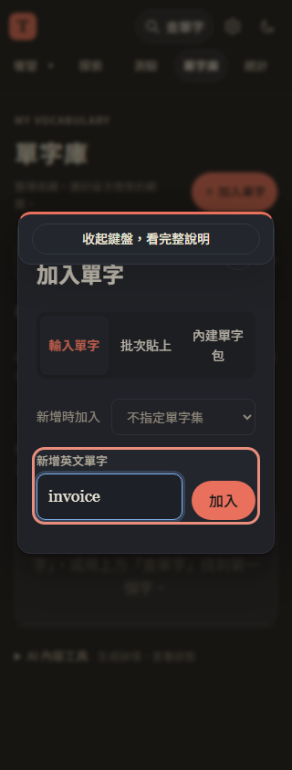
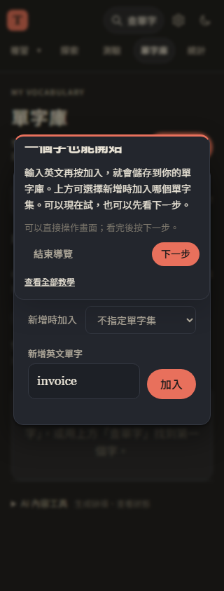

# 第 39 步：手機教學的鍵盤與捲動修正

## 問題

使用者提供 iPhone Safari 截圖：教學按「加入單字」後，輸入欄自動取得焦點並叫出系統鍵盤，浮窗被擠到畫面上方、底部操作看不到；鍵盤開著捲動時，光圈也與欄位錯開。原本的一般手機尺寸模擬沒有涵蓋鍵盤造成的可見區域平移。

## 做法

- 新增 `js/input-focus.js`：觸控裝置在導覽中，開新增／批次／查字時先保留非文字焦點。使用者點欄位才進入輸入；桌機及非導覽流程沿用原本自動聚焦。
- 一併修正批次 details 的非同步 toggle 事件，避免切換分頁的聚焦保護之後又被原 toggle handler 叫出鍵盤。
- 輸入時提示縮成「收起鍵盤，看完整說明」，不遮住整個操作區，也不搶焦點；按小提示後展開。完整浮窗改為內文可捲動、操作列固定，狹小可見區域仍可下一步或結束；換步驟時內文回到開頭。
- 追蹤 VisualViewport resize、scroll、scrollend，以及文件捲動、焦點和目標 ResizeObserver。固定定位原點探針校正覆層座標；左右偏移也計入界線，光圈只顯示目標在可見區域內的部分。
- 沿用 requestAnimationFrame 合併更新，離開導覽移除觀察器與監聽，避免背景輪詢。更新入口與受影響模組版本，保持共用資料模組不變。

瀏覽器的排版區域與使用者實際可見區域可能不同，螢幕鍵盤可縮小後者；`offsetTop`／`offsetLeft` 表示兩者的偏移。參考 [MDN VisualViewport](https://developer.mozilla.org/en-US/docs/Web/API/VisualViewport)。

## 測試結果與限制

使用專案 webapp-testing／Playwright 流程，外部 API 模擬，不登入正式 Firebase。

- `test_tour_keyboard.py`：393／320px 觸控模式，開新增、批次與查字不自動聚焦文字欄；手動輸入後保留焦點、內容與候選；獨立 EventTarget 模擬鍵盤縮小可見區域、純 scroll 平移、scrollend、左右偏移及固定層原點移動，檢查光圈對齊及浮窗界線；狹小高度下捲內文不捲走操作按鈕；結束解除監聽，一般新增仍自動聚焦。
- `test_onboarding.py`：完整導覽、七主題、實際新增與評分、取消、舊資料與手機回歸。輸入後先收起小提示再繼續，符合新的互動。
- `test_lookup_suggestions.py`、`test_batch_add_responsiveness.py`、`test_word_packs.py`：一般查字、批次貼上效能及真正離線重新整理回歸。
- 全部 JavaScript 語法與 139 項 Node 單元測試通過。正式網站冒煙測試增加手機導覽開窗不聚焦、手動輸入縮小及收起後恢復。

以下是可見區域參數模擬的截圖，不包含真實系統鍵盤。測試環境只有 Chromium，未安裝其他瀏覽器，也沒有 iPhone 真機；仍需實機確認 Safari 系統鍵盤的最終表現。

## README 展示更新

README 補上實際操作教學、批次整理／刪除的操作入口與影響範圍，使用內建多益單字包的實際內容重拍展示圖。手機展示採真正的觸控瀏覽器 context，區分完整教學、輸入時縮小提示及深色刪除；圖說明確標示不包含 iOS 系統鍵盤，避免把展示圖當成真機驗證。

重拍方式：先啟動 8123 伺服器，執行 `python tests/capture_readme.py --updates-only`，再執行 `python tools/make_readme_images.py`。此選項只更新近期功能的展示圖，其他歷史畫面保留；完整重拍仍可不加參數。截圖使用隔離示範資料與模擬 API，不使用正式帳號。完成後檢查圖片尺寸、圖說與 README 的本機連結。
