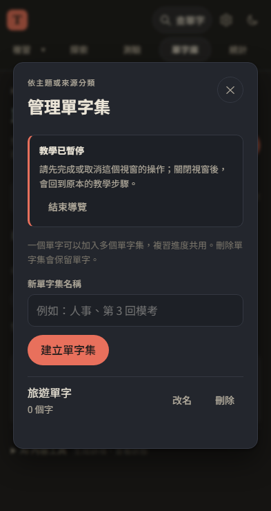
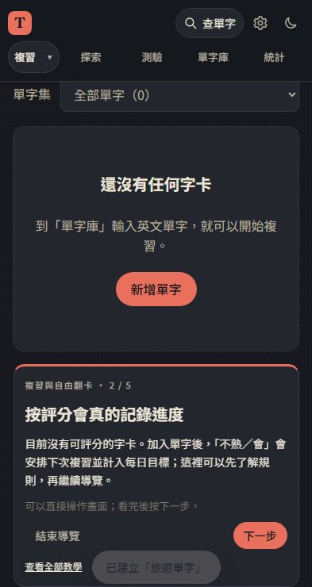

# 第 40 步：導覽與操作視窗不再重疊

## 問題

使用者提供四張 iPhone 截圖：管理單字集視窗還開著，導覽卻前進到視窗外的分類工具；沒有字卡時，翻面／評分教學把整個空白區當目標，說明與備援光圈重疊。這是視窗狀態與排版問題，需要同時處理，不能只調 z-index。

## 做法

- 額外視窗不包含當前教學目標時，暫停導覽。浮窗與光圈隱藏，改在原生視窗標題下方顯示正常排版的「教學已暫停」，不覆蓋表單與關閉按鈕，也不自動關閉視窗或捨棄輸入。
- 暫停時不能跳下一步；關閉額外視窗後恢復同一步。真正按指定按鈕開啟預期視窗時照常前進，避免將正常開窗誤判為中斷。
- 手機沒有可複習字卡時，調整說明內容，將教學接在空白區之後；不再用巨大光圈和浮窗蓋住新增按鈕。其他目標剩餘空間不足時也可退回上下排列，同一步維持穩定排版，換步驟再判斷。
- 有足夠空間時，浮窗限制在目標上方／下方的可用高度，保留先前的內文捲動、固定操作列及輸入小提示。更新導覽模組與樣式版本。

## 測試

使用 webapp-testing／Playwright，外部 API 模擬，不使用正式帳號。

- 新增 `test_tour_overlap.py`：1100／393／320px，管理視窗可建立分類、說明不壓住表單或 X、暫停時不能跳步、關閉後同一步恢復；額外點字查詢視窗也暫停；無字卡的兩個複習步驟與新增按鈕不重疊，之後仍可實際切到自由翻卡。
- `test_onboarding.py`：完整入門與七主題回歸；正常按鈕開窗仍前進、正式資料行為保留。
- `test_tour_keyboard.py`：手機手動輸入、可見區域平移／縮放、固定定位原點與操作列回歸。
- JavaScript 語法與 139 項 Node 單元測試通過；離線導覽由單字包回歸及部署冒煙測試檢查。單字包內容下載重試情境首跑曾逾時，完整重跑通過，保留為測試穩定性觀察。

以下為 Chromium 觸控模式的修正畫面，尚未以實體 iPhone 驗證。

