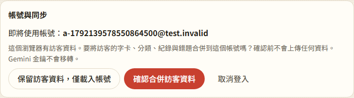

# 第 41 步：帳號與訪客資料隔離

## 確認問題

基準 `6734a6e` 的 Auth callback 直接開始同步；字卡、紀錄、設定、錯題及分類共用本機資料，登出只清同步狀態。Firestore 的 UID 規則無法阻擋「B 正常登入後上傳來源其實是 A 的資料」。各等待點也沒有會話失效判斷。

## 修改

- `profile-storage.js` 將字卡、刪除紀錄、兩類紀錄、設定、錯題、閱讀與金鑰依帳號分開。金鑰仍不上傳或備份；訪客合併也不移轉金鑰。
- 舊資料原地保留，以升級前最後登入帳號標記歸屬，不複製大型字庫。舊版若曾經混入不同帳號資料，無法事後自動辨識或撤回雲端副本；使用者仍需自行檢查。
- 訪客登入先選擇保留或合併；確認前無同步。先固定舊資料歸屬，再記登入狀態，避免確認前重整繞過選擇。
- 合併請求保留到帳號雲端資料載入後才執行，避免新裝置用空白錯題與預設設定覆蓋帳號。
- 切帳以重新載入清除字典／AI 工作、畫面草稿、測驗及複習狀態。舊頁面禁止跨歸屬寫入；其他分頁先把延後存檔寫回舊帳號槽位。
- 登出立即增加 session generation；每個同步等待之後、每批上傳前、交易重試後均驗證會話。已送到伺服器的單次請求無法撤回，但不再開始後續階段，也不套用舊回應。

## 驗證

- `tests/test_account_isolation.py`：真實 Firebase SDK＋`demo-toeic` 模擬器，驗證訪客接受／拒絕、確認前重整、A→訪客→B→A、設定／紀錄／分類隔離、B 雲端無 A 字卡、舊 pull 晚回應不再開始上傳、多分頁切換，以及新裝置訪客合併保留雲端設定與錯題。
- `tests/test_step11.py`：既有所有 Google／密碼／Email 連結、離線、分類交易與安全規則回歸通過；改成明確確認訪客匯入，登出驗收改為訪客空間。
- JavaScript 語法、139 項單元測試通過。安全邊界經獨立唯讀調查與候選補丁審查。
- 僅本機模擬器與假 API，未使用正式帳號。iPhone 真機登入仍未驗證。

