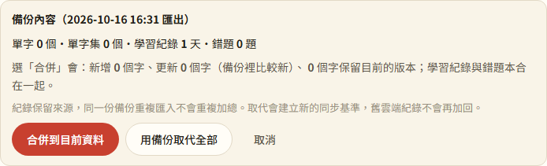

# 第 42 步：備份保留紀錄來源，還原不再重複計算

## 確認問題

`6734a6e` 的備份讀 `getLog()`（跨裝置總數），匯入卻呼叫 `replaceLog()` 寫回本機來源；其餘裝置紀錄仍存在，30 會再加 20 成為 50。原本單獨測備份合併的測試無法發現這個整合問題。

## 修改

- 備份 v3 保存 `logLedger`：來源 ID、來源紀錄快照及 revision，另留加總 `log` 方便閱讀。相同來源只取較新版本；復原評分可使數量下降，不以計數最大值冒充版本。
- 新裝置保留舊來源身分，自己的新學習用新來源。訪客也保留自己的來源，確認合併後不會在下次確認時再加一次。
- 同步使用 Firestore `meta/learningLog` 交易合併帳本。舊 `logs` 僅首次遷移，之後不再讀來加總；同步等待時的新本機紀錄仍保留。
- 「取代」建立新的 epoch，同步先讀雲端再提高基準，較舊的雲端／離線帳本不會加回。還原意圖保留到同步成功：重新讀完整字卡、留下雲端多餘字的刪除紀錄，設定／錯題時間超過已知雲端版本，分類交易保留刪除與移出。
- v1／v2 缺少來源，無法精確判定是否重疊。明示各日取較大值，再以新 epoch 保存；互不重疊的舊來源可能少算，請保留原檔與還原前備份。

## 驗證與限制

- 新增 `test_backup_sync.py`：真 Firebase SDK＋本機模擬器，10＋20＝30、UI 匯出／重複匯入、取代、換裝置、重新同步仍 30；另保留舊雲端 100 次紀錄，確認不會加回；驗證取代後舊字卡、設定與分類不復活。
- `test_step8.py` 回歸通過；144 項單元測試通過，新增來源去重、換裝置、復原減量、epoch 與舊備份測試。
- 帳號隔離及既有完整同步測試再回歸；外部 API 模擬、Firebase 僅 `demo-toeic`。
- **上線前必須發布更新後的 `firestore.rules`**，允許 `learningLog`。舊開著的網頁不支援新帳本，請更新所有裝置；新版不再把舊版寫入的 `logs` 加回。大筆多年多裝置帳本仍受 Firestore 單文件大小限制，超限會回報同步失敗，未全面改用 IndexedDB。
- 已在歷史備份或舊雲端重複加總的數字，沒有原始來源資訊，無法自動逆推出正確值。

