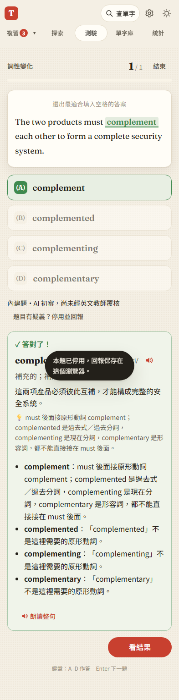

# 第 43 步：題目審核狀態、修訂與回報

## 確認與處理

基準 `6734a6e` 的 complementary／negligent 兩題確實有兩個合理答案；JSON 格式、同字族檢查都無法發現。檢視全部 471 題原始句子、選項、翻譯與解析後，修正 10 題明確歧義；先啟用 75 題有清楚排他線索的題目，其餘 396 題保留為待覆核並停用，沒有宣稱完成全部題目的語文驗收。

- 題庫 v2、`review.json` 逐題記錄與內容雜湊，編題時驗證；產生可信的 `forms-catalog.js`，舊／被改過的內容不列入測驗。
- Part 5 與詞性 AI 候選題新增第二次盲選項檢查，要求所有合理答案與各選項理由。仍標示為 AI 檢查、尚無教師覆核，每批多用一次請求。
- 題目回報使用網站風格視窗，先停用本機修訂版並保存回報；使用者可匯出後手動提交，不自動傳送。
- 舊 AI 題與修訂前錯題停止出題／重做，保留在備份封存；不偽造歷史紀錄重算。

完整狀態與限制見 [教材審核說明](../question-quality.md)。396 題仍待更完整的排除理由與語文覆核，不能將這項列為「471 題全數答案唯一，已完成」。

## 驗證

- 新增 `test_question_quality.py`：75／396 標示、待審題不出題、回報跳過不計分、四個選項解析、舊錯題封存、AI 格式完整但多解仍拒用、新題備份往返。
- `test_forms_quiz.py`、`test_step6.py`、`test_review_regressions.py` 回歸內建、AI、錯題、題庫故障與真正離線重整。舊刪除測試補按目前的確認視窗；徽章像素量測容許 1 CSS px 的字型點陣差異。
- 144 項單元測試通過；編題器驗證全部 471 筆與審核內容吻合。以上為程式行為測試，不是英文教師審核。

