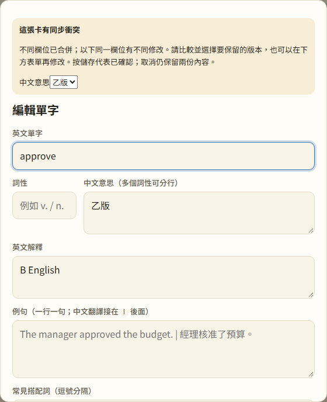
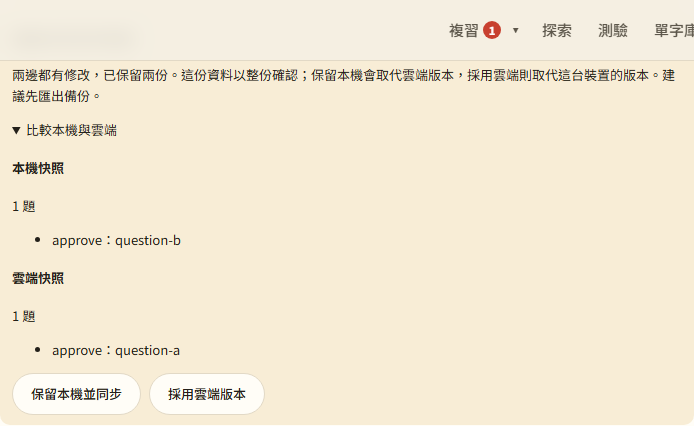
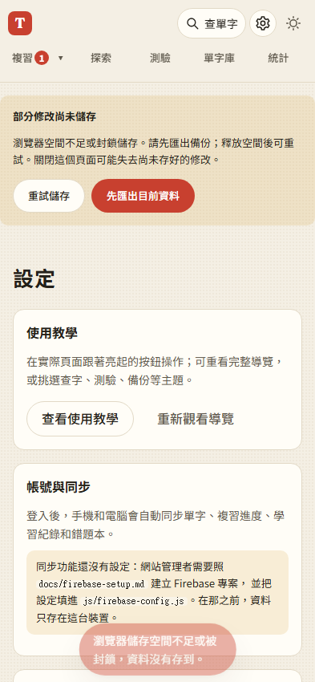

# 第 44 步：同步衝突與儲存恢復

## 確認問題

`6734a6e` 的字卡以整份 `updatedAt` 決勝，兩台裝置分別改字義和複習進度會互蓋；設定與錯題本也依裝置時間決勝。字卡有短暫儲存錯誤提示，但紀錄、設定與錯題缺少一致的保留與重試方式。

## 修改

- 字卡以邏輯版本追蹤各欄位，`src` 來源也分欄。計數按已觀察版本遞增，不按裝置時間排序；SRS 整組合併，避免把不同次評分的 reps／due 等欄位拆開拼成不存在的排程。
- Firestore 在交易內重讀並合併，每 400 筆一組，保留同步等待期間的新修改。不同欄位合併；同欄位不同修改保留兩份，在編輯視窗比較與選擇。已解決的衝突留下標記，避免舊副本加回。
- 刪除作用於同一代字卡，離線舊修改不會復活它；明確重新新增會產生新一代。舊資料未帶欄位版本時仍有相容分支，不能反推歷史上已被覆蓋的欄位。
- 設定／錯題本用上次確認的兩側快照指紋檢查變更，兩邊都改時暫停並保留兩份，讓使用者整份選擇。伺服器交易再檢查讀取後是否被修改；不再讓較快的裝置時鐘自動勝出。這兩種小型快照暫不細分欄位合併。
- 字卡、設定、紀錄與錯題寫入失敗後持續顯示提示；可匯出記憶體資料，釋放空間後重試。紀錄等變更留在記憶體待寫；字卡保留 dirty 狀態。存好資料才前進同步 checkpoint；尚未完整匯入備份時不開始雲端同步。
- 仍有未存修改時不直接登出；其他分頁切帳而本頁無法存檔時，遮住舊頁面，只保留恢復操作，避免把舊帳號畫面交給新帳號。重試寫回原帳號儲存區後重新載入。

## 驗證

- `test_sync_conflicts.py`：兩裝置分別改中文、英文與 SRS、模擬裝置時間差、同欄位雙份保留與選擇、衝突解決傳遞、設定和錯題的快照衝突確認、刪除優先與明確重新新增。Firebase 僅本機 `demo-toeic`。
- `test_storage_recovery.py`：QuotaExceededError、四類資料的記憶體備份、重試與重新整理、localStorage 存取完全被封鎖仍可開站。
- 帳號隔離、備份＋同步、原有完整同步回歸通過；批次新增與刪除回歸。大量新增測試仍為兩次主要寫入、兩次清單重畫；批次刪除有一輪進頁等待逾時，獨立重跑通過，未當成保證不會偶發的效能證明。
- 新增欄位版本與 metadata 快照單元測試。所有外部資料依原備份清理，畫面以 `esc()` 顯示。

## 取捨與限制

- IndexedDB 暫不全面重寫：本次先修正所有權、來源與合併語意，換資料庫本身不能解決它們。版本與衝突副本增加資料量，localStorage 仍有容量限制，現在會提供可操作的恢復流程。
- 交易比單純覆寫多讀一次；同步 checkpoint 只存雙 32-bit 指紋，避免再複製整份字庫。指紋用於變更檢查，不作資安簽章。
- 衝突偵測採保守方式；相隔多個未觀察中間版本時也可能要求確認。每字最多保留 30 組衝突與 300 個解決標記，不是無上限的完整歷史版本庫。
- SRS 到期時間、每日分日仍依裝置日期，系統時間嚴重不正確時需先修正裝置時間；本次修正的是資料版本排序，不能讓錯誤的實體日期自動變正確。
- 所有裝置須更新到新版；舊客戶端不能理解欄位版本、帳本與衝突，請勿混用舊的開啟中網頁。

