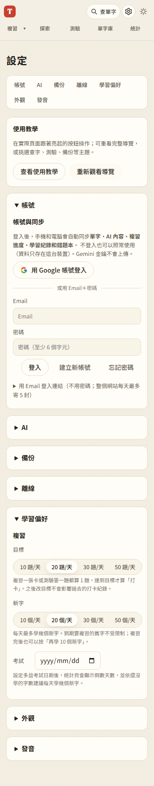

# 第 45 步：設定分組與操作可存取性

設定頁改成七個可收合區塊，記住各帳號的展開狀態，提供快速跳轉。登入的 Email、密碼與登入連結都有可見標籤。

翻卡只讓目前這一面進入焦點與輔助科技閱讀順序，另提供原生翻面按鈕；編輯儲存、取消、關閉與刪除後恢復到適當控制項。提高淺色及深色次要文字對比。

## 驗證

`test_accessibility.py`：設定預設收合、鍵盤操作、記住狀態、登入欄位標籤、隱藏面 inert／aria-hidden、翻面按鈕、編輯與刪除焦點、393px 排版、兩組次要文字色對比均通過。`test_backup_sync.py`、查字模式、自由翻卡、教學鍵盤及教學重疊回歸通過。教學重疊曾在載入入口逾時一次，未改程式重跑三種尺寸均通過，保留作測試穩定性觀察。

## 限制

自動檢查不等同完整 WCAG 認證，尚未使用螢幕閱讀器逐項人工驗收。沒有可操作的 iPhone 真機，因此 Safari 與主畫面 App 的鍵盤、教學、滑卡、捲動、登入仍待依 [真機清單](../iphone-checklist.md) 測試；不以 Chromium 觸控模擬宣稱通過。
