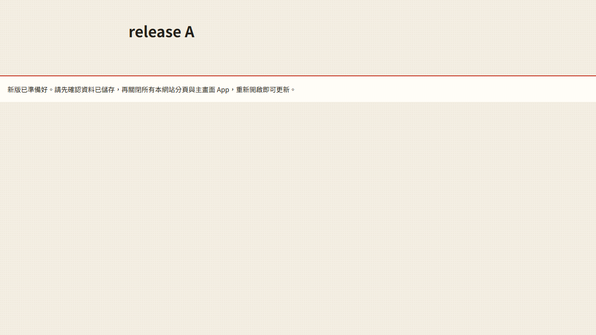

# 第 46 步：完整發布與自動回歸

## 問題與修改

原 Service Worker 逐檔先連網並立即接管；入口、靜態依賴及稍後載入的模組可能不同版。改為開發者提交前產生完整資源 SHA-256 清單，安裝時六路下載並核對全部檔案，失敗不接手。既有頁面只取該版快取，新版等待所有舊頁面關閉，不使用 skipWaiting／claim。快取部分被清除時可補回雜湊吻合的同版檔案；未知程式或不一致檔案不混入。

所有 JS 保持原 ES module URL 與單一 store 實例；快取查找以同一路徑對應發布內容，查詢參數不再代表可混搭的檔案版本。`.gitattributes` 統一發布文字 LF，避免 Windows 與 CI 位元組雜湊不同。

GitHub Actions 加入語法、151 項單元、發布清單一致性與瀏覽器回歸。Firebase 僅啟動 demo-toeic 本機 Auth／Firestore 模擬器；外部字典與 AI 使用模擬回應。失敗保留截圖／模擬器日誌。CI 自行管理伺服器與結束清理，不連正式帳號。

逐步拆分已落實在 profile-storage、log-ledger、restore-data、word-versions、meta-sync、question-policy／review／reports、storage-notice 與 settings-sections，沒有為拆分全面重寫大型畫面。

## 驗證

`test_release_update.py` 啟動隔離伺服器，用實際 Service Worker 與 PWA 提示程式驗證 A→B 多分頁、動態模組、離線、關閉後完整切換、錯誤 C 雜湊拒用、部分快取恢復與未知程式拒用。測試通過。另回歸原 PWA、查字、題庫故障恢復與單字包離線流程；詳見 [驗證報告](../improvement-review.md)。

## 取捨

需要一次下載完整程式與約 1000 字單字包內容，比原先首頁小快取多用空間與下載量；大型擴充字典仍按需且限量。新功能需關閉所有分頁／App 才生效。第一次尚未受控的網路載入及舊 v1 已開啟頁面無法追溯保證，首次遷移需先備份、關閉舊頁面。快取被系統清除且同版已無法下載時，要連線更新完整新版。

依據 [W3C Service Workers：Activate／Try Activate](https://www.w3.org/TR/service-workers/#activation-algorithm)，採原生命週期等待，不強迫正在操作的舊頁面換版。
