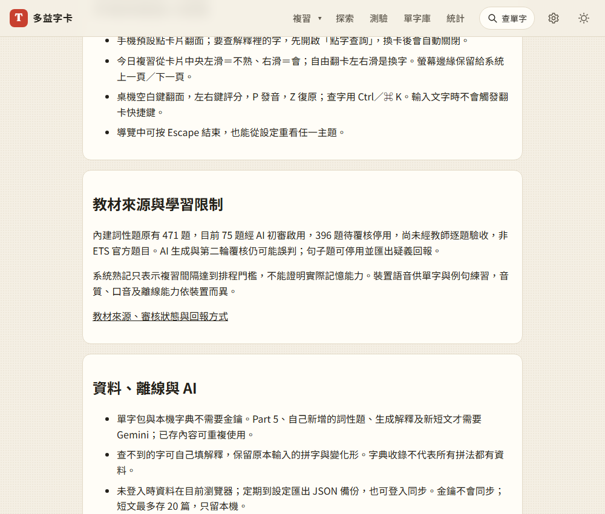

# 第 47 步：學習與教材說明

修正設定頁不準確的「送給 Gemini 的只有英文單字」及「語音不需網路」。現在列出出題、第二輪覆核與閱讀練習會傳送的文字，並說明模型、方案與資料處理以服務條款及帳戶為準。

統計頁明示熟記是排程分類，不能證明實際記憶能力；語音供單字與例句練習，口音、音質、離線依裝置。使用教學直接提供教材來源、75／396 審核狀態、回報與限制入口。

README 更新功能、來源帳本與衝突恢復說明，新增設定分組和題庫狀態展示。使用 `capture_readme.py --reliability-only` 擷取，執行合成腳本並人工檢視新圖。CLAUDE.md 的舊合併規則與 471 題全部可用說法一併修正。

`test_product_copy.py` 實際開教學、設定與有資料的統計頁，確認入口及文字，通過。另記錄 [未來產品驗證](../product-validation.md)，沒有加入收費、追蹤或未經證實的成效宣稱。

