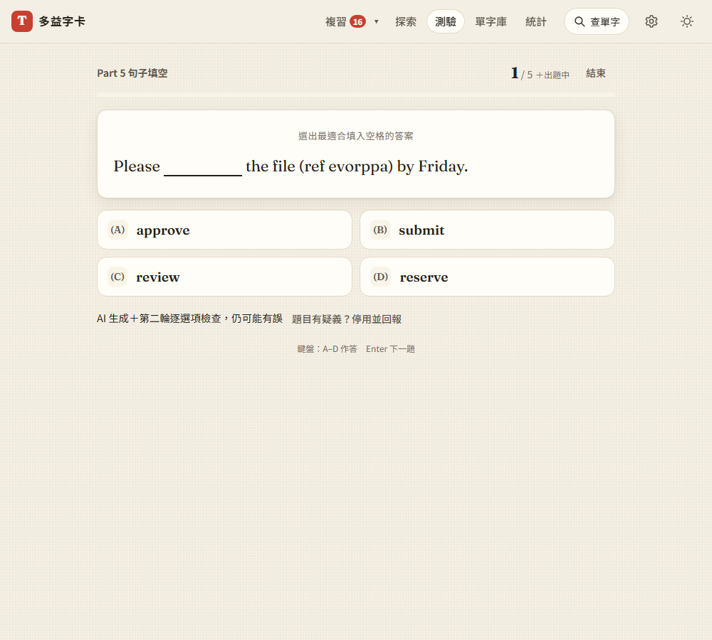

# 第 48 步：Part 5 不用乾等

## 目標

使用者回報 Part 5「AI 生不出題目」：畫面停在「AI 出題中…」、進度條一直是 0。原因不是壞掉，而是太慢、看不到進度：第 43 步之後每批 10 個字要送兩次請求（出題、再請 AI 檢查有沒有兩個答案都對），兩次都完成才會出現第一題，中間沒有任何變化。

## 做法

- **先開考、邊考邊補**（`js/part5.js` 的 `preparePart5` 加上 `onQuestions`）：已存題目的字立刻可考；需要 AI 的字第一批只出 5 題，出好就開考，後面的批次在作答時補進來。題號顯示「1 / 5 ＋出題中」；答完已出好的題目會顯示「下一題還在出題中…」，出好自動接上。中途按「結束」會停止補題。
- **分階段進度**：載入畫面顯示「AI 出題中（1/2）」「AI 檢查題目中（2/2）」、第幾批，以及這個階段已經幾秒。
- **背景補題**（`topUpPart5`、`initPart5Stock`）：有金鑰、設定開啟、分頁在前景、連得上網路、沒有正在生成字卡內容時，開網站 20 秒後開始，每批 10 個字，把目前測驗範圍補到約 20 個字有題目；每天最多 4 批（8 次請求）。前景開始出題時會中止背景那批，避免兩邊搶額度。測驗首頁顯示「已先備好 N 個字的題目」。
- **說明失敗原因**：題目全部被第二輪檢查刷掉時，直接說明「沒通過第二輪檢查（可能有兩個答案都說得通）」，而不是籠統的「請稍後再試」。
- 設定頁 AI 區塊新增「在背景先出好 Part 5 題目」開關（預設開啟，只存在這台裝置，不同步）。

## 遇到的問題與解法

- **同一個模組被載入兩次**：`part5.js` 在不同檔案用不同的 `?v=` 匯入，瀏覽器會當成兩個模組，「前景是否在出題」的狀態就不共用。所有匯入統一成 `?v=part5-fast-1`。
- **測驗跑到一半才補題**：不能整頁重畫（會打斷作答），所以補進題目時只更新題號和「下一題」按鈕。
- **舊測驗假設一次出完**：`test_step6.py` 原本預期 8 個字一次請求，改成第一批 5、第二批 3，並等「出題中」消失再檢查。

## 測試結果

用 webapp-testing 新增 `tests/test_part5_fast.py`（假的 Gemini，第二批故意延遲 1.5 秒）：

- 載入畫面依序出現「出題中（1/2）」「檢查中（2/2）」
- 第一批 5 題就開考、顯示「＋出題中」；答完 5 題顯示等待畫面，第二批出好自動接上，共 10 題全部計分
- 請求順序為「出題 5、覆核 5、出題 5、覆核 5」
- 全部被覆核刷掉時顯示原因
- 背景補題：一批 10 字、補滿就停、有存題時直接開考不呼叫 AI、達每日上限／關閉設定／沒有金鑰都不補
- 手機寬度沒有橫向捲動

另外重跑 `test_step6`、`test_review_regressions`、`test_forms_quiz`、`test_pronunciation` 及完整回歸。

