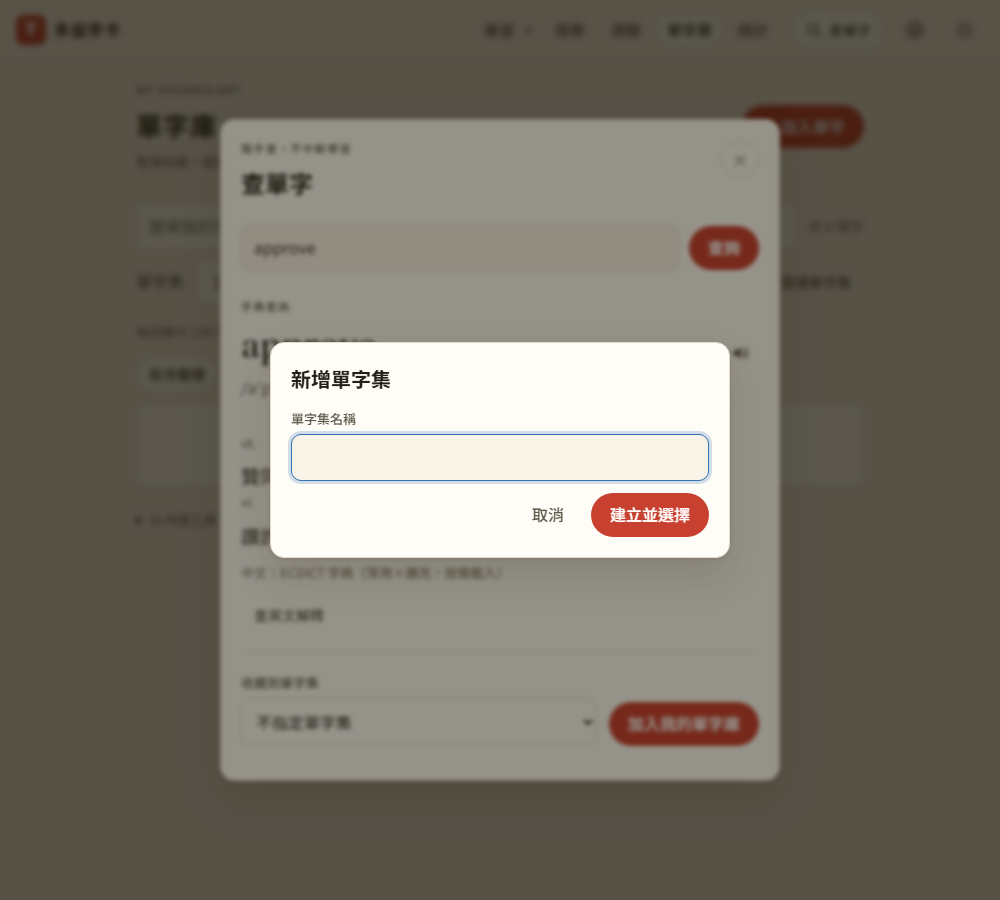

# 第 51 步：加字時直接新增單字集

## 目標

使用者在查單字視窗想把字收藏到新的分類，選單裡卻只有已有的單字集，每次都要先關掉視窗、到單字庫的「管理單字集」建立，再回來查一次，很麻煩。

## 做法

- `js/set-ui.js`：`setOptions(selected, { create: true })` 在選單最後加「＋ 新增單字集…」；`bindCreateSet(select)` 處理選到它的情況：
  1. 用 capture 攔下 change，其他監聽器看不到這個假值，選單先回到原本的選擇
  2. 跳出命名視窗（和改名共用 `askSetName`，換成「新增單字集」標題與「建立並選擇」按鈕）
  3. 建立後重畫選單、自動選好新的單字集，再觸發一次 change，原本的流程（例如批次整理按鈕是否可按）照常更新
- 套用在三個加字的選單：查單字「收藏到單字集」、單字庫「新增時加入」、批次整理「選擇要整理的單字集」。切換範圍的「單字集」選單不加，因為選了就會換整頁內容。
- 單字集改變時各選單重畫，也保留「＋ 新增」選項。

## 遇到的問題與解法

- **視窗疊視窗**：查單字本身是 modal dialog，命名視窗再開一個 modal 會疊在上面；Escape 只關最上面的命名視窗，查單字視窗保持開著，測試也確認了這點。
- **其他監聽器收到假值**：批次整理選單一改就會重算按鈕狀態，若讓它看到「新增」的值會誤判；改用 capture 階段先處理並停止傳遞，建立完成後再送出一次正常的 change。

## 測試結果

用 webapp-testing 新增 `tests/test_create_set_inline.py`（19 項通過）：查單字視窗選「＋ 新增」→ 命名 → 自動選好並收藏進去；取消回到原選擇、不建立；同名提示；Escape 只關命名視窗；「新增時加入」與批次整理都能建立後直接使用；其他選單同步出現新單字集；切換範圍的選單沒有「＋ 新增」；手機沒有橫向捲動。另重跑單字集、單字庫、批次刪除、可存取性、查字、教學導覽等 13 個相關測試，全部通過。

