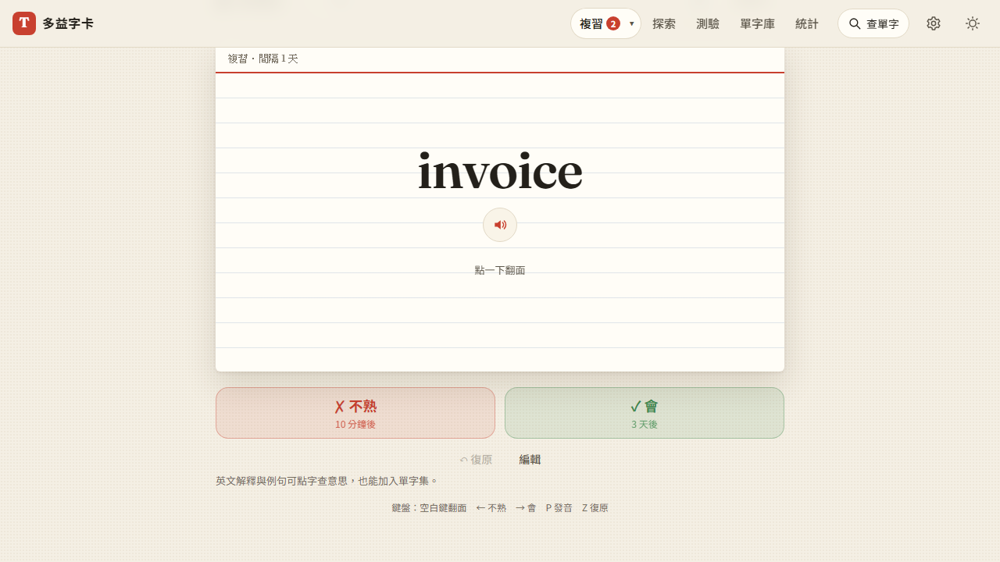

# 第 53 步：同類型的同步顯示問題

## 目標

第 52 步修好「今日複習的佇列不跟著同步更新」後，使用者請我找找有沒有同一類的問題。從程式碼找出三個：

1. **複習頁開著跨過一天**：只在進入頁面時檢查日期，主畫面 App 停在背景到隔天打開，還是昨天的清單；導覽列卻是今天重算的數字。
2. **兩台在同步前都複習同一張卡**：複習排程被當成要手動選的欄位，會跳出「這張卡有同步衝突」，請使用者在「間隔 1 天／連續答對 1 次」之間選，一般人看不懂。
3. **別台的學習紀錄同步進來，今日目標與統計不更新**：同步寫入紀錄時不會通知畫面，只有字卡變動時才重畫。

## 做法

- **跨日**（`js/views/review.js`）：`draw()` 與每 30 秒／回到前景的檢查，發現日期變了就 `startSession()` 重排。
- **複習紀錄自動合併**（`js/word-versions.js`）：`srs` 與 `unfamiliar` 不再產生欄位衝突。兩邊「同時、各自」改過時取 `srs.last` 較晚的那次，「不熟」跟著同一次，並用比兩邊都大的新版本號，兩台各自合併也得到一樣的結果；看過對方之後的修改（例如復原）仍照版本先後。舊資料裡已存在的複習衝突不再顯示。
- **紀錄通知**（`js/log.js`）：新增 `onLogTotals`，本機記錄與同步／還原寫入整本帳本都會發出；今日複習、統計頁改聽它。原本的 `onLogChange` 仍只在本機記錄時發出，用來排程上傳，避免同步後又觸發上傳的迴圈。

## 遇到的問題與解法

- **復原時卡片被拿掉**：舊的 `test_step5` 抓到——按「復原」先扣回紀錄，新的紀錄通知立刻重畫，但字卡的複習紀錄還沒還原，佇列對齊誤以為這張在別處複習過而拿掉。改成扣回紀錄期間暫停重畫，和評分流程一樣。
- **合併後兩台不能再分歧**：若沿用其中一邊的版本號，持有較大版本號但值較舊的那台下次合併會保留自己的值。改用「兩邊最大版本＋1」並記下父版本，兩台都會收斂到同一個結果；單元測試檢查合併順序對調、重複合併都一樣。

## 測試結果

- 單元測試（`tests/unit/word-versions.test.mjs`、`srs.test.mjs`）：以較晚的複習為準且不產生衝突、兩邊結果一致、之後不再分歧；復原照版本先後；舊衝突不再顯示；佇列對齊。
- 用 webapp-testing 擴充 `tests/test_review_sync_queue.py`（Firebase 模擬器、兩台裝置同一帳號），共 8 個情境全部通過，新增：
  - 兩台都複習同一張卡 → 以較晚的那次為準、兩邊一致、設定頁沒有衝突提示
  - 另一台做了 5 題測驗 → 今日目標 3 → 8、統計頁不用重新整理就更新
  - 複習頁開著跨過一天 → 自動換成今天的清單，和導覽列數字一致
- 完整回歸（全部瀏覽器測試）。

