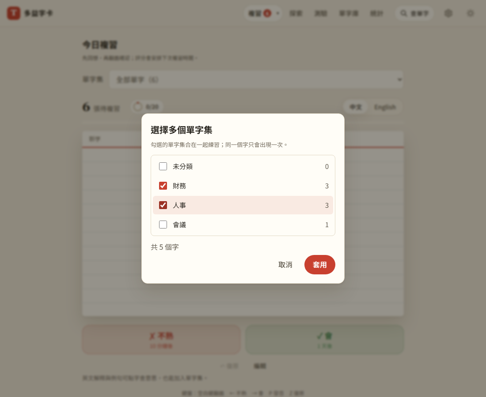

# 第 54 步：一次選多個單字集練習

## 目標

使用者回報：今日複習上方的「單字集」選單只能選一個單字集或全部單字，想同時練「小黃本＋課外」這種指定的幾本就做不到。

## 做法

- **範圍存成逗號串起的字串**（`js/word-sets.js`、`js/store.js`）：`activeSetId` 原本是單一 id，現在可以是 `a,b`（單字集 id 本身不含逗號）。`filterSetWords` 取聯集：屬於任一個勾選的單字集就算，同一個字只出現一次；未分類也能一起勾。`activeSetId()` 只留還存在的單字集並依選單順序排好，同樣的選擇永遠是同一個字串，刪掉其中一個集時自動剩下其他的。
- **選單加一項「選擇多個單字集…」**（`js/set-ui.js`）：選到時跳出勾選視窗，列出未分類與每個單字集的字數，勾選時即時顯示合計字數；沒勾任何一個不能套用。套用後選單多一個代表這個組合的選項，例如「小黃本＋課外（42）」。沿用第 51 步「＋ 新增單字集…」的做法：用 capture 攔下假值，取消就回到原本的選擇。
- **各頁共用**：這個範圍本來就是單字庫、探索、自由翻卡、今日複習、測驗、短文閱讀與統計共用的設定，所以多選在每一頁都有效，不必各自改。
- **加字預設**：單字庫「新增時加入」與查單字收藏，預設加到範圍裡第一個自訂單字集（原本是目前那一個）。
- 統計頁考試計畫的範圍名稱顯示成「小黃本、課外」。

## 遇到的問題與解法

- **相容舊版**：範圍只存在這台裝置、不同步；舊版快取的程式看到 `a,b` 這種不認得的值會當成「全部單字」，不會壞掉，所以沿用同一個設定欄位，不另開新欄位。
- **勾選中途畫面不能重畫**：設定一變，複習頁會整頁重畫。如果每勾一下就寫入設定，彈出的選單會被重畫關掉，複習佇列也會一直重排。改成在視窗裡勾好、按「套用」才寫入一次。
- **測試預期順序**：單字集在選單中依 id 排序、不是建立順序；測試改成從 `getWordSets()` 取得實際順序再比對。

## 測試結果

- 單元測試（`tests/unit/word-sets.test.mjs`）：兩集聯集去重、未分類＋自訂集、已刪的集忽略、全部不存在時回到全部單字。
- 用 webapp-testing 新增 `tests/test_multi_set_scope.py`，全部通過：
  - 勾兩個集即時顯示合計（兩集共有的字只算一次）、都沒勾時不能套用
  - 套用後今日複習只排這兩個集的字、選單顯示組合名稱與字數、評分照常前進
  - 取消不改變範圍；改回單一集後組合選項消失
  - 未分類可以和自訂集一起選；單字庫、自由翻卡共用同一個範圍；新增時預設加入範圍裡的自訂集
  - 刪掉其中一個集，範圍自動只剩其他的
  - 手機（375px）勾選視窗沒有橫向捲動
- 既有的單字集、探索、自由翻卡、單字庫、單字包、測驗、短文、考試計畫等瀏覽器測試重跑。

