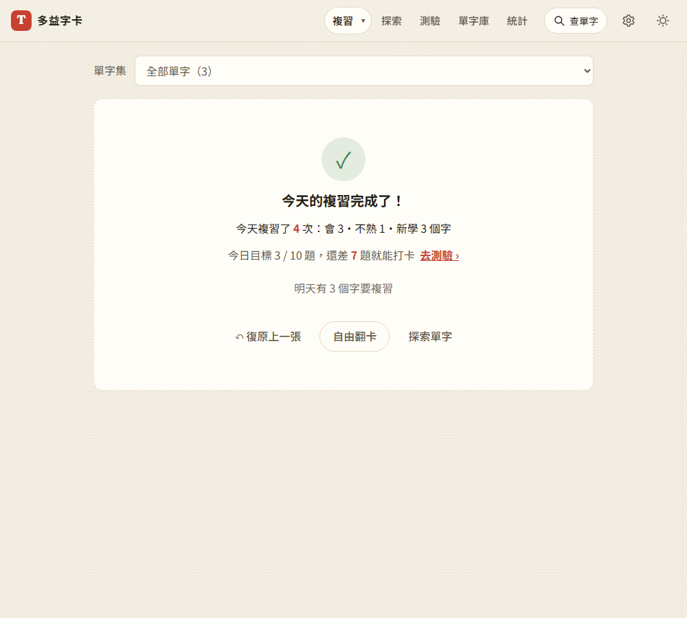

# 第 55 步：每日目標的同一張卡一天只算一次

## 目標

使用者發現按「不熟」（左滑）也會算進今日目標。討論後確認「不熟」本身該算：回想不出來、再看答案也是練習，如果不算，反而會讓人硬按「會」來湊目標。真正不合理的是**重複計算**：按「不熟」的卡會在同一輪隔 3 張再出現、10 分鐘後也會再到期，每評一次分就再加 1 題，一個難字一天可能占好幾題。使用者決定改成「每張卡一天只算一次」。

## 做法

- **學習紀錄多一個 `repeat` 欄位**（`js/log.js`）：記下「同一張卡當天第二次以後的評分」。每日目標的進度改成 `reviews − repeat + quiz`；`reviews`（評分次數）照舊，統計頁的複習次數、會／不熟比例不受影響。
- **怎麼知道是不是重複**（`js/views/review.js`）：評分前看這張卡的 `srs.last`（上次複習時間）是不是今天。不用另外存「今天評過哪些卡」，而且別台裝置今天複習過、同步進來的卡也會被認出來。
- **復原**：紀錄裡的每一步都記下這次是不是重複，按「復原」時一起扣回。
- **打卡天數**（`js/stats.js`）：`goalMet` 用同樣的算法。
- **備份與同步**（`js/log-ledger.js`、`js/backup.js`、`js/sync-core.js`）：`repeat` 加進欄位清單，帳本清理、加總與備份都會保留它。

## 遇到的問題與解法

- **舊紀錄**：過去的日子沒有 `repeat`，當成 0，照原本的次數計算，所以以前的打卡結果不會變。今天在改版前評過的重複次數也照舊算。
- **不另存「今天評過的卡」**：原本想在紀錄裡多存一份卡片 id 清單，但每日紀錄是依裝置分開、再加總的帳本，存 id 清單會讓同步變大，跨裝置也要另外合併。改用每張卡本來就有、也會同步的 `srs.last`，只需要多一個數字。
- **回歸測試在 service worker 那步崩潰**：改完沒先更新發布清單，`sw.js` 的檔案雜湊對不上。跑 `tools/release_manifest.py` 後就正常。

## 測試結果

- 單元測試：`goalMet` 扣掉重複評分、舊紀錄照舊；帳本加總保留 `repeat`。
- 用 webapp-testing 新增 `tests/test_goal_unique_cards.py`，全部通過：三張新卡，第一張按「不熟」後又出現再評分 → 評分 4 次、今日目標只有 3；復原重複的那次會一起扣回；重複出現改按「會」也不加；完成畫面仍顯示「複習了 4 次」；昨天沒有 `repeat` 的舊紀錄仍算打卡。
- `test_step5` 的今日紀錄預期值多了 `repeat: 1`（左滑的那張又出現一次），屬於預期中的改變；`test_daily_goal`、`test_step7`、`test_review_regressions` 重跑通過。`test_backup_sync` 需要 Firebase 模擬器，這次沒有跑。

