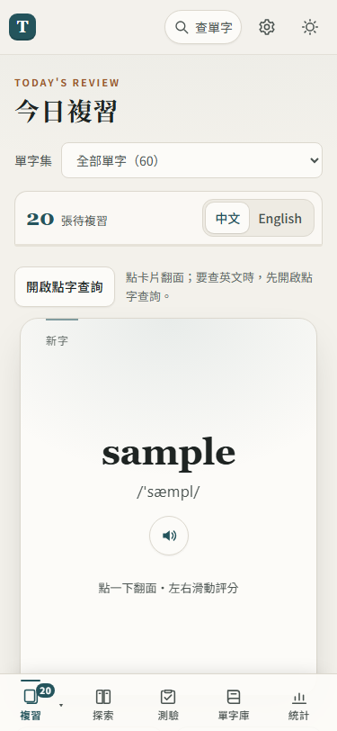

# 56. 全站重新設計：寧靜讀書感

## 目標
使用者要「適合讀書的寧靜感、不單調、不像給小孩用、有設計感」，手機和電腦都好用，加入簡單流暢的動畫；手機版一直覺得擁擠。核心功能（翻卡、滑卡、點字查詢、教學導覽、單字庫、測驗、同步）全部保留。

## 做法
分兩版：
- **第一版**：重做設計基礎（design tokens）：墨綠主色＋陶土點綴、紙張底色；錯誤色 `--danger`、成功色 `--ok` 獨立出來；按鈕、表單、對話框、toast 統一圓角與陰影；換頁淡入、對話框進場、答錯輕晃、完成打勾等短動畫。使用者看縮圖後覺得「跟原版沒差」，因為版面沒動。
- **第二版**：正式照 `ui-ux-pro-max` skill 流程（style／product 搜尋 → design system → ux 規則 → 交付前檢查清單），選 Swiss Modernism 2.0＋Paper、寬鬆密度：
  - 手機（≤ 720px）導覽改到**底部五格**（SVG 圖示＋文字，留 iPhone 安全區），頂部只剩一列；「複習 ▾」選單改成往上開。
  - 桌機（≥ 1080px）導覽改成**左側欄**。
  - 頁面標題改成 Noto Serif TC 襯線大字＋英文小標。
  - 複習頁：張數／目標／中英切換收成一條資訊列，字卡背後露出兩張靜態疊卡，評分按鈕拉開距離。
  - 全部用 CSS 重新排列；只在 `index.html` 的導覽連結**文字後面**加圖示（保留文字是第一個子節點，導覽對齊測試照常量得到）。

## 遇到的問題與解法
- 頂部列有 `backdrop-filter`，會讓裡面 `position: fixed` 的底部導覽跟著頂部列定位 → 手機改成實色背景、不用模糊。
- 按鈕按下用 `scale(.98)` 會讓觸控後量到的高度小於 44px（`test_card_lookup_mode`）→ 改回 `translateY(1px)`。
- 教學光圈原本是無限循環的脈動動畫（耗電）→ 改成只淡入一次。
- 換頁動畫只動 `opacity`，不位移，避免教學光圈量位置時偏掉、固定元素被包住。
- skill 自動推薦的 Claymorphism＋Baloo 是兒童風格（使用者拒絕過）、Cormorant／Cinzel 太古典且要多載字型 → 不採用，理由記在 decisions #122／#123。

## 測試結果
- `tools/run_checks.py`（語法、單元、發布清單）通過。
- 完整瀏覽器回歸（含 Firebase 模擬器）：結果見 `tmp/redesign/REDESIGN-SUMMARY.md`。
- 效能：頁面切換 10 次、翻卡 10 次、單字庫 1000 字捲動，改版前後 long task（> 50ms）都是 0。

