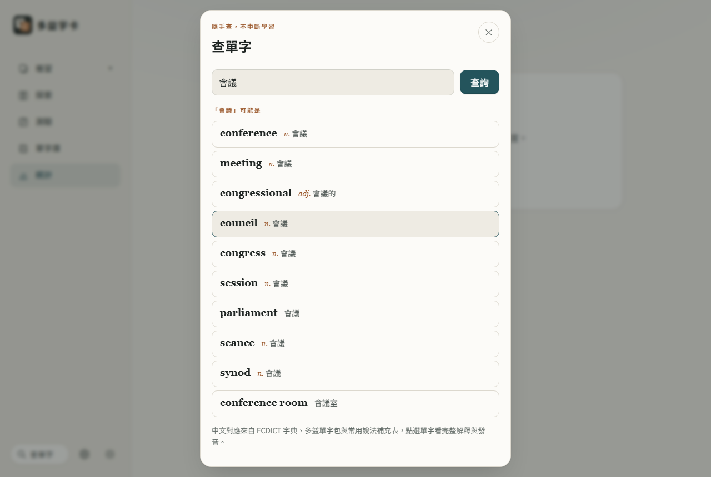
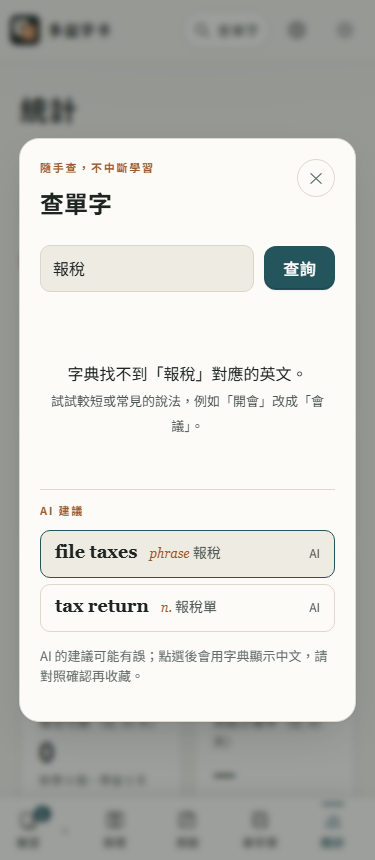

# 第 57 步：查單字可以用中文找英文

## 目標

使用者回報：查單字只能輸入英文。背單字時常常是「記得中文意思、想不起英文」，例如想知道「發票」「延期」的英文，原本只能去別的網站查。

## 做法

- **反查索引**（`tools/build_reverse_index.py` → `data/dict/reverse-v1/00～ff.json`）：從常用字典 `a.json～z.json`（ECDICT 繁體，32,812 字）和多益 1000 單字包的中文，把每個字的釋義拆成短中文詞（去掉詞性、括號註解、縮寫與「[網路]」行、人名地名），得到 90,839 組「中文詞 → 英文字」。
- **分片方式**：中文詞裡每個字都登記一次，依「字的碼位 % 256」分成 256 檔，每個字只留排名前 300 個詞。查「會議」時讀「會」「議」兩個分片合併，就能找出所有**包含**「會議」的詞（會議室、董事會議室…）。全部約 6.8 MB，單檔最大 64 KB，只在輸入中文時下載。
- **排序**：完全相同 → 開頭相同 → 包含；比對時忽略「使延期」的「使」和「重要的」的「的」。同一級再看字的等級（多益單字包、牛津核心／柯林斯三星以上 → 考試字表 → 其他）與 COCA 詞頻；冷僻字往後退一級，免得 synod 這種字排在 boardroom 前面。
- **自己的字卡優先**（`js/dictionary-reverse.js` 的 `ownedMatches`）：字卡的中文（包括手動改過的）有符合的，最多 3 個排在最前面並標「已收藏」。
- **介面**（`js/word-lookup.js`）：同一個輸入框，打中文就自動切換。下拉候選顯示「英文＋對到的中文」，可點選或用上下鍵＋Enter；按「查詢」會在結果區列出最多 10 個可能的英文字，點了再看完整解釋、發音與收藏。輸入法組字中不查詢。
- **離線**：Service Worker 新增 `toeic-reverse-v1` 快取，最多保留 32 片（約 0.8 MB）。

## 遇到的問題與解法

- **「的」太常見**：一開始按字分片時，「的」一個字就有 23,186 個詞，那一片 791 KB。改成每個字最多留前 300 個；查多字時合併每個字的分片，所以「重要的」仍會從「重」「要」兩片拿到完整結果。
- **名詞擠掉形容詞、動詞**：查「重要」時 important（重要的）排到第 7，查「延期」時 postpone（使延期）排最後。加上「忽略使／的」的比對後兩個都排第一。
- **單字包加權太強**：只要是多益單字包的字就排最前，結果 prominent 比 important 前面。改成單字包和牛津核心同一級，單字包只在同級裡用詞頻 ÷ 4 稍微往前。
- **找不到的情況**：ECDICT 沒有「開會」這種口語說法時，提示「試試較短或常見的說法」。

## 測試結果

- 單元測試 `tests/unit/dictionary-reverse.test.mjs`：比對等級、去重、收藏優先、分片合併與失敗回報；並用實際索引確認 發票→invoice、會議→meeting、乘客→passenger、預算→budget、合約→contract 都在前 6 名。
- 用 webapp-testing 新增 `tests/test_reverse_lookup.py`（手機 375px 與桌機）：開站不下載索引；「發票」候選點選後顯示 invoice 完整解釋；「會議」按查詢列出 meeting、conference；上下鍵＋Enter 選字；自訂字卡的中文排最前；找不到時提示；英文候選照舊。`test_lookup_suggestions.py`、`test_inline_lookup.py` 重跑通過。

## 第二輪：提高查得到的比例、查不到時的備援

使用者問能不能再優化、解決查不到的情況。先拿 84 個多益常見說法實測，第一版有 16 個完全查不到（訂單、菜單、退房、外帶、年假、簡體的「会议」…），也有排序怪的（出差 → 出差錯、利率找不到 interest rate）。原因有四個：

1. **常用字典只留了四行、每行五個意思**，例如 interest 的「利率」被截掉了。
2. **OpenCC s2twp 會換成台灣電腦用詞**：菜单 → 選單，所以查「菜單」找不到 menu。
3. **片語不在常用字典**：check out、interest rate 都沒收。
4. **口語說法字典本來就沒有**：退房、外帶、打卡。

### 做法

- **改從原始 CSV 的完整釋義建索引**，含 [網路] 釋義（排在一般意思之後）；同時用 s2twp 和 s2tw（只轉字）兩種轉法，「菜單」「選單」都查得到。
- **收進片語**：每個字都是核心字（牛津核心或柯林斯有星）、三個字以內的片語，例如 interest rate、parking lot。
- **補充詞表 `tools/reverse-extra.tsv`**：約 130 條字典沒收的台灣常用說法（退房 → check out、外帶 → takeout、打卡 → clock in…），只放意思明確的對應。
- **簡體輸入**：另產生 `s2t.json`（2,635 個簡→繁字，16 KB），轉成繁體再查一次，取完整符合比較多的那次，畫面會說明「已把簡體轉成…」。
- **部分符合**：找不到完整的詞時，列出「查詢裡含有的詞」，例如「新進員工」→ employee（員工），並標「部分符合」。
- **候選顯示詞性**：英文旁邊多了 n.／v.／adj.，比較好分辨。
- **AI 備援**（`js/reverse-ai.js`）：有 Gemini 金鑰時，結果下方有「用 AI 找英文」按鈕。**按了才送出**，只送輸入的中文，1 次請求，回傳最多 5 個建議並標「AI」；點選後一樣用本機字典顯示中文，提醒使用者對照確認。沒金鑰時只提示可以到設定填。
- **檔案大小**：分片改成 512 檔。冷僻字和片語每個中文字最多留 60 個、優先留中文詞最短的（最可能剛好等於使用者的輸入）。合計約 14.5 MB，單檔最大 92 KB，查一次下載 16 KB 對照表＋1～4 片。

### 遇到的問題

- **一開始收太多片語**：所有「由常用字組成」的片語有 20 萬個，索引變成 25.8 MB、單檔 210 KB。改成只收核心字組成的片語，再限制冷僻字數量。
- **限制數量時把 interest rate 擠掉了**：原本冷僻項目照分數留前 60 個，長的專業詞分數比較好就把「利率」擠掉。改成優先留中文詞短的。
- **測試題組會偏袒自己寫的補充詞表**：補充詞表是看著第一組 84 個查不到的字寫的，所以另外用一組沒調整過的 83 個說法（合併、海關、報稅、志工…）測：只剩 4 個查不到（型錄、報稅、季報、志工）、6 個只有部分符合，這些交給 AI 備援。

### 測試結果

- 單元測試增加簡體轉換、部分符合、AI 回傳清理（只收英文拼字、去重），實際索引確認會议、利率、菜單、退房、外帶等都在前 6 名。
- `tests/test_reverse_lookup.py` 增加：簡體「会议」、口語「退房」、片語「利率」；「海關申報」顯示部分符合；沒有金鑰時只提示、不呼叫 AI；有金鑰時按下按鈕才呼叫 Gemini 一次（以假回應代替）、請求內容含輸入的中文，點選 AI 建議改用字典查詢。手機與桌機都通過；`test_lookup_suggestions`、`test_inline_lookup`、`test_security` 重跑通過。

